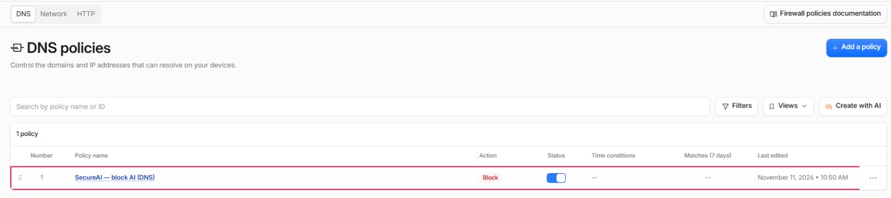
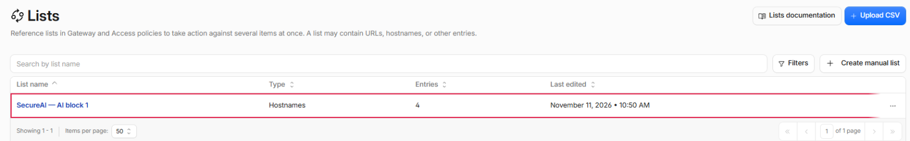
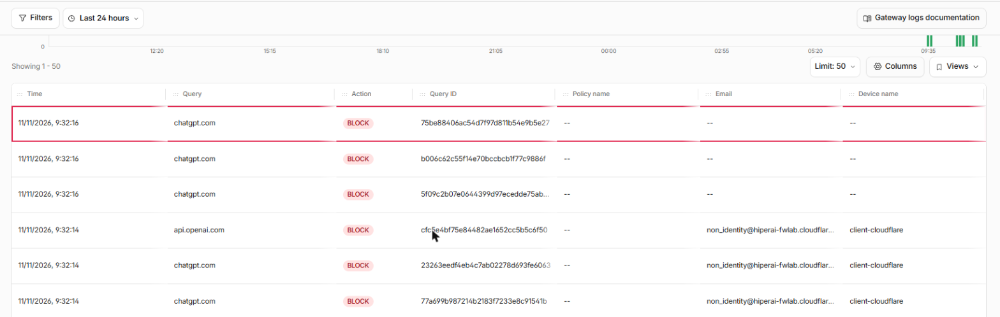

SecureAI reads what Cloudflare Gateway logs (DNS queries, HTTP requests and network sessions), shows you which AI
services your people use, and blocks them in Gateway when you prohibit them in SecureAI. Once connected, you don't
need to go back to the Cloudflare dashboard: SecureAI creates and maintains its own lists and rules.

<Note>
Discovery and API blocking are **available**. Reading through Logpush (Enterprise plans) is in **beta**.
</Note>

## What SecureAI sees on each Cloudflare plan

| | Free | Standard | Enterprise |
|---|---|---|---|
| Gateway analytics through the API (what SecureAI reads) | 31 days | 31 days | 31 days |
| DNS: domain and location | Yes | Yes | Yes |
| DNS: user and device | No | No | Only with Logpush |
| HTTPS without TLS inspection: domain (SNI), device and IP | With the WARP client | With WARP | With WARP or a proxy endpoint |
| HTTP: host, user and device | WARP with TLS inspection | WARP with TLS inspection | WARP or proxy endpoint, with TLS inspection |
| Source-IP proxy endpoint | No | No | Yes |
| Logpush | No | No | Yes |
| Entries per Zero Trust list | 1,000 | 1,000 | 5,000 |

Three rows in this table change what you see in the console:

- **DNS has no user.** Cloudflare's analytics API returns the queried domain, the DNS location and the category,
  with no source IP or user. SecureAI shows each location as a source (`cf-location:<name>`). To know who made
  the query, the traffic has to go through WARP.
- **HTTP has a user only through WARP.** The WARP client identifies the person, and Gateway logs their email and
  device. Without TLS inspection, Gateway doesn't see the HTTPS request: it logs it as a network session with the
  SNI, and SecureAI reads it from there. A device enrolled with a service token, with no person behind it, shows
  as `non_identity@<your-team>`: SecureAI shows its device and no user.
- **Source-IP proxy endpoints are Enterprise only.** On Free and Standard, the proxy endpoint requires every
  browser to sign in and to have the Cloudflare certificate installed.

## What it reads and what it doesn't

- SecureAI reads the **domain** (DNS), the **host** (HTTP) and the **SNI** (network). It never requests URLs,
  paths or content, even if you have TLS inspection on.
- The query filters on Cloudflare's side: SecureAI asks only for traffic in the *Artificial Intelligence* category
  or to the domains in its AI catalog. The rest of your browsing stays in Cloudflare.
- The counts are Cloudflare's estimates, from sampled traffic. At low volume, a domain queried a few times may not
  show up. Logpush delivers every record.
- Cloudflare publishes analytics a few minutes late. A query usually shows up in SecureAI 15 to 45 minutes later.

## 1. Create the API token

In the Cloudflare dashboard: **My Profile → API Tokens → Create Token → Custom token**.

| Permission | What for |
|---|---|
| Account → Account Analytics → Read | Read Gateway analytics |
| Account → Zero Trust → Read | Read lists, rules and categories |
| Account → Zero Trust → Edit | Only if you want SecureAI to block |

Under **Account Resources**, pick only your account. Also copy the **Account ID** (account home → account menu →
*Copy account ID*).

## 2. Connect in SecureAI

In **Integrations**, filter **Network / SWG**, open **Cloudflare Zero Trust**, paste the Account ID and the token
and save. On save, SecureAI tests the token: if it can't read Zero Trust or the analytics, nothing is saved and you
see which permission is missing. If it can read but can't write Zero Trust, the connection is saved with a warning
that it will only discover: blocking can't be turned on until the token has Zero Trust Edit. From then on SecureAI
queries Gateway every 30 minutes, and what it finds shows up in **Network Sources**.

## 3. Turn on blocking

In **Network Sources → Response & auto-block → Blocking through Cloudflare Gateway**. Before you turn it on, the
console asks you to confirm this:

<Warning>
SecureAI creates its own Zero Trust lists and three Gateway rules (DNS, HTTP and network) **in front of your allow
rules**. A domain SecureAI blocks stays blocked even if one of your rules allows it.
</Warning>

Turning it on requires a recent MFA and is recorded in the Activity Log with your user.

### What SecureAI creates in your account

| Object | Name | What it does |
|---|---|---|
| Domain lists | `SecureAI — AI block 1`, `2`, … | Hold the domains SecureAI blocks |
| DNS rule | `SecureAI — block AI (DNS)` | Blocks resolution of those domains |
| HTTP rule | `SecureAI — block AI (HTTP)` | Blocks the request, when TLS inspection is on |
| Network rule | `SecureAI — block AI (network)` | Cuts the HTTPS connection by SNI |

You'll find them under **Traffic controls → Firewall policies** and **Reusable components → Lists** (Cloudflare
shows the Domain type as "Hostnames"):





An entry in a Domain list covers the domain and its subdomains: `openai.com` also blocks `api.openai.com`.

The list comes from the providers you mark as **prohibited**, the extension's blocked sites and the active
temporary blocks, minus the approved sites.

### Check that it blocks

In **Insights & Logs → Logs → DNS query logs**, queries to a prohibited provider show with action **Block** and
Gateway answers `0.0.0.0`. In SecureAI, the source shows those queries as blocked after the next sync.



### How it stays in sync

- SecureAI syncs every 5 minutes, and right away when you create or release a temporary block.
- If nothing changed, it doesn't write to Cloudflare.
- Once a day it compares what's in the account and repairs hand edits: it puts back missing entries in its lists
  and recreates a deleted `SecureAI —` rule. There can be up to 24 hours between two passes.
- If the list goes past your plan's entry limit, SecureAI splits it into several lists covered by the same rules.
- Cloudflare allows 100 lists per account. When the account uses 80 or more (counting yours), SecureAI warns the
  administrator.

### If something fails

- If SecureAI can't build the block list, it writes nothing and Cloudflare keeps the previous list.
- If Cloudflare rejects a change mid-sync, SecureAI stops there and retries on the next one. It adds new entries
  first and removes old ones last, so a list is never left empty in between.
- The last error is shown on the blocking card.

### Rule order

Cloudflare requires a distinct precedence for every rule in the account. SecureAI puts its rules in the first free
slot in front of your rules of the same type. If there's no free slot, it puts them last and the console warns you
that your rules run first. You can move them by hand: SecureAI keeps the position you give them.

### Pause without unblocking

SecureAI's global enforcement switch **freezes** the account: SecureAI stops writing to Cloudflare, and the lists
and rules stay as they are, still blocking what they blocked. A policy change made in the meantime reaches
Cloudflare when you turn the switch back on.

### Turn blocking off

**Turn off** disables the three rules, so it **unblocks everything** SecureAI was blocking through Cloudflare. It
asks for confirmation and a recent MFA, and is recorded in the Activity Log. The lists stay in the account:
turning it back on is a single sync.

To remove SecureAI from the account completely: turn blocking off, delete the `SecureAI — block AI` and
`SecureAI — exception` rules, then the `SecureAI — AI block` and `SecureAI — exception` lists (Cloudflare won't
delete a list a rule still uses), and revoke the token.

## 4. Blocking settings

On the same card, **How SecureAI blocks in Cloudflare** has three settings. Saving them asks for a recent MFA and
is recorded in the Activity Log.

### Blocking by application

On by default. The rules also block the Cloudflare application of each prohibited provider. Cloudflare knows every
hostname of apps like ChatGPT or Claude, including the ones the SecureAI catalog doesn't list; for ChatGPT, for
example, the domains it loads its scripts and files from.

- If Cloudflare renames or drops an application, the console tells you and that provider is blocked by domain only.
- If you approved a site of a provider in the extension, that provider isn't blocked by application, so the
  approved site stays reachable.

### Block page

- **Cloudflare's page** (default).
- **Send people to the SecureAI chat**: Gateway redirects to your tenant's chat, or to the extension's redirect URL
  if you set one. The link carries neither the person's email nor the blocked address.

People see the page only on devices that trust the Cloudflare root certificate; without it, the browser shows a
certificate error. A block by SNI (the network rule) cuts the connection and shows no page.

### Exceptions for a person or a group

An exception lets a person or a directory group (provisioned by SCIM) use prohibited providers, and keeps blocking
them for everyone else. Up to 10 exceptions. For each one, SecureAI creates an email list `SecureAI — exception
<id>` and three allow rules in front of the block rules in your account.

- **It only applies to people signed in to the Cloudflare One client (WARP) with your identity provider.** Traffic
  from a DNS location or a device without a user stays blocked.
- **It never opens blocked sites or temporary blocks.**
- **It follows the directory:** when someone leaves the group, they leave the Cloudflare list within 5 minutes.
- **It fails closed:** if SecureAI can't read the members, it turns the exception rules off and blocks everyone.
- The exception is Cloudflare's only: the extension and the endpoint agent keep their own rules.

## Who a block reaches

Everything that goes through Gateway: devices with WARP and the networks that use your DNS locations, except the
people in an exception. A temporary block an analyst creates from a source blocks those domains for the whole
organization until it expires, for the exceptions too.

## Logpush

For Enterprise plans, in beta. With Logpush, Cloudflare sends SecureAI every record instead of the analytics: DNS
records carry the user too, and they arrive within minutes.

1. In SecureAI, in **Network Sources**, create an ingest source with the **Cloudflare Zero Trust (Logpush)**
   connector. Copy
   the URL and the token, which is shown only once.
2. In Cloudflare, create one Logpush job per dataset (`gateway_dns`, `gateway_http`, `gateway_network`) with an
   HTTP destination:

   ```text
   https://<your-tenant>/api/network-ingest/<source-id>?header_Authorization=Bearer%20<token>
   ```

   With these `output_options`:

   ```json
   { "output_type": "ndjson", "batch_prefix": "{\"events\":[", "batch_suffix": "]}", "record_delimiter": "," }
   ```

3. Leave the `URL` field out of the job: SecureAI doesn't use it.

Blocking still comes from the **Cloudflare Zero Trust** connection in step 2. Logpush only replaces the reading.

## Troubleshooting

| Symptom | Likely cause |
|---|---|
| Saving fails with `NO_ANALYTICS_SCOPE` | The token is missing Account Analytics Read |
| Saving fails with `NO_ZT_READ` or `CF_AUTH` | The token is missing Zero Trust Read, or belongs to another account |
| "Discovery only" warning on save, or turning blocking on returns `NO_ZT_WRITE` | The token is missing Zero Trust Edit |
| Blocking shows the error `CF_FORBIDDEN` | Zero Trust Edit was removed from the token after blocking was turned on |
| `CF_LIMIT` error | No free lists left in the account (100 max) |
| `cf-location:…` sources with no user | It's DNS by location: the user only comes with WARP |
| Nothing in Network Sources after an hour | The traffic doesn't go through Gateway, or didn't go to AI domains |
