With this integration, SecureAI shows which AI services the people behind your FortiGates use, from which device and
how often, and you block them from SecureAI. You don't need Fortinet's GenAI control module: the FortiGate sends its
logs to SecureAI and downloads from SecureAI the list of domains it has to block.

<Note>
The integration is in **beta**. We tested it in a lab with FortiGate-VM and FortiOS 7.6.8; see
[Tested versions](#tested-versions).
</Note>

## How it works

1. The FortiGate sends its traffic logs (`type=traffic`) and security profile logs (`type=utm`, subtypes
   `webfilter`, `app-ctrl` and `dns`) over syslog to the SecureAI collector, a container that runs in your network.
2. The collector keeps only the lines whose destination is an AI service and sends them to your tenant over HTTPS.
   The rest of the browsing never leaves your network.
3. SecureAI reads the source (`srcip`, `user`, `srcname`), the destination (`hostname`, `qname` or the host in
   `url`), the decision (`action`, `utmaction`) and the FortiGuard classification (`app`, `appcat`, `catdesc`) from
   each line, and shows it under **Inventory → Network Sources**.
4. When you block AI domains in SecureAI, they go into a block feed. The FortiGate downloads it with an External
   Connector, and its DNS Filter profile stops resolving those domains.

## Requirements

- A FortiGate running FortiOS 7.2 or later, and an administrator with write access to Log & Report, Security
  Profiles, Security Fabric and Policy & Objects.
- A Linux machine with Docker on the FortiGate's network for the collector (1 vCPU and 1 GB handle thousands of
  events per second). The FortiGate must reach it over syslog, and it must reach your tenant over HTTPS.
- The FortiGate must reach your tenant (`https://<tenant>.hiperai.com`) over HTTPS to download the feed.
- A SecureAI administrator with a second factor set up: creating and rotating the tokens asks for it.

## 1. Connect the FortiGate in SecureAI

1. Open **Admin → Integrations** and pick the **Network / SWG** category.
2. On the **Fortinet FortiGate** card, click **Connect**.

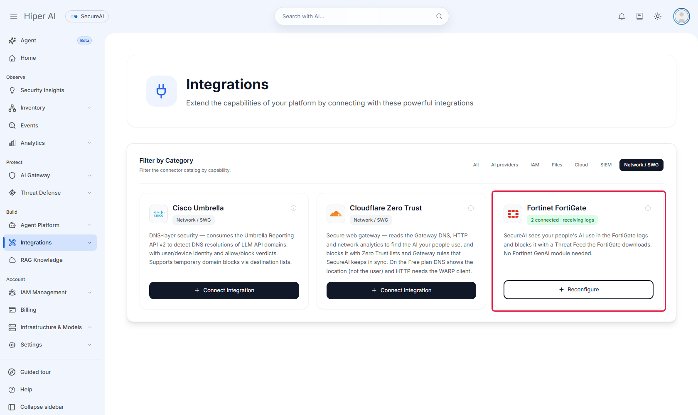

3. Under **Add a Fortinet FortiGate**, enter a name that lets you recognize the device. The other two fields are
   optional:
   - **Collector IP**: SecureAI sets it as the syslog server in the FortiGate configuration.
   - **Public IP of the firewall**: if you enter it, SecureAI hands the block list only to that address, even to
     someone else who has the token.

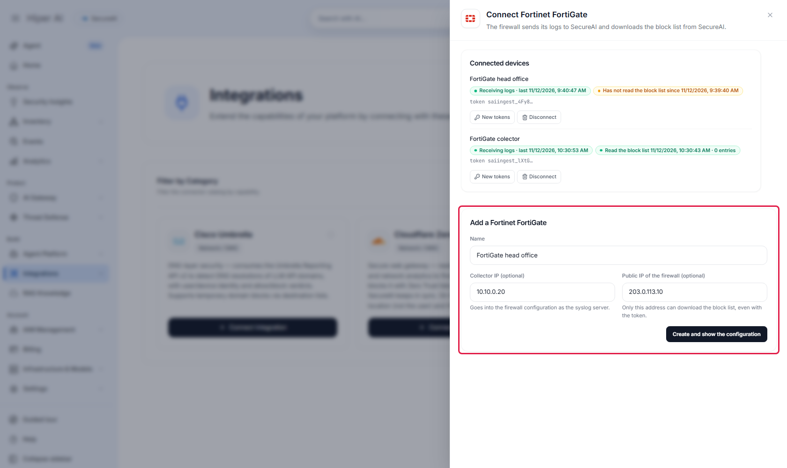

4. Click **Create and show the configuration**. SecureAI asks for your second factor and creates three things: the
   collector's log source, the FortiGate's block feed, and the feed with the list of AI domains the collector uses
   to filter. Then it offers **Download the collector (.zip)** and shows two blocks to copy: `collector.env`, with
   the collector's settings, and the FortiOS CLI, with the feed URL and token.

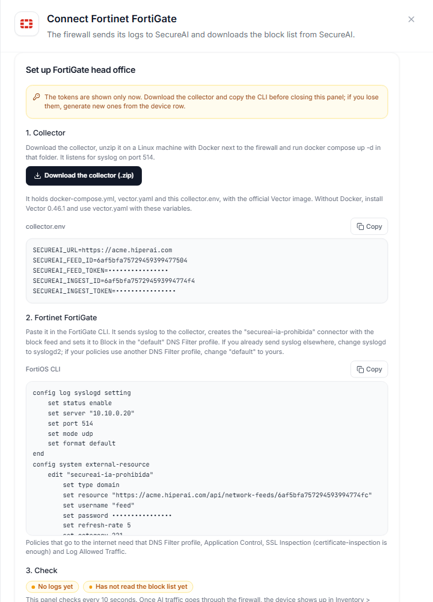

The tokens are shown only at that moment. Download the collector and copy the CLI before closing the panel, and
store the tokens in your secrets manager. If you lose them, **New tokens** on the device row generates new ones, and the old ones stop working.

Under **Connected devices** you see, for each FortiGate, whether its logs are arriving and when it last downloaded
the block list. If a device stops downloading it for more than 30 minutes, the panel warns you.

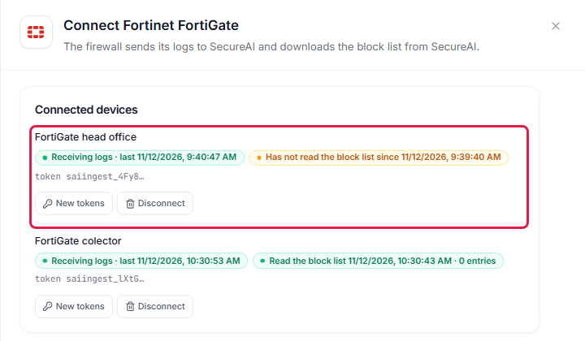

## 2. Install the collector

The collector is [Vector](https://vector.dev) 0.46.1 with the official `timberio/vector:0.46.1-debian` image.
SecureAI doesn't publish an image of its own. **Download the collector (.zip)**, in the step 1 panel, gets you three
files:

| File | What it is |
|---|---|
| `docker-compose.yml` | Runs the official image with `vector.yaml` mounted. Port 514 on the machine goes to 5514 in the container |
| `vector.yaml` | Receives the syslog, keeps the lines that go to an AI service and sends them to your tenant |
| `collector.env` | Your tenant URL and this device's ids and tokens. Don't share it or commit it to a repository |

1. Copy the `.zip` to a Linux machine with Docker on the FortiGate's network and unzip it.
2. In the `secureai-collector` folder, run `docker compose up -d`.
3. `docker compose logs -f` shows Vector starting and listening on port 5514 in the container.

The collector listens for syslog on port 514 of the machine, UDP and TCP. Every hour it downloads the list of AI
domains from your tenant and only sends the lines whose destination is on that list. The rest of the browsing never
leaves your network. Until the first list arrives it sends nothing, and if your tenant stops answering, it keeps the
last list for 7 days.

### Without Docker

Install Vector 0.46.1 on the machine, export the variables in `collector.env` and run `vector --config vector.yaml`.
It then listens on port 5514; point the FortiGate's syslog there or redirect 514. This is the package's
`vector.yaml`:

<Accordion title="vector.yaml">

```yaml
# SecureAI firewall log collector (Vector 0.46.1). Runs at the customer, next to the firewall, with the
# official image timberio/vector:0.46.1-debian and nothing else: no image of ours, no extra tools.
#
#   firewall --syslog--> [syslog_udp / syslog_tcp] --> extract_host --> ai_candidates --> ai_only --> secureai_ingest --HTTPS--> SecureAI
#                                                                                           ^
#   SecureAI AI domain list (feed list=ai-catalog) --> [ai_list] --> ai_list_rows --> ai_patterns (memory table)
#
# Lines whose destination is not an AI service never leave the customer network. Until the first list
# arrives nothing is sent; if SecureAI stops answering, the last list stays for 7 days.
#
# Settings come from collector.env (the console's "Connect" panel writes it): SECUREAI_URL, SECUREAI_FEED_ID,
# SECUREAI_FEED_TOKEN, SECUREAI_INGEST_ID, SECUREAI_INGEST_TOKEN and, optional, SECUREAI_FEED_REFRESH_SECONDS.

data_dir: /var/lib/vector

enrichment_tables:
  # One entry per AI domain pattern (chatgpt.com, *.openai.azure.com, bedrock.*.amazonaws.com, ...).
  # Every download rewrites the entries; one the list drops expires after the TTL.
  ai_patterns:
    type: memory
    ttl: 604800
    # Required: without flush_interval, Vector 0.46.1 on Linux exits at startup ("overflow when adding duration to instant").
    flush_interval: 5
    inputs: [ai_list_rows]

sources:
  syslog_udp:
    type: socket
    mode: udp
    address: 0.0.0.0:5514
    decoding:
      codec: bytes
  syslog_tcp:
    type: socket
    mode: tcp
    address: 0.0.0.0:5514
    framing:
      method: newline_delimited
    decoding:
      codec: bytes
  # The AI domain list, one pattern per line. A failed download (401, 5xx, timeout) emits nothing:
  # the table keeps the patterns it has.
  ai_list:
    type: http_client
    endpoint: "${SECUREAI_URL}/api/network-feeds/${SECUREAI_FEED_ID}"
    scrape_interval_secs: ${SECUREAI_FEED_REFRESH_SECONDS:-3600}
    scrape_timeout_secs: 60
    auth:
      strategy: bearer
      token: "${SECUREAI_FEED_TOKEN}"
    decoding:
      codec: bytes
    framing:
      method: newline_delimited

transforms:
  ai_list_rows:
    type: remap
    inputs: [ai_list]
    source: |
      p = downcase(strip_whitespace(to_string(.message) ?? ""))
      if !match(p, r'^[a-z0-9*._-]+$') { abort }
      . = set!(value: {}, path: [p], data: true)

  # Find the destination host in the line: CEF first (dhost / destinationHostName /
  # request URL), then the MikroTik RouterOS DNS query log, then key=value logs (FortiOS native:
  # hostname="...", or qname="..." in DNS logs), then a url=.
  # Also drops the query string of the request URL: the host is all SecureAI needs.
  extract_host:
    type: remap
    inputs: [syslog_udp, syslog_tcp]
    source: |
      msg = to_string(.message) ?? ""
      msg = replace(msg, r'(request=[^ ?]*)\?[^ ]*', "$$1")
      .message = msg
      host = ""
      at = find(msg, "CEF:")
      if at >= 0 {
        cef, err = parse_cef(slice!(msg, at))
        if err == null {
          host = to_string(cef.dhost)
          if host == "" { host = to_string(cef.destinationHostName) }
          if host == "" {
            u, uerr = parse_url(to_string(cef.request))
            if uerr == null { host = to_string(u.host) }
          }
        }
      }
      # MikroTik RouterOS DNS log (topics=dns): "query from 10.0.0.5: #12 chatgpt.com. A".
      if host == "" {
        q, qerr = parse_regex(msg, r'(?:^|[\s>])(?:query )?from [0-9A-Fa-f:.]+: #\d+ (?P<name>\S+?)\.? [A-Z]')
        if qerr == null { host = to_string(q.name) }
      }
      if host == "" {
        kv, kerr = parse_key_value(msg)
        if kerr == null {
          host = to_string(kv.hostname) ?? ""
          # FortiOS DNS Filter logs (subtype=dns) name the destination in qname.
          if host == "" { host = to_string(kv.qname) ?? "" }
          if host == "" { host = to_string(kv.dhost) ?? "" }
          if host == "" { host = to_string(kv.host) ?? "" }
          if host == "" {
            u, uerr = parse_url(to_string(kv.url) ?? "")
            if uerr == null { host = to_string(u.host) }
          }
        }
      }
      .secureai_host = downcase(replace(host, r'\.$', ""))

  # Every list pattern that could match the host, under the list's rule: a pattern matches the host or a
  # parent domain, and "*" stands for any run of characters inside one label. For x.api.openai.com:
  # x.api.openai.com, api.openai.com, openai.com, com, each of them with one label as "*"
  # (*.openai.com, api.*.com, ...) and with the first label's start as "*" (*i.openai.com, *pi.openai.com, ...).
  ai_candidates:
    type: remap
    inputs: [extract_host]
    source: |
      labels = split(to_string(.secureai_host) ?? "", ".")
      candidates = []
      if length(labels) > 1 || (length(labels) == 1 && labels[0] != "") {
        for_each(labels) -> |s, _label| {
          suffix = slice!(labels, s)
          candidates = push(candidates, join!(suffix, "."))
          for_each(suffix) -> |j, _l| {
            candidates = push(candidates, join!(set!(suffix, [j], "*"), "."))
          }
          first = string!(suffix[0])
          for_each(split(first, "")) -> |k, _c| {
            if k > 0 && k < length(first) {
              candidates = push(candidates, join!(set!(suffix, [0], "*" + slice!(first, k)), "."))
            }
          }
        }
      }
      .secureai_candidates = unique(candidates)

  # Keeps the line only when one of its candidates is in the AI domain list; drops the helper field.
  ai_only:
    type: remap
    inputs: [ai_candidates]
    drop_on_abort: true
    source: |
      found = false
      for_each(array(.secureai_candidates) ?? []) -> |_i, key| {
        if !found {
          _row, err = get_enrichment_table_record("ai_patterns", { "key": key })
          if err == null { found = true }
        }
      }
      del(.secureai_candidates)
      if !found { abort }

sinks:
  secureai_ingest:
    type: http
    inputs: [ai_only]
    uri: "${SECUREAI_URL}/api/network-ingest/${SECUREAI_INGEST_ID}"
    method: post
    auth:
      strategy: bearer
      token: "${SECUREAI_INGEST_TOKEN}"
    encoding:
      codec: text
    framing:
      method: newline_delimited
    request:
      headers:
        Content-Type: text/plain
    batch:
      max_events: 1000
      timeout_secs: 5
    # SecureAI answers 503 when it cannot write: the batch waits here on disk and is retried.
    buffer:
      type: disk
      max_size: 268435488
      when_full: drop_newest
```

</Accordion>

<Accordion title="docker-compose.yml">

```yaml
# SecureAI firewall log collector. Put this file, vector.yaml and collector.env in one folder on a Linux host
# the firewall can reach, and run: docker compose up -d
# The console's "Connect" panel (Integrations > Network / SWG) downloads the three files ready to use.
services:
  secureai-collector:
    image: timberio/vector:0.46.1-debian
    restart: unless-stopped
    env_file: collector.env
    command: ["--config", "/etc/vector/vector.yaml"]
    ports:
      # Point the firewall's syslog at this host, port 514 (UDP or TCP).
      - "514:5514/udp"
      - "514:5514/tcp"
    volumes:
      - ./vector.yaml:/etc/vector/vector.yaml:ro
      # Vector's disk buffer: batches wait here while SecureAI is unreachable.
      - collector-data:/var/lib/vector

volumes:
  collector-data:
```

</Accordion>

## 3. Send the FortiGate logs to the collector

In the FortiOS GUI: **Log & Report → Log Settings**, **Global Settings** tab. Set **Syslog logging** to **Enable**
and enter the collector IP. In FortiOS 7.2 and 7.4 the option is called **Send logs to syslog**.

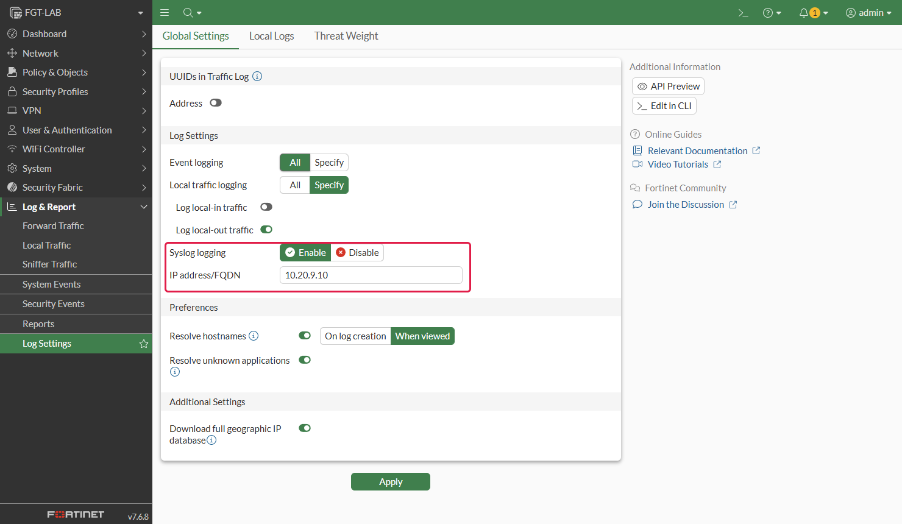

In the CLI it's the start of the block the panel gave you:

```
config log syslogd setting
    set status enable
    set server "<collector IP>"
    set port 514
    set mode udp
    set format default
end
```

`format default` sends FortiOS's native key=value format, which is what SecureAI reads. If you already send syslog
to another server, use `log syslogd2` (up to `syslogd4`) to leave it alone.

The policies that carry traffic to the internet need:

- **Log Allowed Traffic** set to *All Sessions* (`set logtraffic all`) or *Security Events* (`set logtraffic utm`);
- an SSL Inspection profile, even `certificate-inspection`, so FortiOS reads the destination name (SNI) of HTTPS
  connections;
- Application Control with the `default` profile or your own. FortiGuard classifies generative AI as `GenAI`;
- the DNS Filter profile from step 4, with **Log all DNS queries and responses**.

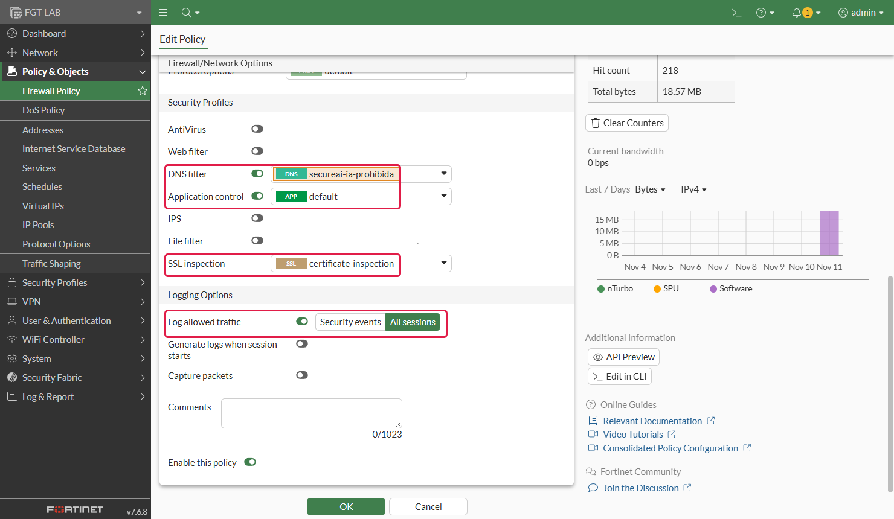

## 4. Block with the SecureAI feed

The panel's CLI creates the `secureai-ia-prohibida` External Connector with the feed URL and token, and sets it to
**Block** in the `default` DNS Filter profile. If your policies use another profile, replace `default` with yours
before pasting it. In the GUI:

1. **Security Fabric → External Connectors → Create New → Threat Feeds → Domain Name**:

   | Field | Value |
   |---|---|
   | Name | `secureai-ia-prohibida` |
   | URI of external resource | The feed URL the panel shows |
   | HTTP basic authentication | On. Username: anything (for example `feed`). Password: the feed token |
   | Refresh Rate | 5 minutes |

   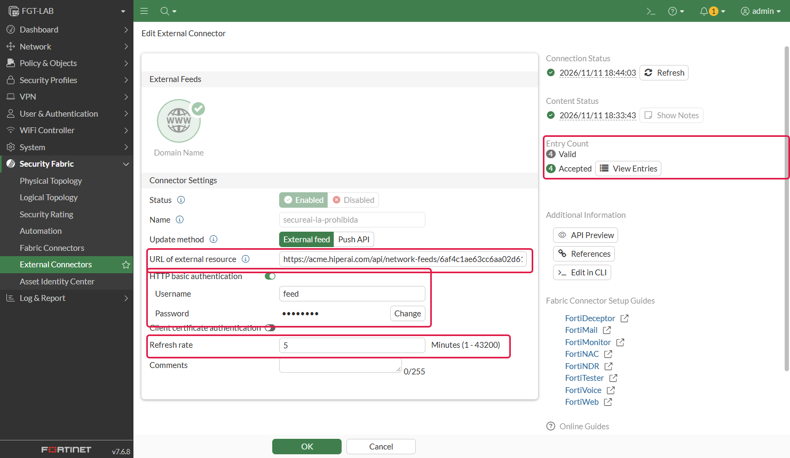

   **View Entries** shows the list it downloaded. SecureAI writes each domain twice, `chatgpt.com` and
   `*.chatgpt.com`, to cover the domain and its subdomains. Until you block something, the list is empty.

   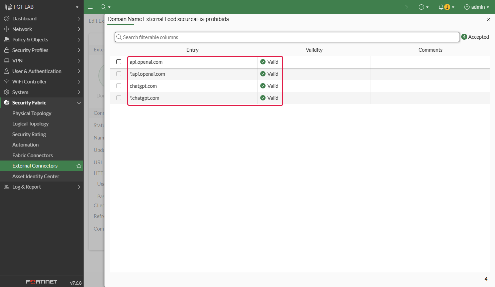

2. In the DNS Filter profile your policies use (**Security Profiles → DNS Filter**), the connector's category shows
   up under **Remote Categories**. Set it to **Block** and keep **Redirect to Block Portal**.

   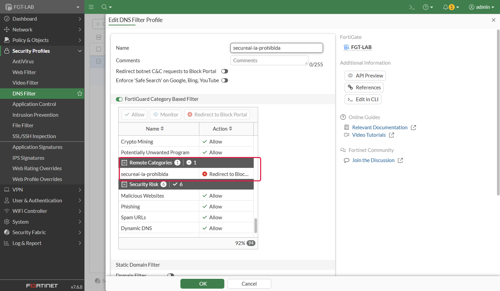

3. Under **Options**, at the end of the profile, turn on **Allow DNS requests when a rating error occurs** and
   **Log all DNS queries and responses**.

   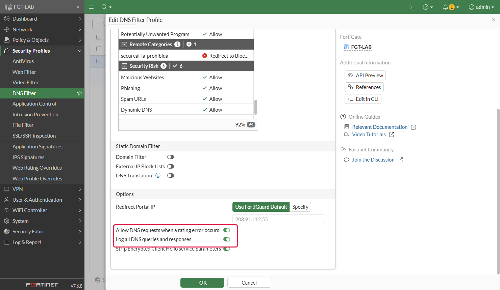

<Warning>
Without **Allow DNS requests when a rating error occurs** (`set options error-allow`), a FortiGate without the
FortiGuard DNS Filter subscription, or without a connection to FortiGuard, blocks every domain on a rating error,
not just the ones in the feed.
</Warning>

Through the CLI and the REST API, FortiOS leaves the connector's category at 0, which DNS Filter can't use. That's
why the panel's CLI assigns it 221; if another connector already uses it, pick a free one between 192 and 221 and
use the same one in the profile.

DNS Filter acts on the DNS queries that go through the FortiGate: those from devices that use it as their DNS
server, or those that cross a policy with the profile. A device that resolves another way (the browser's DNS over
HTTPS, a resolver that doesn't go through the FortiGate) isn't blocked this way.

## 5. Check

1. From a device behind the FortiGate, open chatgpt.com. Within a minute or two the device shows up under
   **Inventory → Network Sources**, with its calls, the providers and, if the FortiGate knows it, the user.

   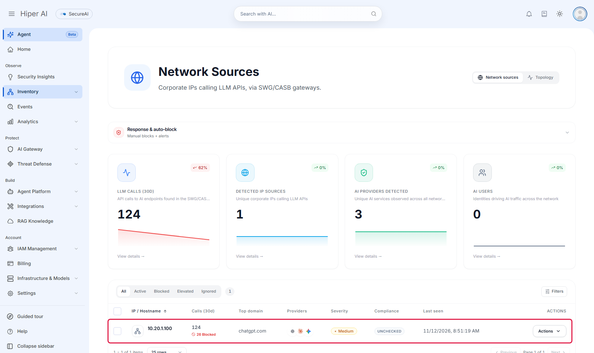

   In the source detail (**Actions → View details**), **Connectors** reads `fortinet-fortigate` and **Gateway
   enforcement** offers to block through the firewall feed.

   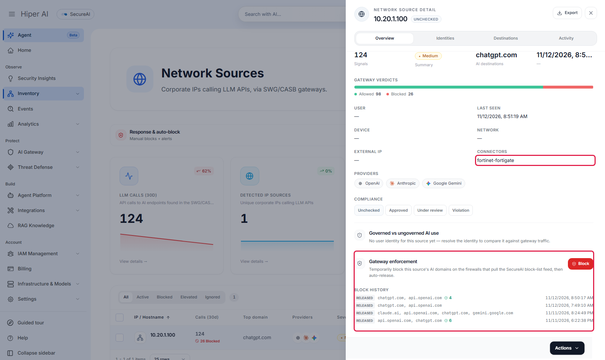

2. On the device's row, open **Actions** and pick **Block**.

   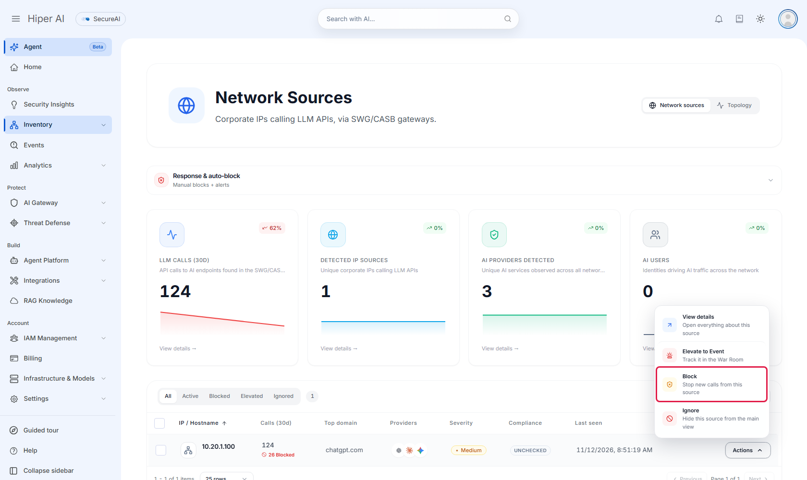

3. Check the domains (for example `chatgpt.com` and `api.openai.com`), pick the duration (30 minutes up to **Until
   released**) and enter the reason. **Enforced via** must read **Firewall block-list feed**.

   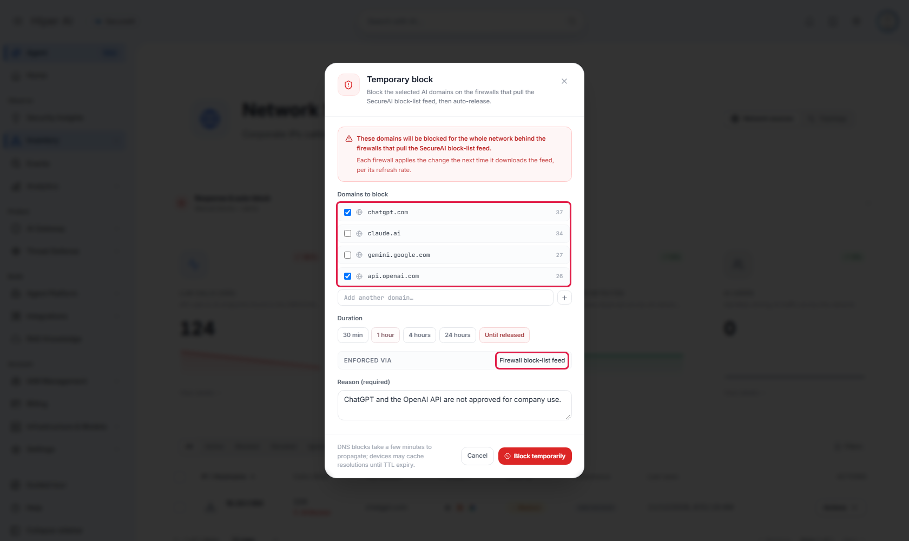

4. On the connector's next refresh, `nslookup chatgpt.com` from the device returns 208.91.112.55, the FortiGuard
   block portal IP, and the browser can't get through. Under **Log & Report → Security Events → DNS Query**, the
   `chatgpt.com` response has **Action** `redirect`.

   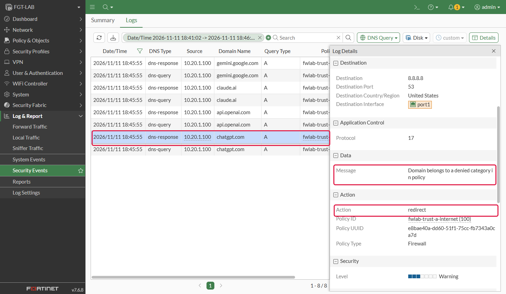

5. That log comes back to SecureAI. In the source detail, **Gateway enforcement** switches to **Enforcement
   confirmed** and counts the queries the FortiGate blocked since you created the block.

   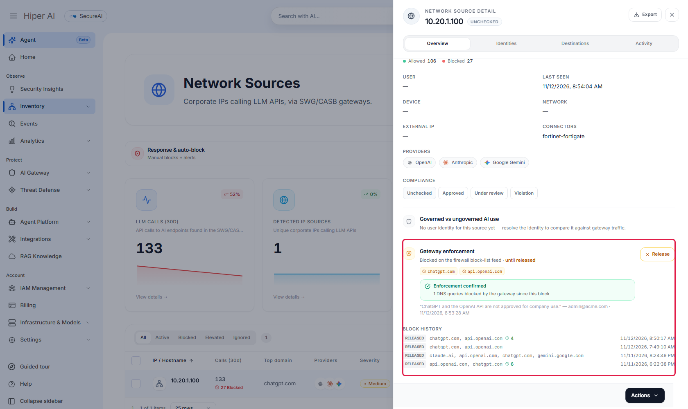

6. To lift it, pick **Actions → Release** on the row. SecureAI takes the domains out of the feed and the FortiGate
   resolves them again on its next refresh.

   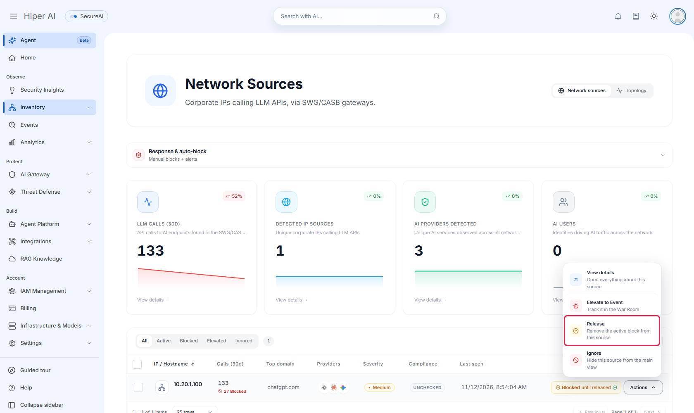

## Automatic blocking

In **Response & auto-block**, above the Network Sources list, turn on **Auto-block sources that exceed the
threshold** and set the call threshold (per day or per 7 days), how long the block lasts and how many automatic
blocks can be active at once. When a source crosses the threshold, SecureAI puts its AI domains in the feed and
takes them out when the block expires. Saving these settings asks for your second factor.

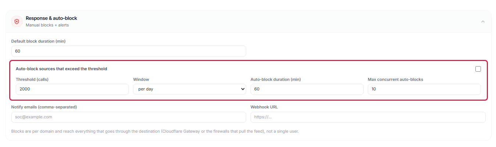

## Limits

- **Without TLS inspection, the FortiGate sees the destination name, not the content.** SecureAI knows someone used
  ChatGPT, from which device and how many times; not what they wrote.
- **The connector uses `https://`.** With `http://` the feed token travels in clear text.
- **Disabling or deleting the feed doesn't unblock anything.** The FortiGate keeps the last list it downloaded. To
  unblock, use **Release** or take the category out of the DNS Filter profile.
- **A domain the FortiGate already resolved can take a while to be blocked or released.** Besides the connector's
  refresh (5 minutes), the FortiGate keeps DNS answers for a while. In our lab, the block portal answered between 1
  and 8 minutes after the block.
- **A block reaches the whole network behind the FortiGate**, not a user or an IP: the feed is a list of domains.
- **If your tenant also has Cisco Umbrella or Cloudflare Gateway blocking, blocks go there and not to the feed.** To
  send them to the FortiGate, ask support to set the block destination to the feed.
- **Counters are approximate.** FortiOS logs the same session in the security log and in the traffic log. SecureAI
  counts it once, unless the service restarts in between.
- If SecureAI can't build the list, it answers with an error and the FortiGate keeps the previous one. It never gets
  an empty list because of an error.

## Tested versions

| FortiOS | Device | Result |
|---|---|---|
| 7.6.8 | FortiGate-VM, in a lab | Setup from the console, collector installed from the panel's `.zip` on a Linux machine with Docker, discovery through DNS Filter and Application Control, manual and automatic blocking through the feed, enforcement confirmed and release |

We haven't tested it yet on FortiOS 7.2 or 7.4, or on physical devices. The steps use objects that exist in all
three versions; GUI menu names may change.
