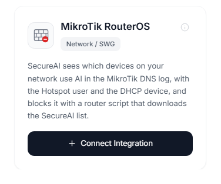
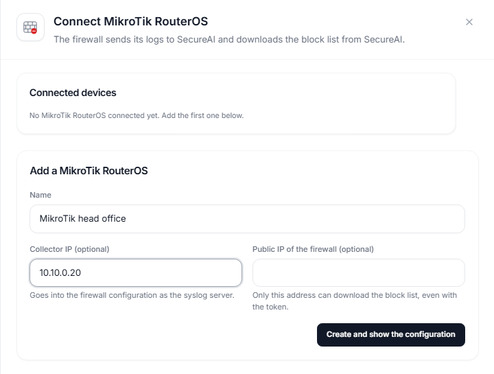
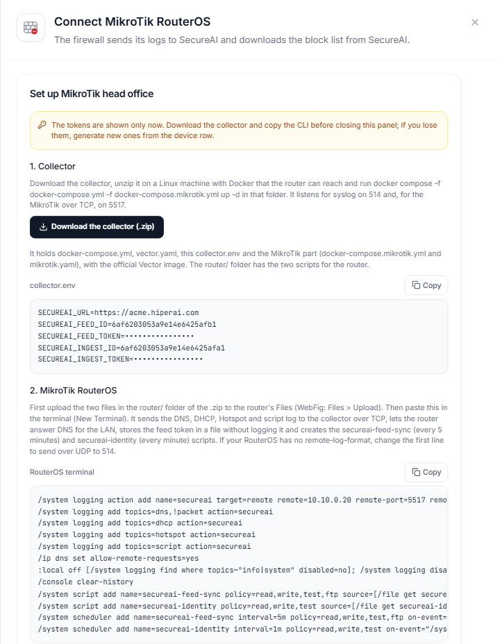
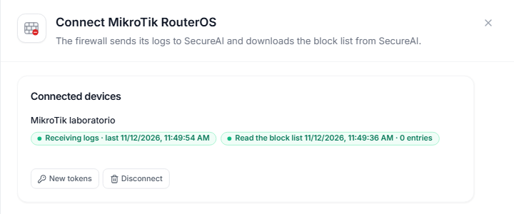
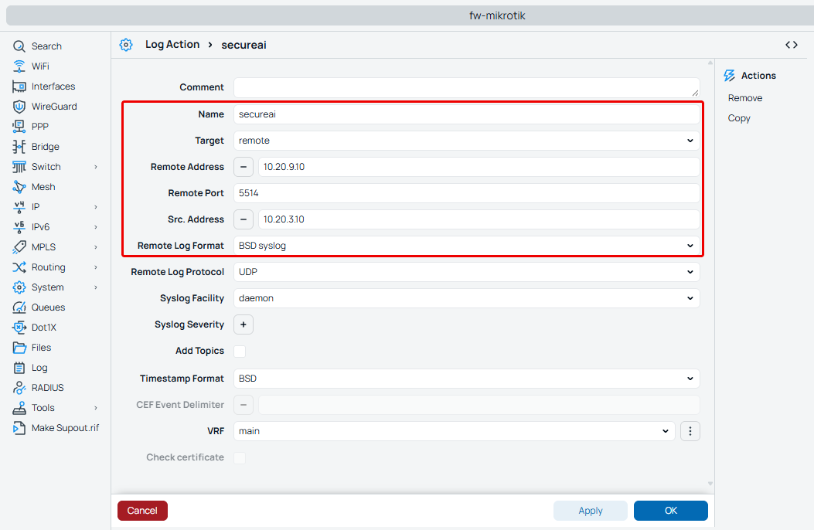
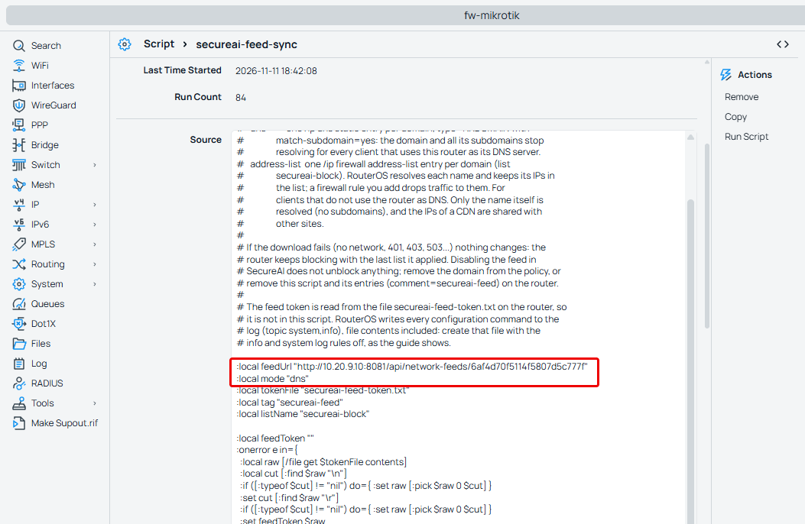
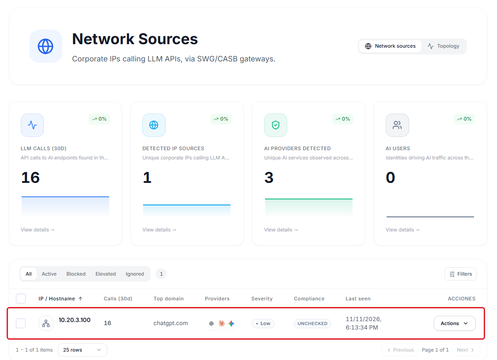
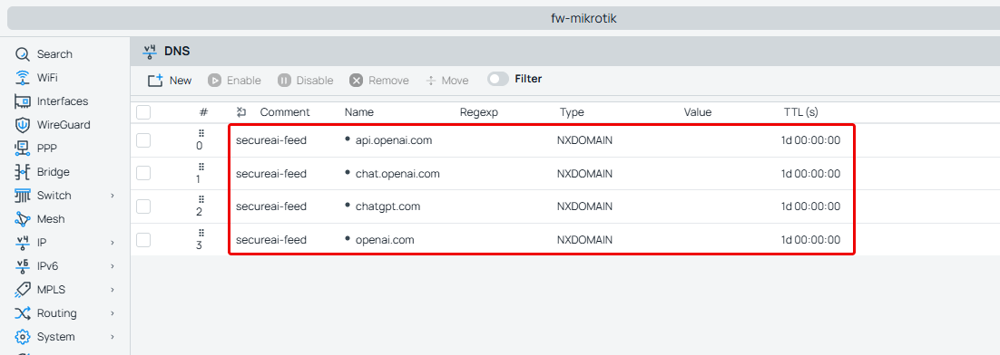

SecureAI reads the DNS query log of your MikroTik router, shows you which devices on your network use AI services
and makes the router stop resolving the providers you prohibit in SecureAI. RouterOS logs no URLs: everything comes
from the names clients ask the router's DNS for.

<Note>
The `mikrotik-routeros` connector is in **beta**. In beta, the SecureAI team assists with the setup.
</Note>

## How it works

1. The router sends one syslog line for every DNS query it gets from a client, IPv4 or IPv6
   (`query from 10.20.3.100: #5 chatgpt.com. A`).
2. The SecureAI collector, a container that runs in your network, keeps the queries to AI services and sends them
   to SecureAI. The rest of the browsing never leaves your network.
3. **Network Sources** shows the IP of each device and the AI providers it looked up.
4. When you prohibit a provider, a router script downloads the SecureAI block list every 5 minutes and creates one
   DNS entry per domain. A client that asks for `chatgpt.com` or `ab.chatgpt.com` gets NXDOMAIN.

Both halves depend on clients resolving through the router. Sections 4 and 5 cover the ones that do not.

## What SecureAI sees and what it does not

- The **domain** looked up and the **client IP**, IPv4 or IPv6. No URLs, paths or content.
- The **user** and the **device**, if the router runs a Hotspot or hands out IPs over DHCP: the collector adds to each
  query who held that IP at that moment ([section 7](#7-user-and-device)). Without Hotspot or DHCP, the query arrives
  without a user.
- A query is not a connection. Browsers look up names they may not use, and the device's cache skips queries for
  names they do use. The count is approximate.

## Requirements

- A MikroTik with **RouterOS 7.15 or later** (see [Versions](#versions)).
- A router user with the `read`, `write`, `test` and `ftp` policies.
- Clients that get the router as their DNS server (through DHCP, the usual setup), and a router that answers LAN
  queries: `/ip dns set allow-remote-requests=yes`. The default configuration drops queries that arrive on the WAN;
  if you changed it, make sure port 53 is not open to the internet.
- A Linux machine with Docker in your network for the collector. The router must reach it over syslog, and it must
  reach your tenant over HTTPS.
- A router that reaches your SecureAI tenant over HTTPS to read the block list.

## 1. Connect the router and install the collector

1. Open **Admin → Integrations** and pick the **Network / SWG** category.
2. On the **MikroTik RouterOS** card, click **Connect**.

   

3. Fill in the name, the collector IP (the Linux machine) and, if you want, the router's public IP: SecureAI then
   refuses anyone else who asks for the block list, even with the token.
4. **Create and show the configuration** asks for your second factor and creates the log source for the
   `mikrotik-routeros` connector and the block feed in the `plain` format.



The tokens show only once, in that panel. If you lose them, **New tokens** on the device row rotates them.



### Install the collector

In the same panel, **Download the collector (.zip)**. The package holds the collector configuration with this
device's values and, in `router/`, the two scripts for the router. It runs on the official Vector image. On the Linux
machine, inside the package folder:

```bash
docker compose -f docker-compose.yml -f docker-compose.mikrotik.yml up -d
```

The collector listens for syslog on 514 (UDP and TCP) and, for MikroTik over TCP, on 5517.

The panel also shows, under **RouterOS terminal**, the router lines with the collector IP and the feed token filled
in. Upload the two files in `router/` to the router's **Files** and paste those lines into the terminal. The next steps
explain what each one does.

Once the router sends its log and has read the list, the device row shows both states in green:



## 2. Send the router's DNS log to the collector

In the router terminal (WebFig or Winbox: **New Terminal**):

```text
/system logging action add name=secureai target=remote remote=<collector IP> remote-port=5517 \
  remote-protocol=tcp remote-log-format=syslog src-address=<router LAN IP>
/system logging add topics=dns,!packet action=secureai
/system logging add topics=dhcp action=secureai
/system logging add topics=hotspot action=secureai
/system logging add topics=script action=secureai
```

Over TCP, lines arrive in the order the router wrote them and are not lost on the way. `dhcp`, `hotspot` and `script`
are for the user and the device ([section 7](#7-user-and-device)). `!packet` leaves out the dump of each DNS packet,
which takes several lines per query.

If your RouterOS has no `remote-log-format`, send over UDP to 514 (`remote-port=514 remote-protocol=udp`). Each
message travels in its own packet, but a lost packet is not sent again.



The screenshot is from our lab, with the action over UDP to 5514.

## 3. Block with the SecureAI script

The `secureai-feed-sync` script runs every 5 minutes. Each run:

1. reads the feed token from the `secureai-feed-token.txt` file on the router;
2. downloads the list with `Authorization: Bearer <token>` and validates the TLS connection (expiry, name and issuer)
   against the CAs that ship with RouterOS;
3. creates one `/ip dns static` entry per domain, of type NXDOMAIN with `match-subdomain=yes`, and removes the ones no
   longer in the list. All of them carry `comment=secureai-feed`.

If the download fails (no network, 401, 403, 503, TLS that does not validate), the script changes nothing and the router
keeps blocking with the last list. It logs `secureai: feed download failed (...)`.

### 3.1 Store the token without logging it

RouterOS logs every configuration command with its values. This command turns off the `info` and `system` log rules,
creates the token file and turns them back on, in a single line:

```text
:local off [/system logging find where topics~"info|system" disabled=no]; /system logging disable $off; /file add name=secureai-feed-token.txt contents="<feed token>"; /system logging enable $off
```

Then clear the terminal history, which also keeps the command: `/console clear-history`. To change the token, repeat
the line with `/file remove secureai-feed-token.txt` before the `/file add`.

### 3.2 Create the script and the scheduler

In WebFig, **System > Scripts > Add New**:

| Field | Value |
|---|---|
| Name | `secureai-feed-sync` |
| Policy | `read`, `write`, `test`, `ftp` |
| Source | the script below, with `FEED_URL` replaced by `https://<your-tenant>/api/network-feeds/<feed id>` |

The script holds no secrets: the token is in the file from the previous step.

<Accordion title="secureai-feed-sync script">

```text
# SecureAI block list for MikroTik RouterOS 7.15+ (docs/integrations/mikrotik.md).
#
# Downloads the SecureAI feed (format "plain") and applies it in one of two modes:
#
#   dns           one /ip dns static entry per domain, type=NXDOMAIN with
#                 match-subdomain=yes: the domain and all its subdomains stop
#                 resolving for every client that uses this router as its DNS server.
#   address-list  one /ip firewall address-list entry per domain (list
#                 secureai-block). RouterOS resolves each name and keeps its IPs in
#                 the list; a firewall rule you add drops traffic to them. For
#                 clients that do not use the router as DNS. Only the name itself is
#                 resolved (no subdomains), and the IPs of a CDN are shared with
#                 other sites.
#
# blockDoh "yes" also blocks the public DNS over HTTPS resolvers, which a
# browser or the OS can use to skip the router: their names go into the block
# list (with the Firefox and iCloud Private Relay canaries), and their IPs into
# the address lists secureai-doh (/ip and /ipv6 firewall) for the firewall rules
# of the guide. The list of resolvers is below, in dohNames / dohIps / dohIps6.
#
# If the download fails (no network, 401, 403, 503...) nothing changes: the
# router keeps blocking with the last list it applied. Disabling the feed in
# SecureAI does not unblock anything; remove the domain from the policy, or
# remove this script and its entries (comment=secureai-feed) on the router.
#
# The feed token is read from the file secureai-feed-token.txt on the router, so
# it is not in this script. RouterOS writes every configuration command to the
# log (topic system,info), file contents included: create that file with the
# info and system log rules off, as the guide shows.

:local feedUrl "FEED_URL"
:local mode "dns"
:local tokenFile "secureai-feed-token.txt"
:local tag "secureai-feed"
:local listName "secureai-block"
:local blockDoh "no"
:local dohList "secureai-doh"

# Public DoH resolvers (names of their DoH endpoints, match-subdomain covers the
# variants such as mozilla.cloudflare-dns.com), and two canaries: Firefox turns
# its default DoH off when use-application-dns.net does not resolve, and Apple
# devices turn iCloud Private Relay off when mask.icloud.com does not.
:local dohNames {"dns.google";"dns.google.com";"cloudflare-dns.com";"one.one.one.one";"quad9.net";"doh.opendns.com";"doh.familyshield.opendns.com";"dns.nextdns.io";"doh.cleanbrowsing.org";"dns.adguard-dns.com";"dns.adguard.com";"dns.mullvad.net";"doh.mullvad.net";"doh.dns.sb";"freedns.controld.com";"use-application-dns.net";"mask.icloud.com";"mask-h2.icloud.com"}
# Their addresses: Windows and Android reach a known resolver over DoH by IP, with no name to block.
:local dohIps {"8.8.8.8";"8.8.4.4";"1.1.1.1";"1.0.0.1";"9.9.9.9";"149.112.112.112";"208.67.222.222";"208.67.220.220";"94.140.14.14";"94.140.15.15";"185.228.168.9";"185.228.169.9";"45.90.28.0";"45.90.30.0";"194.242.2.2";"185.222.222.222";"76.76.2.0";"76.76.10.0"}
:local dohIps6 {"2001:4860:4860::8888";"2001:4860:4860::8844";"2606:4700:4700::1111";"2606:4700:4700::1001";"2620:fe::fe";"2620:fe::9";"2620:119:35::35";"2620:119:53::53";"2a10:50c0::ad1:ff";"2a10:50c0::ad2:ff";"2a07:e340::2"}

:local feedToken ""
:onerror e in={
  :local raw [/file get $tokenFile contents]
  :local cut [:find $raw "\n"]
  :if ([:typeof $cut] != "nil") do={ :set raw [:pick $raw 0 $cut] }
  :set cut [:find $raw "\r"]
  :if ([:typeof $cut] != "nil") do={ :set raw [:pick $raw 0 $cut] }
  :set feedToken $raw
} do={}
:if ([:len $feedToken] = 0) do={
  :log warning ("secureai: no token in " . $tokenFile . ", keeping the current block list")
  :error "secureai: no feed token"
}

:local res
:local why ""
# Over HTTPS the certificate is checked (expiry, name and a CA of RouterOS's built-in trust store);
# without that check fetch accepts any certificate.
:onerror e in={
  :if ([:pick $feedUrl 0 8] = "https://") do={
    :set res [/tool fetch url=$feedUrl check-certificate=yes-without-crl http-header-field=("Authorization: Bearer " . $feedToken) output=user as-value]
  } else={
    :set res [/tool fetch url=$feedUrl http-header-field=("Authorization: Bearer " . $feedToken) output=user as-value]
  }
} do={ :set why $e }
# fetch throws on anything but a 2xx, so reaching here without `why` is a good download.
:if ($why != "") do={
  :log warning ("secureai: feed download failed (" . $why . "), keeping the current block list")
  :error "secureai: feed download failed"
}

# One domain per line. A leading "*." is dropped (the dns mode covers subdomains);
# a pattern with any other "*" cannot be written as an entry and is skipped.
:local body ($res->"data")
:local want [:toarray ""]
:local pos 0
:local total [:len $body]
:while ($pos < $total) do={
  :local nl [:find $body "\n" $pos]
  :if ([:typeof $nl] = "nil") do={ :set nl $total }
  :local line [:pick $body $pos $nl]
  :set pos ($nl + 1)
  :if ([:pick $line 0 2] = "*.") do={ :set line [:pick $line 2 [:len $line]] }
  :if ([:len $line] > 0 && [:typeof [:find $line "*"]] = "nil") do={ :set ($want->$line) true }
}
:if ($blockDoh = "yes") do={ :foreach n in=$dohNames do={ :set ($want->$n) true } }

# The DoH addresses: kept in sync like the domains, removed when blockDoh goes back to "no".
:local wantIp [:toarray ""]
:local wantIp6 [:toarray ""]
:if ($blockDoh = "yes") do={
  :foreach a in=$dohIps do={ :set ($wantIp->$a) true }
  # /ipv6 firewall address-list stores a single address as <address>/128.
  :foreach a in=$dohIps6 do={ :set ($wantIp6->($a . "/128")) true }
}
:foreach id in=[/ip firewall address-list find list=$dohList comment=$tag dynamic=no] do={
  :local a [/ip firewall address-list get $id address]
  :if ([:typeof ($wantIp->$a)] = "nothing") do={ /ip firewall address-list remove $id } else={ :set ($wantIp->$a) false }
}
:foreach a,v in=$wantIp do={ :if ($v) do={ /ip firewall address-list add list=$dohList address=$a comment=$tag } }
:onerror e in={
  :foreach id in=[/ipv6 firewall address-list find list=$dohList comment=$tag dynamic=no] do={
    :local a [/ipv6 firewall address-list get $id address]
    :if ([:typeof ($wantIp6->$a)] = "nothing") do={ /ipv6 firewall address-list remove $id } else={ :set ($wantIp6->$a) false }
  }
  :foreach a,v in=$wantIp6 do={ :if ($v) do={ /ipv6 firewall address-list add list=$dohList address=$a comment=$tag } }
} do={ :log warning ("secureai: could not update the IPv6 DoH list (" . $e . ")") }
:if ($blockDoh = "yes") do={ :log info ("secureai: DoH resolvers blocked, " . [:len $dohNames] . " names, " . ([:len $dohIps] + [:len $dohIps6]) . " addresses") }

# Inside `find`, a variable named like a property ($name, $address) reads the
# property: the entries already applied are collected in `have` instead.
:local have [:toarray ""]
:if ($mode = "address-list") do={
  # Switching modes: the entries of the other mode go away.
  :foreach id in=[/ip dns static find comment=$tag] do={ /ip dns static remove $id }
  :foreach id in=[/ip firewall address-list find list=$listName comment=$tag dynamic=no] do={
    :local dom [/ip firewall address-list get $id address]
    :if ([:typeof ($want->$dom)] = "nothing") do={ /ip firewall address-list remove $id } else={ :set ($have->$dom) true }
  }
  :foreach dom,v in=$want do={
    :if ([:typeof ($have->$dom)] = "nothing") do={
      :onerror e in={
        /ip firewall address-list add list=$listName address=$dom comment=$tag
      } do={ :log warning ("secureai: could not add " . $dom . " (" . $e . ")") }
    }
  }
  :log info ("secureai: block list applied, " . [:len [/ip firewall address-list find list=$listName comment=$tag dynamic=no]] . " domains (address-list)")
} else={
  :foreach id in=[/ip firewall address-list find list=$listName comment=$tag dynamic=no] do={ /ip firewall address-list remove $id }
  :foreach id in=[/ip dns static find comment=$tag] do={
    :local dom [/ip dns static get $id name]
    :if ([:typeof ($want->$dom)] = "nothing") do={ /ip dns static remove $id } else={ :set ($have->$dom) true }
  }
  :foreach dom,v in=$want do={
    :if ([:typeof ($have->$dom)] = "nothing") do={
      :onerror e in={
        /ip dns static add name=$dom type=NXDOMAIN match-subdomain=yes comment=$tag
      } do={ :log warning ("secureai: could not add " . $dom . " (" . $e . ")") }
    }
  }
  /ip dns cache flush
  :log info ("secureai: block list applied, " . [:len [/ip dns static find comment=$tag]] . " domains")
}
```

</Accordion>



In the screenshot, the lab downloads the feed over HTTP inside its own network. With your tenant, the URL is HTTPS.

Then, in the terminal:

```text
/system scheduler add name=secureai-feed-sync interval=5m policy=read,write,test,ftp \
  on-event="/system script run secureai-feed-sync"
```

A provider you prohibit is blocked on the router within 5 minutes, plus however long the device keeps the previous
answer in its cache.

## 4. Clients with another DNS server

A device with another DNS server set by hand (`8.8.8.8`, for example) does not ask the router: it does not show up in
SecureAI and is not blocked. These rules send every DNS query that leaves the LAN to the router, whatever server it
was meant for:

```text
/ip firewall nat add chain=dstnat in-interface-list=LAN protocol=udp dst-port=53 action=redirect to-ports=53 \
  comment=secureai-dns
/ip firewall nat add chain=dstnat in-interface-list=LAN protocol=tcp dst-port=53 action=redirect to-ports=53 \
  comment=secureai-dns
```

`LAN` is the interface list of the default configuration. If your router does not have it, use `in-interface=` with
the LAN interface or bridge. The device believes `8.8.8.8` answers, but the answer comes from the router.

For IPv6, the same rules go in `/ipv6 firewall nat`. We have not tested that variant yet.

## 5. DNS over HTTPS

Browsers and operating systems can resolve over DNS over HTTPS (DoH): the query travels encrypted to a public
resolver and the router never sees it. With `:local blockDoh "yes"` in the script, each run:

- adds the known public DoH resolvers (`dns.google`, `cloudflare-dns.com`, `quad9.net` and others) to the block list,
  plus two canaries: `use-application-dns.net`, which makes Firefox turn off its default DoH, and `mask.icloud.com`,
  which makes Apple devices turn off iCloud Private Relay;
- fills the `secureai-doh` lists (`/ip` and `/ipv6 firewall address-list`) with their addresses, because some
  systems reach a known resolver by IP, with no name to block.

The addresses only block anything with these rules (853 is DNS over TLS):

```text
/ip firewall filter add chain=forward in-interface-list=LAN protocol=tcp dst-port=443,853 \
  dst-address-list=secureai-doh action=reject reject-with=tcp-reset comment=secureai-doh
/ip firewall filter add chain=forward in-interface-list=LAN protocol=udp dst-port=443,853 \
  dst-address-list=secureai-doh action=drop comment=secureai-doh
/ipv6 firewall filter add chain=forward in-interface-list=LAN protocol=tcp dst-port=443,853 \
  dst-address-list=secureai-doh action=reject reject-with=tcp-reset comment=secureai-doh
/ipv6 firewall filter add chain=forward in-interface-list=LAN protocol=udp dst-port=443,853 \
  dst-address-list=secureai-doh action=drop comment=secureai-doh
```

Blocking DoH also blocks legitimate HTTPS use of those resolvers. An uncommon or private resolver is not in the list:
on managed devices, turning DoH off through browser policy (`DnsOverHttpsMode=off` in Chrome and Edge) is still the
firmest option. If you set it back to `"no"`, the next run removes what it had added.

## 6. Address-list mode

For devices that do not go through the router's DNS even with the redirect, the script can block by IP: with
`:local mode "address-list"` it creates one entry per domain in the `secureai-block` list, RouterOS resolves each name
and keeps its IPs, and these rules cut the traffic:

```text
/ip firewall filter add chain=forward in-interface-list=LAN protocol=tcp dst-address-list=secureai-block \
  action=reject reject-with=tcp-reset comment=secureai-block
/ip firewall filter add chain=forward in-interface-list=LAN dst-address-list=secureai-block action=drop \
  comment=secureai-block
```

We do not recommend it as the main mode. Large AI services sit behind CDNs that share IPs with other sites: in our
lab, blocking `chatgpt.com` and `openai.com` also cut `platform.openai.com`. It also resolves only the exact name,
without subdomains. When you switch modes, the next run removes the entries of the previous mode.

## 7. User and device

A DNS query carries the device IP, not who it is. The collector fills that in with what the router knows:

- **Device**, from the DHCP server: the name the device sent and its MAC, for example `laptop-ana (02:00:5A:00:00:0A)`.
- **User**, from the Hotspot: the user who logged in with that IP.

Identity comes only from the router's Hotspot and DHCP. A device with a fixed IP, or one that does not use those
services, shows up without user and device. So does a device on IPv6.

For that, the router runs the `secureai-identity` script every minute. It logs one line per live lease and one per
Hotspot session, with what is left of each. Create it like the blocking script (policies `read`, `write`, `test`)
and schedule it:

```text
/system scheduler add name=secureai-identity interval=1m policy=read,write,test \
  on-event="/system script run secureai-identity"
```

<Accordion title="secureai-identity script">

```text
# SecureAI identity snapshot for MikroTik RouterOS 7.15+ (docs/integrations/mikrotik.md).
#
# Logs one line per bound DHCP lease and per active Hotspot session, so the
# SecureAI collector can tell which device and which Hotspot user had each IP:
#
#   secureai-identity dhcp ip=10.0.0.10 mac=02:00:5A:00:00:0A name="laptop-ana" ttl=578
#   secureai-identity hotspot ip=10.0.0.10 mac=02:00:5A:00:00:0A user="ana" ttl=3540
#
# ttl is what is left of the lease or the session, in seconds (0 when it does
# not expire). The collector keeps each entry for that long at most, and never
# more than 3 minutes without seeing it again, so this runs every minute from
# the scheduler. The router's own log lines (dhcp: assigned / deassigned,
# hotspot: logged in / logged out) add and remove entries in between.
#
# A name or a user with a double quote or a backslash is skipped: the collector
# could not read it back without ambiguity. The collector also drops values with
# control characters.

:local ok do={
  :if ([:typeof $1] != "str") do={ :return false }
  :if ([:typeof [:find $1 "\""]] != "nil") do={ :return false }
  :if ([:typeof [:find $1 "\\"]] != "nil") do={ :return false }
  :return true
}
:local secs do={
  :if ([:typeof $1] != "time") do={ :return 0 }
  :return [:tonum $1]
}

# Over TCP the collector only cuts a message when the next one starts: this line, every run, pushes out the
# last query the router logged.
:log info "secureai-identity tick"

:foreach id in=[/ip dhcp-server lease find where status="bound"] do={
  :local l [/ip dhcp-server lease get $id]
  :local name ($l->"host-name")
  :if ([:typeof $name] != "str") do={ :set name "" }
  :if ([$ok $name]) do={
    :log info ("secureai-identity dhcp ip=" . ($l->"active-address") . " mac=" . ($l->"active-mac-address") . " name=\"" . $name . "\" ttl=" . [$secs ($l->"expires-after")])
  }
}

:foreach id in=[/ip hotspot active find] do={
  :local s [/ip hotspot active get $id]
  :local user ($s->"user")
  :if ([:len $user] > 0 && [$ok $user]) do={
    :log info ("secureai-identity hotspot ip=" . ($s->"address") . " mac=" . ($s->"mac-address") . " user=\"" . $user . "\" ttl=" . [$secs ($s->"session-time-left")])
  }
}
```

</Accordion>

How the collector decides, because putting the wrong person on an access is worse than putting nobody:

- An entry lasts what is left of the lease or the session, and never more than 3 minutes without the script confirming
  it.
- When the router releases a lease (`deassigned`) or a session ends (`logged out`), the entry is removed at once.
- A Hotspot user whose MAC is not the one holding the lease of that IP is not used.
- With no live entry, or when the collector has restarted and the script has not run again yet, the query still
  arrives, without user and device. It never gets an old identity.
- When two routers send to the same collector, each one only uses the entries it logged itself, even if both
  networks use the same range. Two routers behind the same NAT reach the collector from the same address: in that
  case, use one collector per router.

If the same IP went through two people in a day, **Network Sources** shows one row for each.

## Check it

From a LAN device that uses the router as DNS, before prohibiting anything, `dig chatgpt.com` returns an IP. In
SecureAI, **Network Sources** shows that device's IP with OpenAI among its providers:



Prohibit OpenAI and wait up to 5 minutes. On the router, **IP > DNS > Static** shows the `secureai-feed` entries, and
the log shows `secureai: block list applied, N domains`:



```bash
dig chatgpt.com          # status: NXDOMAIN
dig ab.chatgpt.com       # status: NXDOMAIN (subdomain)
dig claude.ai            # an IP: what is not prohibited still resolves
```

## Disabling the feed does not unblock

If you disable the feed, delete it or rotate its token, the router gets 403 or 401 and keeps blocking with the last
list. To unblock, take the domain out of the policy in SecureAI: on the next run the script removes its entries. To
remove the integration from the router, delete the scheduler and the script, then run
`/ip dns static remove [find comment=secureai-feed]` and `/ip firewall address-list remove [find comment=secureai-feed]`.

A block through the feed reaches the whole network behind the router, not a single device.

## Why not `/ip dns adlist`

RouterOS 7.15 ships `/ip dns adlist`, which reads a domain list from a URL. We do not recommend it: it sends no
credentials (with a user and password in the URL, RouterOS drops them and SecureAI answers 401), it does not block
subdomains, and it writes the full URL to the DNS log.

## Limits

- It only sees and blocks devices whose DNS queries go through the router.
- A DoH resolver that is not in the script's list bypasses the router.
- Catalog patterns with a `*` in the middle (`bedrock.*.amazonaws.com`) cannot be written as DNS entries: the script
  skips them.
- The user and the device come only from the router's Hotspot and DHCP: a device with a fixed IP, outside those
  services or on IPv6 shows up without a user.

## Versions

RouterOS 7.15 is the first version with everything the integration uses, according to MikroTik's changelogs:
`/file add` with contents (7.15), `:onerror` (7.13) and `match-subdomain` (7.5). We tested it end to end on RouterOS
7.25.1 (CHR): discovery over IPv4 and IPv6, user and device from the Hotspot and DHCP with an IP that goes from one person
to another, blocking with subdomains, the port 53 redirect, DoH blocking by name and by
IP, address-list mode, and the behavior on 401 and 403. TLS validation was tested separately: the router accepts a valid
server and rejects an expired one, one for another name and a self-signed one.

## Troubleshooting

| Symptom | Likely cause |
|---|---|
| Nothing in Network Sources | Devices do not use the router as DNS, or resolve over DoH (sections 4 and 5) |
| `secureai: no token in secureai-feed-token.txt` | The token file is missing or empty |
| `secureai: feed download failed (failure: Status 401, Unauthorized ...)` | The feed token is wrong or was rotated |
| `secureai: feed download failed (failure: Status 403, Forbidden ...)` | The feed is disabled, or the router's IP is not the allowed one |
| A TLS error on download | The router cannot validate the TLS connection to the tenant, or its clock is wrong |
| The script skips domains with `*` | Expected: they cannot be written as DNS entries |
