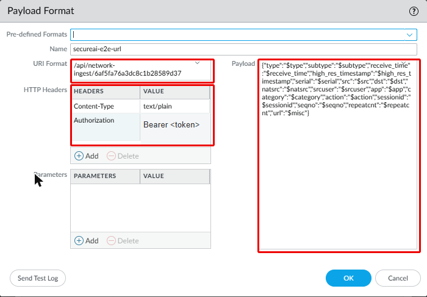
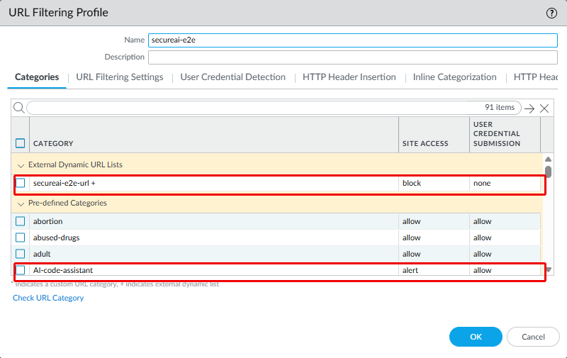
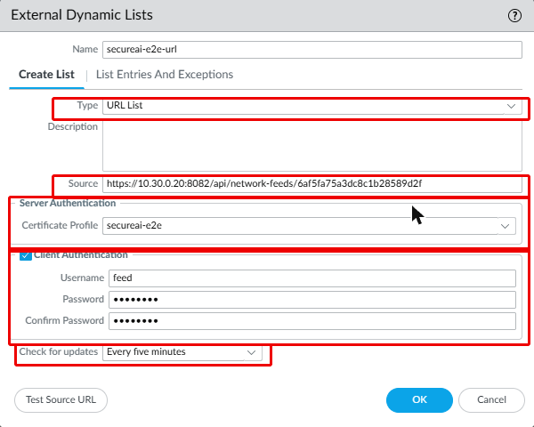
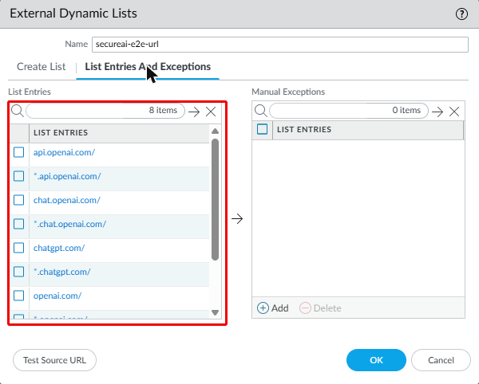
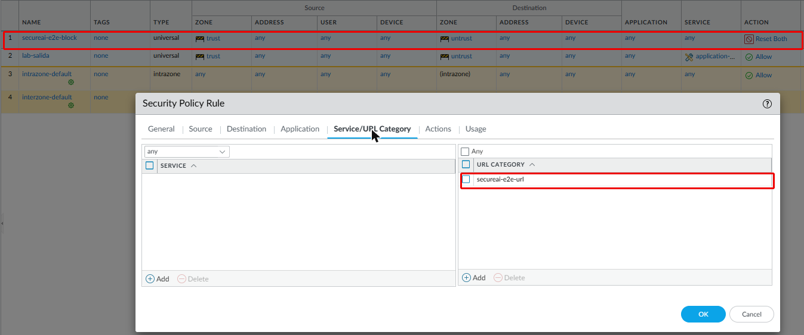
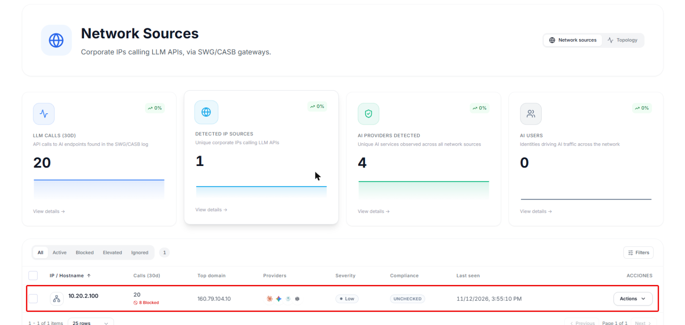
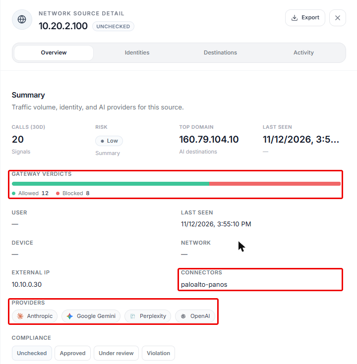
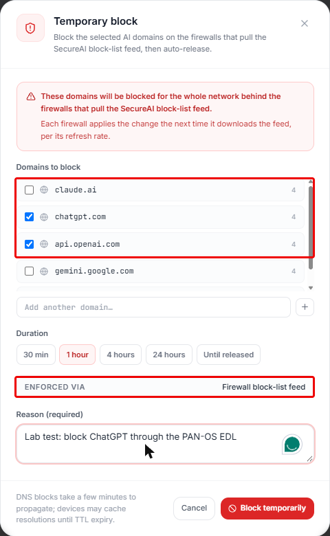
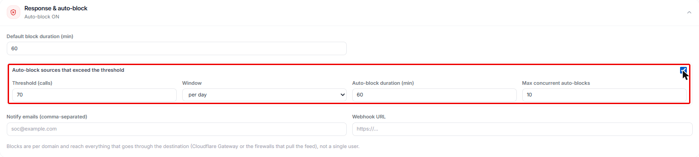

SecureAI reads the URL Filtering and Traffic logs of your Palo Alto firewalls, shows you which AI services your
people use, and publishes External Dynamic Lists (EDLs) with what you prohibit. The firewall downloads them and
enforces them with its own profiles and rules. You do not need the AI Access Security subscription.

<Note>
The integration is in **beta**. The console does not have a screen yet to create log sources and feeds: the
SecureAI team sets them up with you and gives you the IDs and tokens.
</Note>

## How it works

1. The firewall sends its URL Filtering and Traffic logs to SecureAI, by syslog through the SecureAI collector or
   straight through HTTP log forwarding.
2. From each log, SecureAI reads the source device, the user (when the firewall knows it), the destination, the
   action and the Palo Alto classification: the App-ID and the PAN-DB category. App-IDs tagged *Generative AI*
   (`openai-chatgpt`, `claude-base`, `google-gemini`, `github-copilot` and about 500 more) and the
   `artificial-intelligence` and `AI-*` categories count as AI.
3. You see the result in **Inventory > Network Sources**.
4. When you prohibit a provider or block domains, SecureAI adds them to the EDLs. The firewall downloads them every
   five minutes and blocks with a URL Filtering profile, a Security policy rule and the DNS policy of an
   Anti-Spyware profile.

## What SecureAI sees and what it does not

- **Without TLS decryption, the firewall sees the domain, not the content.** It reads the SNI of the HTTPS
  connection and the DNS query. SecureAI knows that someone used ChatGPT, from which device and how many times; not
  what they wrote.
- **The URL Filtering log carries the domain** (`chatgpt.com/`). The Traffic log carries the destination IP and the
  App-ID: when that is all that arrives, SecureAI shows the IP and names the provider from the App-ID.
- **The user shows up when the firewall has User-ID.** Without User-ID, SecureAI groups by the device IP.

## Which license each piece needs

From the Palo Alto documentation. In the SecureAI lab we use VM-Series with the Bundle2 license, which includes
every subscription: we could not test what happens without each one.

| Piece | License |
|---|---|
| App-ID and its content updates | No subscription: the support contract is enough ([Dynamic Content Updates](https://docs.paloaltonetworks.com/pan-os/11-1/pan-os-upgrade/software-and-content-updates/dynamic-content-updates)) |
| URL Filtering profile, PAN-DB categories and the URL Filtering log | Advanced URL Filtering, or the legacy URL Filtering license. When it expires, the firewall stops URL filtering ([Configure URL Filtering](https://docs.paloaltonetworks.com/advanced-url-filtering/administration/configuring-url-filtering/configure-url-filtering), [Activate URL Filtering License](https://docs.paloaltonetworks.com/advanced-url-filtering/administration/configuring-url-filtering/activate-url-filtering-license)) |
| URL-type EDL in a URL Filtering profile | The profile's: Advanced URL Filtering |
| URL-type EDL as a category in a Security policy rule | The Palo Alto documentation does not say, and we did not test it without the license |
| Domain-type EDL in the DNS policy of an Anti-Spyware profile | Threat Prevention or Advanced Threat Prevention. DNS Security is not needed ([Configure DNS Sinkholing for a List of Custom Domains](https://docs.paloaltonetworks.com/advanced-threat-prevention/administration/configure-threat-prevention/use-dns-queries-to-identify-infected-hosts-on-the-network/configure-dns-sinkholing-for-a-list-of-custom-domains)) |
| IP-type EDL | The documentation names no license for your own EDLs. Palo Alto's predefined IP EDLs need Threat Prevention ([Built-in EDLs](https://docs.paloaltonetworks.com/pan-os/11-1/pan-os-admin/policy/use-an-external-dynamic-list-in-policy/built-in-edls)) |

With only the support contract, SecureAI sees AI through the App-ID in the Traffic log. To block with the SecureAI
EDLs you need Advanced URL Filtering or Threat Prevention.

## What you need

- PAN-OS 11.1 or later, and an administrator with write access to Device, Objects and Policies.
- HTTPS access from the firewall to your tenant (`https://<tenant>.hiperai.com`) from its management interface, or
  from the one you set in **Device > Setup > Services > Service Route Configuration**.
- For syslog, a Linux machine with Docker on the firewall's network, where the SecureAI collector runs. HTTP log
  forwarding does not need it.
- From the SecureAI team: the ID and token of the log source, and the ID and token of the two feeds (`panos-url` and
  `panos-domain`). Keep the tokens in your secrets manager.

## 1. Send the logs to SecureAI

Pick one of the two paths.

### Option A: HTTP log forwarding, no collector

**Device > Server Profiles > HTTP > Add**. In **Servers**:

| Field | Value |
|---|---|
| Address | `<tenant>.hiperai.com` |
| Protocol | HTTPS |
| Port | 443 |
| TLS Version | 1.2 |
| HTTP Method | POST |

In **Payload Format**, set one format for **Traffic** and one for **URL**, each with:

| Field | Value |
|---|---|
| URI Format | `/api/network-ingest/<log source ID>` |
| Headers | `Content-Type: text/plain` and `Authorization: Bearer <log source token>` |

**Traffic** payload:

```json
{"type":"$type","subtype":"$subtype","receive_time":"$receive_time","high_res_timestamp":"$high_res_timestamp","serial":"$serial","src":"$src","dst":"$dst","natsrc":"$natsrc","srcuser":"$srcuser","app":"$app","category":"$category","action":"$action","sessionid":"$sessionid","seqno":"$seqno","repeatcnt":"$repeatcnt"}
```

**URL** payload: the same, with `,"url":"$misc"` before the closing brace.



The token travels in a header, never in the URL. Use `text/plain`, not `application/json`: PAN-OS does not escape
the values it fills in (a user `ACME\ana` arrives with an unescaped backslash, and `$misc` brings its own quotes),
and SecureAI fixes each line when it reads it.

PAN-OS checks the server certificate against its trusted root CAs (**Device > Certificate Management >
Certificates > Default Trusted Certificate Authorities**). Your tenant's certificate comes from a public CA.

### Option B: syslog to the collector

1. Install the SecureAI collector with the log source ID and token. The SecureAI team gives you the package and
   walks you through it.
2. **Device > Server Profiles > Syslog > Add**: the collector IP, UDP or TCP 514, **BSD** format. With the default
   format (CSV) there is nothing else to set. If your SIEM already expects CEF or LEEF, enter in **Custom Log
   Format**, for **Traffic** and **URL**:

   CEF (Traffic; for URL, append ` request=$misc`):

   ```
   CEF:0|Palo Alto Networks|PAN-OS|$sender_sw_version|$subtype|$type|1|rt=$cef-formatted-receive_time deviceExternalId=$serial src=$src dst=$dst sourceTranslatedAddress=$natsrc cs1Label=Rule cs1=$rule suser=$srcuser app=$app cn1Label=SessionID cn1=$sessionid cnt=$repeatcnt act=$action cs2Label=URL Category cs2=$category externalId=$seqno
   ```

   LEEF (Traffic; for URL, append `|Miscellaneous=$misc`):

   ```
   LEEF:1.0|Palo Alto Networks|PAN-OS Syslog Integration|$sender_sw_version|$subtype|cat=$type|devTime=$cef-formatted-receive_time|SerialNumber=$serial|src=$src|dst=$dst|srcPostNAT=$natsrc|usrName=$srcuser|Application=$app|SessionID=$sessionid|RepeatCount=$repeatcnt|action=$action|URLCategory=$category|sequence=$seqno
   ```

The collector sends SecureAI only the URL Filtering logs with an AI destination, and the rest of the browsing stays
in your network. The Traffic log has no domain and the collector drops it: over syslog, SecureAI sees AI through the
URL Filtering log.

### Log Forwarding

**Objects > Log Forwarding > Add**, with two entries: **Log Type** `traffic` and `url`, filter **All Logs**, and the
server profile from option A or B. With HTTP log forwarding you can filter on the firewall, for example
`(category eq artificial-intelligence)` on the `url` entry.

On every Security policy rule that carries traffic to the internet (**Policies > Security**), in **Actions**, pick
the profile under **Log Forwarding** and check **Log at Session End**.

## 2. Log AI in the URL Filtering log

**Objects > Security Profiles > URL Filtering**: in your profile, set the `artificial-intelligence` category and
the `AI-*` ones (`AI-conversational-assistant`, `AI-code-assistant` and the rest) to **Alert**. Categories on
**Allow** do not log. Assign the profile to the rules that go to the internet.



## 3. Block with the SecureAI EDLs

### The two EDLs

**Objects > External Dynamic Lists > Add**:

| Field | URL EDL | Domain EDL |
|---|---|---|
| Type | URL List | Domain List |
| Source | `https://<tenant>.hiperai.com/api/network-feeds/<panos-url feed ID>` | `https://<tenant>.hiperai.com/api/network-feeds/<panos-domain feed ID>` |
| Server Authentication | A certificate profile with the root CA of your tenant's certificate | The same |
| Client Authentication | Username: anything, for example `feed`. Password: the feed token | Username `feed` and the other feed's token |
| Automatically expand to include subdomains | | On |
| Check for updates | Five Minute | Five Minute |



PAN-OS accepts a username and password on an EDL only with a certificate profile, that is, with an HTTPS source.
The token travels as the HTTP Basic password, never in the URL.

**List Entries And Exceptions** shows what the firewall downloaded. SecureAI writes each domain twice in the URL EDL
(`chatgpt.com/` and `*.chatgpt.com/`) and once in the domain EDL (`chatgpt.com`; the subdomain option covers the
rest). While nothing is prohibited, the lists are empty.



From the CLI:

```
set profiles certificate-profile secureai CA <imported root CA>
set external-list secureai-ai-url type url url https://<tenant>.hiperai.com/api/network-feeds/<id>
set external-list secureai-ai-url type url certificate-profile secureai
set external-list secureai-ai-url type url auth username feed password <panos-url feed token>
set external-list secureai-ai-url type url recurring five-minute
set external-list secureai-ai-domains type domain url https://<tenant>.hiperai.com/api/network-feeds/<id>
set external-list secureai-ai-domains type domain certificate-profile secureai
set external-list secureai-ai-domains type domain auth username feed password <panos-domain feed token>
set external-list secureai-ai-domains type domain recurring five-minute
set external-list secureai-ai-domains type domain expand-domain yes
```

### Where they are used

- **URL Filtering profile**: in the profile from step 2, the URL EDL shows up among the categories. Set it to
  **Block**.
- **Security policy rule**: a rule above the internet rules, with the URL EDL in **Service/URL Category** and the
  **Reset both** or **Deny** action. It blocks even when the rule below has no URL Filtering profile.

  

- **Anti-Spyware**: in **Objects > Security Profiles > Anti-Spyware > DNS Policies**, add the domain EDL with the
  **Sinkhole** action. Assign the profile to the rules the devices' DNS goes through.

## 4. Check

1. From a device behind the firewall, open chatgpt.com. Within a minute or two the device shows up in
   **Inventory > Network Sources** in SecureAI.

   

   In the details (**Actions > View details**), **Connectors** says `paloalto-panos`.

   

2. On the device's row, **Actions > Block**: pick the domains, the duration and the reason. **Enforced via** must say
   **Firewall block-list feed**.

   

3. To skip the wait, on the firewall:

   ```
   request system external-list refresh type url name secureai-ai-url
   request system external-list show type url name secureai-ai-url
   ```

4. The device can no longer open chatgpt.com, and the block comes back to SecureAI as a blocked call.
5. **Release** on the same row takes the domains out of the list, and the firewall lets them through on its next
   refresh.

With the EDL on **Five Minute**, the firewall applies a block or a release within five minutes. In our tests, a block
made from the console reached the device in just over a minute.

### Automatic block

In **Response & auto-block**, above the Network Sources list, turn on **Auto-block sources that exceed the
threshold** and set the call threshold (per day or per 7 days), how long the block lasts and how many automatic
blocks can be active at once. When a device crosses the threshold, SecureAI blocks the AI domains it uses most and
releases them when the block expires, with nobody touching the console.



## When the feed fails

In our lab tests, with the feed disabled, with a SecureAI server error and with a wrong token, the firewall kept the
last list it downloaded and kept blocking. SecureAI never answers an empty list because of an error.

For a wrong token, the Palo Alto documentation says the firewall stops enforcing the EDL; in our tests that did not
happen during the minute we measured. If you rotate a feed token, update the EDL in the same change.

When nothing is blocked, the EDL carries a single entry, `secureai-empty.invalid`. PAN-OS does not accept an empty
EDL (it keeps the previous one and would never unblock), and `.invalid` is a reserved domain that matches no real
site.

Disabling or deleting a feed unblocks nothing: to unblock, release the block in SecureAI or remove the EDL from the
policy.

## Limits

- **A block reaches the whole network behind the firewall**: the EDLs are lists of domains, not of users.
- **Counters are approximate.** SecureAI counts each session once per firewall and log type, with a 10-minute
  memory.
- **IPs are not blocked.** The SecureAI EDLs are domain lists. An IP that came from the Traffic log shows up in the
  console but does not go into the list.
- **Entries per model**: from 50,000 URLs on VM-50 and PA-220 to 250,000 on PA-5200 and PA-5400
  ([External Dynamic List](https://docs.paloaltonetworks.com/pan-os/11-1/pan-os-admin/policy/use-an-external-dynamic-list-in-policy/external-dynamic-list)).
  The SecureAI list has tens to hundreds of entries.
- **Prisma Access**: SecureAI also has a Prisma Access connector that reads Strata Logging. It has not been
  validated against a real account yet.

## Tested versions

| PAN-OS | Device | Result |
|---|---|---|
| 12.2.3 | VM-Series on Google Cloud, Bundle2 license | Discovery by syslog and by HTTP log forwarding, blocking with the URL and domain EDLs (URL Filtering profile, Security policy rule and DNS sinkhole), and the last list kept when the feed fails |
| 11.2.15 | VM-Series on Google Cloud, Bundle2 license | The same test |
| 12.2.3 | The same, set up as a customer would | Syslog to the SecureAI collector, EDLs over HTTPS, and from the console: block, release and automatic block by threshold |

The CEF and LEEF formats were tested with real PAN-OS 12.2.3 logs. We have not tested PAN-OS 11.1, hardware
firewalls or Panorama yet; GUI menu names can change between versions.
