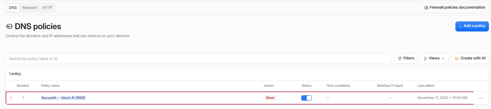
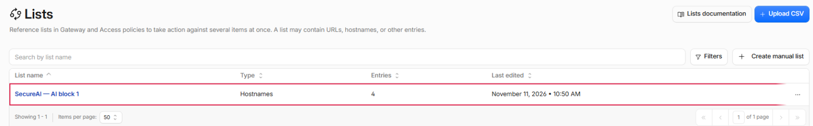
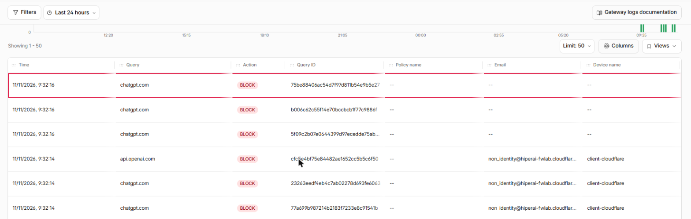

SecureAI lee lo que registra Cloudflare Gateway (consultas DNS, pedidos HTTP y sesiones de red), le muestra qué
servicios de IA usa su gente y los bloquea en Gateway cuando usted los prohíbe en SecureAI. Después de conectar,
no hace falta volver al dashboard de Cloudflare: SecureAI crea y mantiene sus propias listas y reglas.

<Note>
El descubrimiento y el bloqueo por API están **disponibles**. La lectura por Logpush (planes Enterprise) está en
**beta**.
</Note>

## Qué ve SecureAI según su plan de Cloudflare

| | Free | Standard | Enterprise |
|---|---|---|---|
| Analíticas de Gateway por API (lo que lee SecureAI) | 31 días | 31 días | 31 días |
| DNS: dominio y ubicación | Sí | Sí | Sí |
| DNS: usuario y dispositivo | No | No | Solo con Logpush |
| HTTPS sin inspección TLS: dominio (SNI), dispositivo e IP | Con el cliente WARP | Con WARP | Con WARP o proxy endpoint |
| HTTP: host, usuario y dispositivo | WARP con inspección TLS | WARP con inspección TLS | WARP o proxy endpoint, con inspección TLS |
| Proxy endpoint por IP de origen | No | No | Sí |
| Logpush | No | No | Sí |
| Entradas por lista de Zero Trust | 1.000 | 1.000 | 5.000 |

Tres puntos de esta tabla cambian lo que ve en la consola:

- **DNS no trae usuario.** La API de analíticas de Cloudflare entrega el dominio consultado, la ubicación DNS y
  la categoría, sin IP de origen ni usuario. SecureAI muestra cada ubicación como una fuente
  (`cf-location:<nombre>`). Para saber quién hizo la consulta, el tráfico tiene que pasar por WARP.
- **HTTP con usuario solo vía WARP.** El cliente WARP identifica a la persona, y Gateway registra su email y su
  dispositivo. Sin inspección TLS, Gateway no ve el pedido HTTPS: lo registra como sesión de red con el SNI, y
  SecureAI lo lee de ahí. Un equipo enrolado con un service token, sin persona, aparece como
  `non_identity@<su-equipo>`: SecureAI lo muestra con su dispositivo y sin usuario.
- **Proxy endpoints por IP solo en Enterprise.** En Free y Standard, el proxy endpoint pide que cada navegador
  inicie sesión y tenga instalado el certificado de Cloudflare.

## Qué lee y qué no

- SecureAI lee el **dominio** (DNS), el **host** (HTTP) y el **SNI** (red). No pide URLs, rutas ni contenido,
  aunque usted tenga la inspección TLS prendida.
- La consulta filtra del lado de Cloudflare: SecureAI pide solo el tráfico de la categoría *Artificial
  Intelligence* o de los dominios de su catálogo de IA. El resto de la navegación no sale de Cloudflare.
- Las cifras son las estimaciones de Cloudflare, que muestrea el tráfico. Con poco volumen, un dominio
  consultado pocas veces puede no aparecer. Con Logpush llega cada registro.
- Cloudflare publica las analíticas con algunos minutos de demora. Una consulta suele aparecer en SecureAI entre
  15 y 45 minutos después.

## 1. Crear el token de API

En el dashboard de Cloudflare: **My Profile → API Tokens → Create Token → Custom token**.

| Permiso | Para qué |
|---|---|
| Account → Account Analytics → Read | Leer las analíticas de Gateway |
| Account → Zero Trust → Read | Leer listas, reglas y categorías |
| Account → Zero Trust → Edit | Solo si quiere que SecureAI bloquee |

En **Account Resources** elija solo su cuenta. Copie también el **Account ID** (página de inicio de la cuenta →
menú de la cuenta → *Copy account ID*).

## 2. Conectar en SecureAI

En **Integraciones**, filtro **Network / SWG**, abra **Cloudflare Zero Trust**, pegue el Account ID y el token y
guarde. Al guardar, SecureAI prueba el token: si no lee Zero Trust o las analíticas, no guarda y le dice qué permiso
falta. Si lee pero no puede escribir en Zero Trust, guarda y le avisa que solo va a descubrir: el bloqueo no se puede
prender hasta que el token tenga Zero Trust Edit. Desde ahí SecureAI consulta Gateway cada 30 minutos, y lo que
encuentra aparece en **Fuentes de red**.

## 3. Prender el bloqueo

En **Integraciones → Cloudflare Zero Trust → pestaña Bloqueo**. Antes de prenderlo, la consola
le pide confirmar esto:

<Warning>
SecureAI crea sus propias listas de Zero Trust y tres reglas de Gateway (DNS, HTTP y red) **delante de sus reglas
de allow**. Un dominio que SecureAI bloquea queda bloqueado aunque una regla suya lo permita.
</Warning>

Prenderlo pide MFA reciente y queda en el Activity Log con su usuario.

### Qué crea SecureAI en su cuenta

| Objeto | Nombre | Qué hace |
|---|---|---|
| Listas de tipo Domain | `SecureAI — AI block 1`, `2`, … | Guardan los dominios que SecureAI bloquea |
| Regla DNS | `SecureAI — block AI (DNS)` | Bloquea la resolución de esos dominios |
| Regla HTTP | `SecureAI — block AI (HTTP)` | Bloquea el pedido, si la inspección TLS está prendida |
| Regla de red | `SecureAI — block AI (network)` | Corta la conexión HTTPS por el SNI |

Las encuentra en **Traffic controls → Firewall policies** y en **Reusable components → Lists** (Cloudflare muestra
el tipo Domain como "Hostnames"):





Una entrada de una lista Domain cubre el dominio y sus subdominios: `openai.com` bloquea también
`api.openai.com`.

La lista sale de los proveedores que usted marca como **prohibidos**, los sitios bloqueados de la extensión y los
bloqueos temporales activos, menos los sitios aprobados.

### Comprobar que bloquea

En **Insights & Logs → Logs → DNS query logs**, las consultas a un proveedor prohibido aparecen con acción
**Block** y Gateway responde `0.0.0.0`. En SecureAI, la fuente muestra esas consultas como bloqueadas en el
siguiente sync.



### Cómo se mantiene

- SecureAI sincroniza cada 5 minutos, y en el momento en que usted crea o libera un bloqueo temporal.
- Si nada cambió, no escribe en Cloudflare, pero en cada corrida revisa sus reglas. Si alguien borró, apagó o
  editó una regla `SecureAI —`, la vuelve a poner en menos de 5 minutos y le avisa al administrador.
- Las entradas de las listas no se revisan en cada corrida: un dominio que alguien saca a mano de una lista
  `SecureAI —` vuelve con la pasada diaria, así que puede faltar hasta 24 horas.
- Si la lista pasa el tope de entradas de su plan, SecureAI la parte en varias listas que cubren las mismas
  reglas.
- Cloudflare admite 100 listas por cuenta. Cuando la cuenta usa 80 o más (contando las suyas), SecureAI avisa al
  administrador.

### Si algo falla

- Si SecureAI no puede armar la lista de bloqueo, no escribe nada y Cloudflare sigue con la lista anterior.
- Si Cloudflare rechaza un cambio a mitad del sync, SecureAI corta ahí y reintenta en el siguiente. Primero agrega
  lo nuevo y al final saca lo que sobra, así que nunca deja una lista vacía en el medio.
- El último error queda a la vista en la pestaña Bloqueo.

### El orden de las reglas

Cloudflare exige una precedencia distinta para cada regla de la cuenta. SecureAI pone las suyas en el primer lugar
libre delante de sus reglas del mismo tipo. Si no hay lugar libre, las pone al final y la consola le avisa que sus
reglas corren antes. Puede moverlas a mano: SecureAI respeta el lugar que les dé.

### Pausar sin desbloquear

El interruptor general de enforcement de SecureAI **congela** la cuenta: SecureAI deja de escribir en Cloudflare,
y las listas y reglas quedan como están, bloqueando lo que ya bloqueaban. Un cambio de política hecho mientras
tanto llega a Cloudflare cuando vuelve a prender el interruptor.

### Apagar el bloqueo

**Apagar** deshabilita las tres reglas, así que **desbloquea todo** lo que SecureAI bloqueaba por Cloudflare. Pide
confirmación y MFA reciente, y queda en el Activity Log. Las listas quedan en la cuenta: volver a prenderlo es un
solo sync.

Para sacar a SecureAI de la cuenta por completo: apague el bloqueo, borre las reglas `SecureAI — block AI` y
`SecureAI — exception`, después las listas `SecureAI — AI block` y `SecureAI — exception` (Cloudflare no deja borrar
una lista que una regla usa) y revoque el token.

## 4. Ajustes del bloqueo

En la misma pestaña, **Cómo bloquea SecureAI en Cloudflare** tiene tres ajustes. Guardarlos pide MFA reciente y
queda en el Activity Log.

### Bloqueo por aplicación

Prendido por defecto. Las reglas también bloquean la aplicación de Cloudflare de cada proveedor prohibido.
Cloudflare conoce todos los hosts de aplicaciones como ChatGPT o Claude, también los que SecureAI no tiene en su
catálogo; en ChatGPT, por ejemplo, los dominios de donde carga sus scripts y archivos.

- Si Cloudflare renombra o quita una aplicación, la consola lo avisa y ese proveedor queda bloqueado solo por
  dominio.
- Si aprobó un sitio de un proveedor en la extensión, ese proveedor no se bloquea por aplicación, para no volver a
  bloquear el sitio aprobado.

### Página de bloqueo

- **La página de Cloudflare** (por defecto).
- **Mandar a la persona al chat de SecureAI**: Gateway redirige al chat de su tenant, o a la URL de redirección de la
  extensión si configuró una. El link no lleva el mail de la persona ni la dirección bloqueada.

La página solo se ve en equipos que confían en el certificado raíz de Cloudflare; sin él, el navegador muestra un
error de certificado. Un bloqueo por SNI (la regla de red) corta la conexión y no muestra página.

### Excepciones por persona o grupo

Una excepción deja que una persona o un grupo de su directorio (aprovisionado por SCIM) use proveedores
prohibidos, y los sigue bloqueando para el resto. Hasta 10 excepciones. Por cada una, SecureAI crea en su cuenta una
lista de mails `SecureAI — exception <id>` y tres reglas de allow delante de las de bloqueo.

- **Solo aplica a quien entra al cliente Cloudflare One (WARP) con su proveedor de identidad.** El tráfico de una
  ubicación DNS o de un equipo sin usuario sigue bloqueado.
- **No abre los sitios bloqueados ni los bloqueos temporales.**
- **Sigue al directorio:** si alguien deja el grupo, sale de la lista de Cloudflare en los 5 minutos siguientes.
- **Falla cerrado:** si SecureAI no puede leer los miembros, apaga las reglas de excepción y bloquea a todos.
- La excepción es solo de Cloudflare: la extensión y el agente de endpoint siguen con sus propias reglas.

## A quién alcanza un bloqueo

A todo lo que pasa por Gateway: los dispositivos con WARP y las redes que usan sus ubicaciones DNS, salvo las
personas de una excepción. Un bloqueo temporal que un analista crea desde una fuente bloquea esos dominios para
toda la organización hasta que vence, también para las excepciones.

## Logpush

Para planes Enterprise, en beta. Con Logpush, Cloudflare le manda a SecureAI cada registro en lugar de las analíticas: llega también el usuario en
DNS, y llega en minutos.

1. En SecureAI, en **Fuentes de red**, cree una fuente de ingesta con el conector **Cloudflare Zero Trust
   (Logpush)**. Copie la URL y el token, que se muestra una sola vez.
2. En Cloudflare, cree un job de Logpush por dataset (`gateway_dns`, `gateway_http`, `gateway_network`) con
   destino HTTP:

   ```text
   https://<su-tenant>/api/network-ingest/<id-de-la-fuente>?header_Authorization=Bearer%20<token>
   ```

   Con estas `output_options`:

   ```json
   { "output_type": "ndjson", "batch_prefix": "{\"events\":[", "batch_suffix": "]}", "record_delimiter": "," }
   ```

3. No incluya el campo `URL` en el job: SecureAI no lo usa.

El bloqueo sigue saliendo de la conexión **Cloudflare Zero Trust** del paso 2. Logpush solo reemplaza la lectura.

## Problemas comunes

| Síntoma | Causa probable |
|---|---|
| Guardar falla con `NO_ANALYTICS_SCOPE` | Al token le falta Account Analytics Read |
| Guardar falla con `NO_ZT_READ` o `CF_AUTH` | Al token le falta Zero Trust Read, o es de otra cuenta |
| Aviso "Solo descubrimiento" al guardar, o prender el bloqueo da `NO_ZT_WRITE` | Al token le falta Zero Trust Edit |
| Con el bloqueo prendido, la pestaña Bloqueo dice que el token ya no puede escribir (`NO_ZT_WRITE`) | Le quitaron Zero Trust Edit al token, o se guardó otro token sin ese permiso. SecureAI no cambia nada en Cloudflare: las listas y reglas quedan como están, pero los bloqueos nuevos, las liberaciones y las reparaciones no llegan. Devuélvale Zero Trust Edit al token |
| Error `CF_LIMIT` | No quedan listas libres en la cuenta (máximo 100) |
| Fuentes `cf-location:…` sin usuario | Es DNS por ubicación: el usuario solo llega con WARP |
| Nada en Fuentes de red después de una hora | El tráfico no pasa por Gateway, o no fue a dominios de IA |
