Con esta integración ve en SecureAI qué servicios de IA usa la gente detrás de sus FortiGate, desde qué equipo y con
qué frecuencia, y los bloquea desde SecureAI. No necesita el módulo de control de GenAI de Fortinet: el FortiGate
manda sus logs a SecureAI y descarga de SecureAI la lista de dominios que tiene que bloquear.

<Note>
La integración está en **beta**. La probamos en laboratorio con FortiGate-VM y FortiOS 7.6.8; vea
[Versiones probadas](#versiones-probadas).
</Note>

## Cómo funciona

1. El FortiGate manda por syslog sus logs de tráfico (`type=traffic`) y de los perfiles de seguridad (`type=utm`,
   subtipos `webfilter`, `app-ctrl` y `dns`) al colector de SecureAI, un contenedor que corre en su red.
2. El colector se queda solo con las líneas cuyo destino es un servicio de IA y se las manda a su tenant por
   HTTPS. El resto de la navegación no sale de su red.
3. SecureAI lee de cada línea el origen (`srcip`, `user`, `srcname`), el destino (`hostname`, `qname` o el host de
   `url`), la decisión (`action`, `utmaction`) y la clasificación de FortiGuard (`app`, `appcat`, `catdesc`), y lo
   muestra en **Inventario → Fuentes de red**.
4. Cuando usted bloquea dominios de IA en SecureAI, entran a un feed de bloqueo. El FortiGate lo descarga con un
   External Connector y su perfil de DNS Filter deja de resolver esos dominios.

## Requisitos

- Un FortiGate con FortiOS 7.2 o posterior, y un administrador con permiso de escritura en Log & Report, Security
  Profiles, Security Fabric y Policy & Objects.
- Una máquina Linux con Docker en la red del FortiGate para el colector. Con 1 vCPU y 1 GB procesa unos 3.000
  eventos de syslog por segundo; si su FortiGate manda más, sume vCPU. El FortiGate tiene que llegarle por syslog, y ella tiene que salir por HTTPS a su tenant.
- Que el FortiGate salga por HTTPS a su tenant (`https://<tenant>.hiperai.com`) para descargar el feed.
- Un administrador de SecureAI con segundo factor configurado: crear y rotar los tokens lo pide.

## 1. Conectar el FortiGate en SecureAI

1. Abra **Administrador → Integraciones** y elija la categoría **Red / SWG**.
2. En la tarjeta **Fortinet FortiGate**, haga clic en **Conectar**.

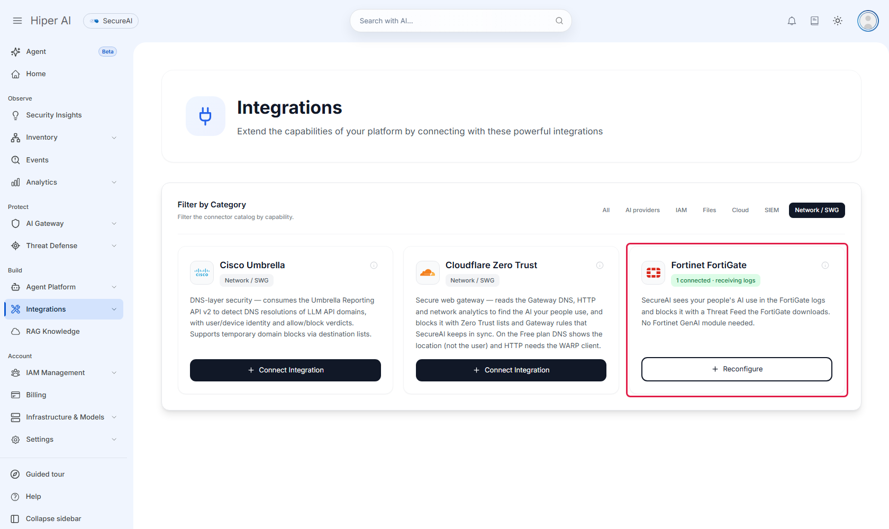

3. En **Agregar un Fortinet FortiGate**, escriba un nombre que le permita reconocer el equipo. Los otros dos campos
   son opcionales:
   - **IP del colector**: SecureAI la pone como servidor de syslog en la configuración del FortiGate.
   - **IP pública del firewall**: si la carga, SecureAI solo le entrega la lista de bloqueo a esa dirección, aunque
     otro tenga el token.

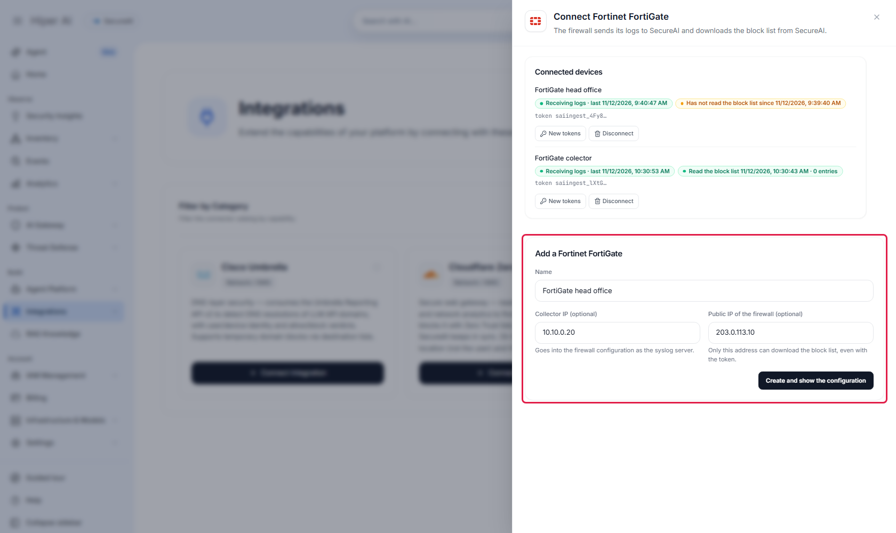

4. Haga clic en **Crear y mostrar la configuración**. SecureAI le pide el segundo factor y crea tres cosas: la
   fuente de logs del colector, el feed de bloqueo del FortiGate y el feed con la lista de dominios de IA que usa
   el colector para filtrar. Después ofrece **Descargar el colector (.zip)** y muestra dos bloques para copiar:
   `collector.env`, con los datos del colector, y la CLI de FortiOS, con la URL y el token del feed.

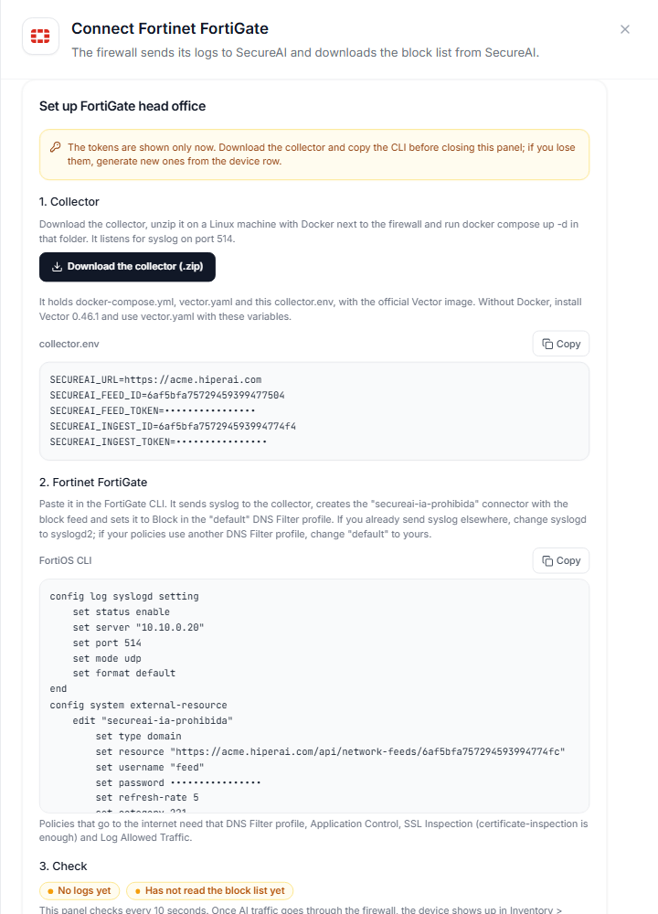

Los tokens se ven solo en ese momento. Descargue el colector y copie la CLI antes de cerrar el panel, y guarde los
tokens en su gestor de secretos. Si los pierde, **Tokens nuevos** en la fila del equipo genera otros y los anteriores dejan de funcionar.

En **Equipos conectados** ve, por cada FortiGate, si llegan sus logs y cuándo descargó la lista de bloqueo por
última vez. Si un equipo deja de descargarla por más de 30 minutos, el panel lo avisa.

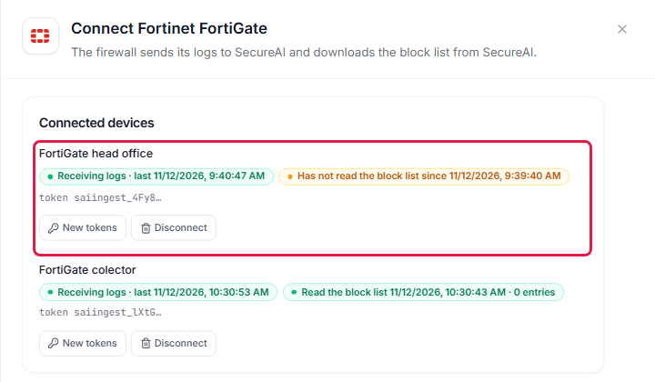

## 2. Instalar el colector

El colector es [Vector](https://vector.dev) 0.46.1 con la imagen oficial `timberio/vector:0.46.1-debian`. SecureAI
no publica una imagen propia. **Descargar el colector (.zip)**, en el panel del paso 1, baja tres archivos:

| Archivo | Qué es |
|---|---|
| `docker-compose.yml` | Corre la imagen oficial con `vector.yaml` montado. El puerto 514 de la máquina va al 5514 del contenedor |
| `vector.yaml` | Recibe el syslog, se queda con las líneas que van a un servicio de IA y las manda a su tenant |
| `collector.env` | La URL de su tenant y los ids y tokens de este equipo. No lo comparta ni lo suba a un repositorio |

1. Copie el `.zip` a una máquina Linux con Docker en la red del FortiGate y descomprímalo.
2. En la carpeta `secureai-collector`, ejecute `docker compose up -d`.
3. Con `docker compose logs -f` ve que Vector arranca y escucha en el puerto 5514 del contenedor.

El colector escucha syslog en el puerto 514 de la máquina, UDP y TCP. Cada hora descarga de su tenant la lista de
dominios de IA y solo manda las líneas cuyo destino está en esa lista. El resto de la navegación no sale de su red.
Hasta que llega la primera lista no manda nada, y si su tenant deja de contestar, conserva la última lista 7 días.

### Sin Docker

Instale Vector 0.46.1 en la máquina, exporte las variables de `collector.env` y ejecute
`vector --config vector.yaml`. Así escucha en el puerto 5514; apunte ahí el syslog del FortiGate o redirija el 514.
Este es el `vector.yaml` del paquete:

<Accordion title="vector.yaml">

```yaml
# SecureAI firewall log collector (Vector 0.46.1). Runs at the customer, next to the firewall, with the
# official image timberio/vector:0.46.1-debian and nothing else: no image of ours, no extra tools.
#
#   firewall --syslog--> [syslog_udp / syslog_tcp] --> extract_host --> ai_candidates --> ai_only --> secureai_ingest --HTTPS--> SecureAI
#                                                                                           ^
#   SecureAI AI domain list (feed list=ai-catalog) --> [ai_list] --> ai_list_rows --> ai_patterns (memory table)
#
# Lines whose destination is not an AI service never leave the customer network. Until the first list
# arrives nothing is sent; if SecureAI stops answering, the last list stays for 7 days.
#
# Settings come from collector.env (the console's "Connect" panel writes it): SECUREAI_URL, SECUREAI_FEED_ID,
# SECUREAI_FEED_TOKEN, SECUREAI_INGEST_ID, SECUREAI_INGEST_TOKEN and, optional, SECUREAI_FEED_REFRESH_SECONDS.

data_dir: /var/lib/vector

enrichment_tables:
  # One entry per AI domain pattern (chatgpt.com, *.openai.azure.com, bedrock.*.amazonaws.com, ...).
  # Every download rewrites the entries; one the list drops expires after the TTL.
  ai_patterns:
    type: memory
    ttl: 604800
    # Required: without flush_interval, Vector 0.46.1 on Linux exits at startup ("overflow when adding duration to instant").
    flush_interval: 5
    inputs: [ai_list_rows]

sources:
  syslog_udp:
    type: socket
    mode: udp
    address: 0.0.0.0:5514
    decoding:
      codec: bytes
  syslog_tcp:
    type: socket
    mode: tcp
    address: 0.0.0.0:5514
    framing:
      method: newline_delimited
    decoding:
      codec: bytes
  # The AI domain list, one pattern per line. A failed download (401, 5xx, timeout) emits nothing:
  # the table keeps the patterns it has.
  ai_list:
    type: http_client
    endpoint: "${SECUREAI_URL}/api/network-feeds/${SECUREAI_FEED_ID}"
    scrape_interval_secs: ${SECUREAI_FEED_REFRESH_SECONDS:-3600}
    scrape_timeout_secs: 60
    auth:
      strategy: bearer
      token: "${SECUREAI_FEED_TOKEN}"
    decoding:
      codec: bytes
    framing:
      method: newline_delimited

transforms:
  ai_list_rows:
    type: remap
    inputs: [ai_list]
    source: |
      p = downcase(strip_whitespace(to_string(.message) ?? ""))
      if !match(p, r'^[a-z0-9*._-]+$') { abort }
      . = set!(value: {}, path: [p], data: true)

  # Find the destination host in the line: CEF first (dhost / destinationHostName /
  # request URL), then the MikroTik RouterOS DNS query log, then key=value logs (FortiOS native:
  # hostname="...", or qname="..." in DNS logs), then a url=.
  # Also drops the query string of the request URL: the host is all SecureAI needs.
  extract_host:
    type: remap
    inputs: [syslog_udp, syslog_tcp]
    source: |
      msg = to_string(.message) ?? ""
      msg = replace(msg, r'(request=[^ ?]*)\?[^ ]*', "$$1")
      .message = msg
      host = ""
      at = find(msg, "CEF:")
      if at >= 0 {
        cef, err = parse_cef(slice!(msg, at))
        if err == null {
          host = to_string(cef.dhost)
          if host == "" { host = to_string(cef.destinationHostName) }
          if host == "" {
            u, uerr = parse_url(to_string(cef.request))
            if uerr == null { host = to_string(u.host) }
          }
        }
      }
      # MikroTik RouterOS DNS log (topics=dns): "query from 10.0.0.5: #12 chatgpt.com. A".
      if host == "" {
        q, qerr = parse_regex(msg, r'(?:^|[\s>])(?:query )?from [0-9A-Fa-f:.]+: #\d+ (?P<name>\S+?)\.? [A-Z]')
        if qerr == null { host = to_string(q.name) }
      }
      if host == "" {
        kv, kerr = parse_key_value(msg)
        if kerr == null {
          host = to_string(kv.hostname) ?? ""
          # FortiOS DNS Filter logs (subtype=dns) name the destination in qname.
          if host == "" { host = to_string(kv.qname) ?? "" }
          if host == "" { host = to_string(kv.dhost) ?? "" }
          if host == "" { host = to_string(kv.host) ?? "" }
          if host == "" {
            u, uerr = parse_url(to_string(kv.url) ?? "")
            if uerr == null { host = to_string(u.host) }
          }
        }
      }
      .secureai_host = downcase(replace(host, r'\.$', ""))

  # Every list pattern that could match the host, under the list's rule: a pattern matches the host or a
  # parent domain, and "*" stands for any run of characters inside one label. For x.api.openai.com:
  # x.api.openai.com, api.openai.com, openai.com, com, each of them with one label as "*"
  # (*.openai.com, api.*.com, ...) and with the first label's start as "*" (*i.openai.com, *pi.openai.com, ...).
  ai_candidates:
    type: remap
    inputs: [extract_host]
    source: |
      labels = split(to_string(.secureai_host) ?? "", ".")
      candidates = []
      if length(labels) > 1 || (length(labels) == 1 && labels[0] != "") {
        for_each(labels) -> |s, _label| {
          suffix = slice!(labels, s)
          candidates = push(candidates, join!(suffix, "."))
          for_each(suffix) -> |j, _l| {
            candidates = push(candidates, join!(set!(suffix, [j], "*"), "."))
          }
          first = string!(suffix[0])
          for_each(split(first, "")) -> |k, _c| {
            if k > 0 && k < length(first) {
              candidates = push(candidates, join!(set!(suffix, [0], "*" + slice!(first, k)), "."))
            }
          }
        }
      }
      .secureai_candidates = unique(candidates)

  # Keeps the line only when one of its candidates is in the AI domain list; drops the helper field.
  ai_only:
    type: remap
    inputs: [ai_candidates]
    drop_on_abort: true
    source: |
      found = false
      for_each(array(.secureai_candidates) ?? []) -> |_i, key| {
        if !found {
          _row, err = get_enrichment_table_record("ai_patterns", { "key": key })
          if err == null { found = true }
        }
      }
      del(.secureai_candidates)
      if !found { abort }

sinks:
  secureai_ingest:
    type: http
    inputs: [ai_only]
    uri: "${SECUREAI_URL}/api/network-ingest/${SECUREAI_INGEST_ID}"
    method: post
    auth:
      strategy: bearer
      token: "${SECUREAI_INGEST_TOKEN}"
    encoding:
      codec: text
    framing:
      method: newline_delimited
    request:
      headers:
        Content-Type: text/plain
    batch:
      max_events: 1000
      timeout_secs: 5
    # SecureAI answers 503 when it cannot write: the batch waits here on disk and is retried.
    buffer:
      type: disk
      max_size: 268435488
      when_full: drop_newest
```

</Accordion>

<Accordion title="docker-compose.yml">

```yaml
# SecureAI firewall log collector. Put this file, vector.yaml and collector.env in one folder on a Linux host
# the firewall can reach, and run: docker compose up -d
# The console's "Connect" panel (Integrations > Network / SWG) downloads the three files ready to use.
services:
  secureai-collector:
    image: timberio/vector:0.46.1-debian
    restart: unless-stopped
    env_file: collector.env
    command: ["--config", "/etc/vector/vector.yaml"]
    ports:
      # Point the firewall's syslog at this host, port 514 (UDP or TCP).
      - "514:5514/udp"
      - "514:5514/tcp"
    volumes:
      - ./vector.yaml:/etc/vector/vector.yaml:ro
      # Vector's disk buffer: batches wait here while SecureAI is unreachable.
      - collector-data:/var/lib/vector

volumes:
  collector-data:
```

</Accordion>

## 3. Mandar los logs del FortiGate al colector

En la GUI de FortiOS: **Log & Report → Log Settings**, pestaña **Global Settings**. Ponga **Syslog logging** en
**Enable** y cargue la IP del colector. En FortiOS 7.2 y 7.4 la opción se llama **Send logs to syslog**.

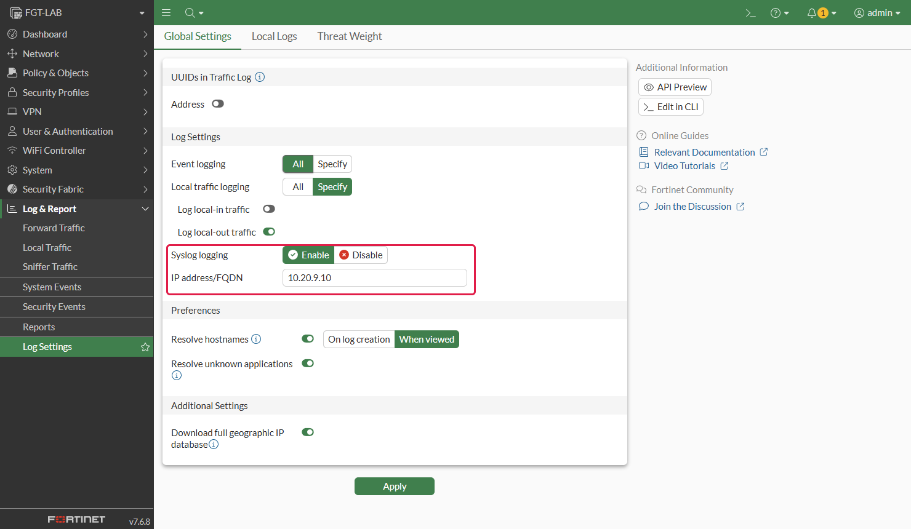

Por CLI es el comienzo del bloque que le dio el panel:

```
config log syslogd setting
    set status enable
    set server "<IP del colector>"
    set port 514
    set mode udp
    set format default
end
```

`format default` manda el formato key=value nativo de FortiOS, que es el que lee SecureAI. Si ya manda syslog a
otro equipo, use `log syslogd2` (hasta `syslogd4`) para no tocarlo.

Las políticas que llevan tráfico a internet necesitan:

- **Log Allowed Traffic** en *All Sessions* (`set logtraffic all`) o en *Security Events* (`set logtraffic utm`);
- un perfil de SSL Inspection, aunque sea `certificate-inspection`, para que FortiOS lea el nombre del destino
  (SNI) de las conexiones HTTPS;
- Application Control con el perfil `default` o uno propio. FortiGuard clasifica la IA generativa como `GenAI`;
- el perfil de DNS Filter del paso 4, con **Log all DNS queries and responses**.

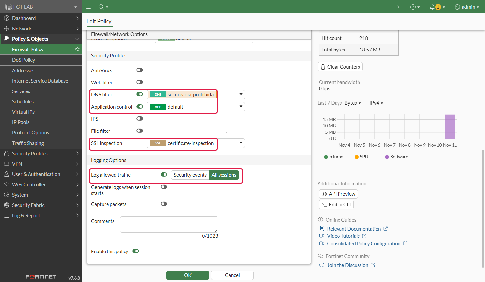

### Usuario en vez de IP

SecureAI muestra la persona cuando el log del FortiGate trae el usuario. FortiOS lo escribe en las sesiones de una
política que identifica usuarios: una política con un grupo de usuarios (**Source → User**) cuyo login sale de
FSSO, de RSSO (RADIUS accounting de una NAC, una VPN o un controlador Wi-Fi) o de la autenticación del propio
FortiGate.

Antes de agregar el grupo a una política que ya está en producción, pruebe qué pasa con los equipos que no se
identifican: esa política ya no los cubre, y según el resto de sus políticas pueden quedar sin salida. SecureAI no
cambia nada de esto; solo lee el usuario que el FortiGate ya escribe.

## 4. Bloquear con el feed de SecureAI

La CLI del panel crea el External Connector `secureai-ia-prohibida` con la URL y el token del feed, y lo pone en
**Block** en el perfil de DNS Filter `default`. Si sus políticas usan otro perfil, cambie `default` por el suyo antes
de pegarla. Por la GUI:

1. **Security Fabric → External Connectors → Create New → Threat Feeds → Domain Name**:

   | Campo | Valor |
   |---|---|
   | Name | `secureai-ia-prohibida` |
   | URI of external resource | La URL del feed que muestra el panel |
   | HTTP basic authentication | Activado. Usuario: cualquiera (por ejemplo `feed`). Contraseña: el token del feed |
   | Refresh Rate | 5 minutos |

   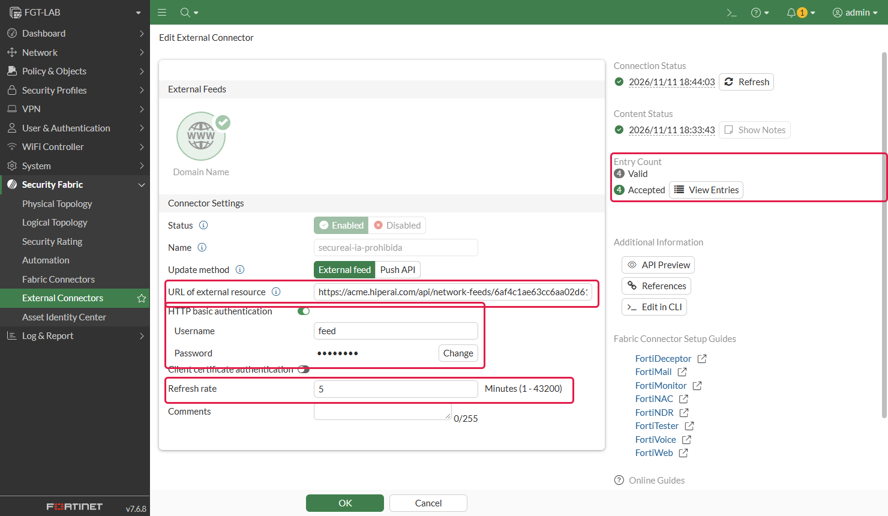

   **View Entries** muestra la lista que descargó. SecureAI escribe cada dominio dos veces, `chatgpt.com` y
   `*.chatgpt.com`, para cubrir el dominio y sus subdominios. Mientras no bloquee nada, la lista está vacía.

   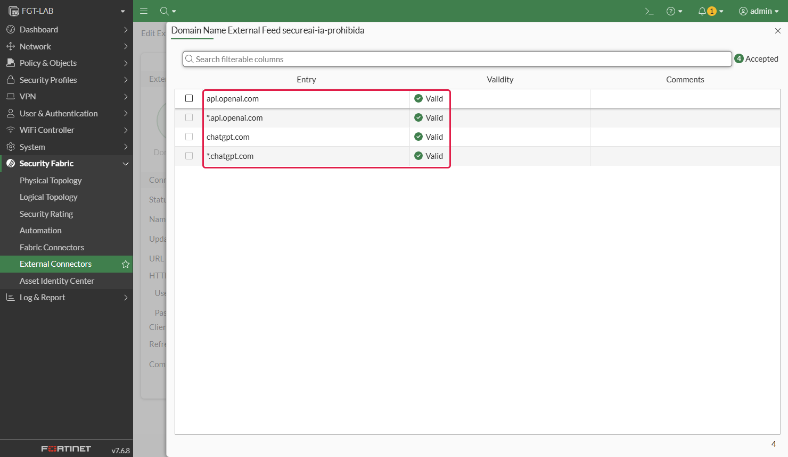

2. En el perfil de DNS Filter de sus políticas (**Security Profiles → DNS Filter**), la categoría del connector
   aparece en **Remote Categories**. Póngala en **Block** y deje **Redirect to Block Portal**.

   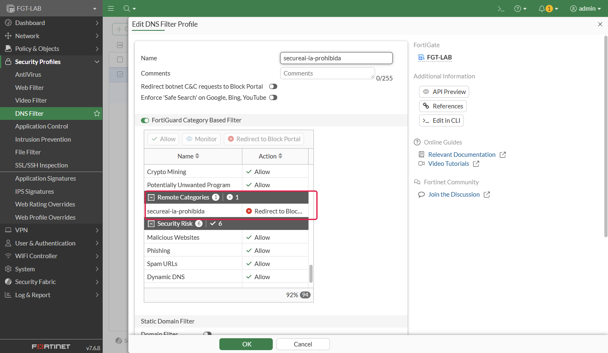

3. En **Options**, al final del perfil, active **Allow DNS requests when a rating error occurs** y **Log all DNS
   queries and responses**.

   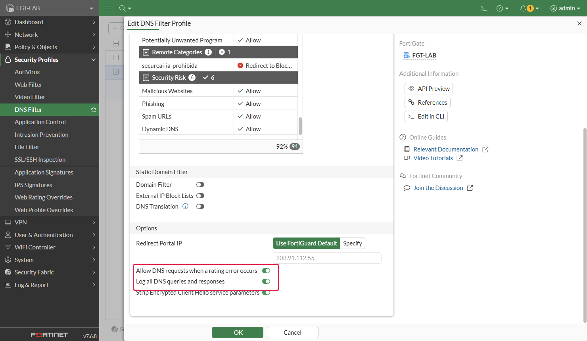

<Warning>
Sin **Allow DNS requests when a rating error occurs** (`set options error-allow`), un FortiGate sin la suscripción
de DNS Filter de FortiGuard, o sin conexión a FortiGuard, bloquea todos los dominios por error de clasificación, no
solo los del feed.
</Warning>

Por CLI y por la REST API, FortiOS deja la categoría del connector en 0, que DNS Filter no puede usar. Por eso la
CLI del panel le asigna la 221. Antes de pegarla, revise con `show system external-resource` si otro connector ya
la usa; si la usa, cambie los dos `221` por una libre entre 192 y 220. FortiOS acepta dos connectors en la misma
categoría, pero el DNS Filter bloquea con la lista de uno solo y no avisa.

DNS Filter actúa sobre las consultas DNS que pasan por el FortiGate: las de los equipos que lo usan como servidor DNS
o las que atraviesan una política con el perfil. Un equipo que resuelve por otro camino (DNS sobre HTTPS del
navegador, un resolver que no pasa por el FortiGate) no se bloquea así. Para esos equipos, sume el bloqueo por Web
Filter.

### Bloquear también por HTTPS (Web Filter)

Web Filter mira el nombre del sitio en la conexión HTTPS (SNI), así que alcanza a los equipos que resuelven DNS por
otro camino. Usa el mismo feed con un segundo connector:

1. **Security Fabric → External Connectors → Create New → Threat Feeds → FortiGuard Category**, con la misma URI,
   el mismo usuario y el mismo token que el connector de dominios. Su categoría tiene que ser otra, libre.
2. En el perfil de Web Filter de sus políticas (**Security Profiles → Web Filter**), la categoría del connector
   aparece en **Remote Categories**: póngala en **Block**. Sin la suscripción de Web Filter de FortiGuard, active
   también **Allow websites when a rating error occurs**, por la misma razón que en DNS Filter.
3. La política necesita el perfil de Web Filter y SSL Inspection, aunque sea `certificate-inspection`.

Por CLI, con la categoría 220 si está libre:

```
config system external-resource
    edit "secureai-ia-prohibida-web"
        set type category
        set resource "https://<tenant>.hiperai.com/api/network-feeds/<id>"
        set username "feed"
        set password <token del feed>
        set refresh-rate 5
        set category 220
    next
end
config webfilter profile
    edit "default"
        set log-all-url enable
        config ftgd-wf
            set options error-allow
            config filters
                edit 0
                    set category 220
                    set action block
                    set log enable
                next
            end
        end
    next
end
```

Con `certificate-inspection` el FortiGate no ve adentro del TLS: corta la conexión con su propio certificado y el
navegador muestra un error de certificado en lugar de la página de bloqueo. Con inspección profunda muestra la
página. El log de Web Filter vuelve a SecureAI y suma al bloqueo confirmado.

## 5. Comprobar

1. Desde un equipo detrás del FortiGate, abra chatgpt.com. En uno o dos minutos el equipo aparece en
   **Inventario → Fuentes de red**, con las llamadas, los proveedores y, si el FortiGate lo conoce, el usuario.

   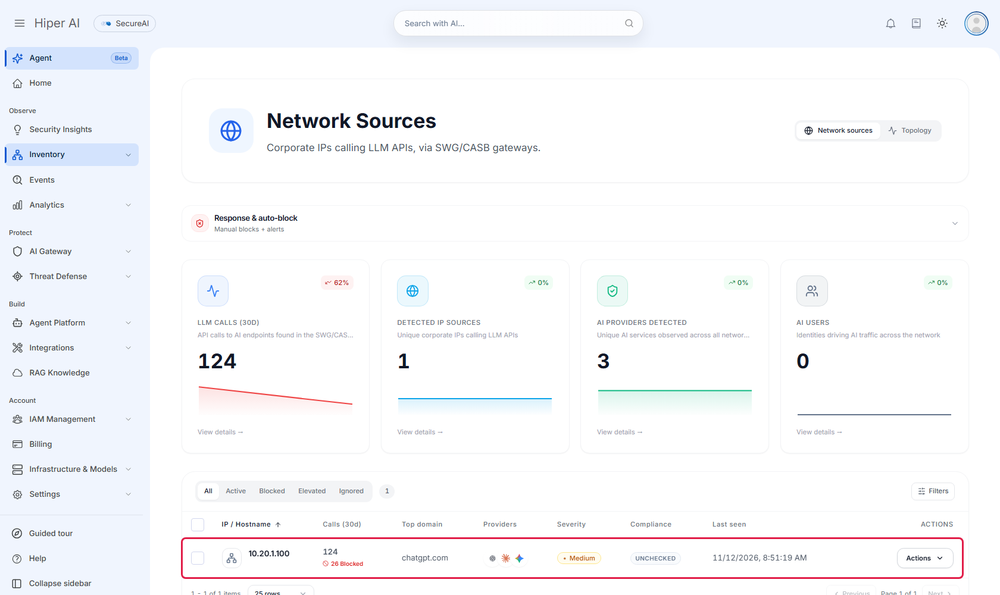

   En el detalle de la fuente (**Acciones → Ver detalles**), **Conectores** dice `fortinet-fortigate` y
   **Aplicación en el gateway** ofrece bloquear por el feed de firewalls.

   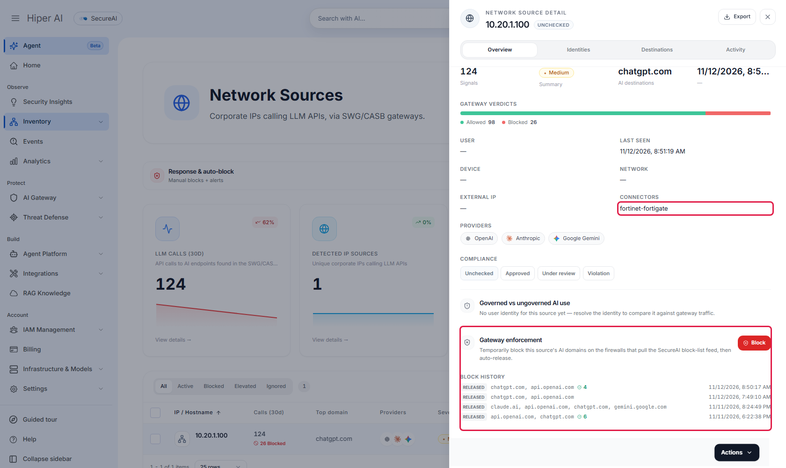

2. En la fila del equipo, abra **Acciones** y elija **Bloquear**.

   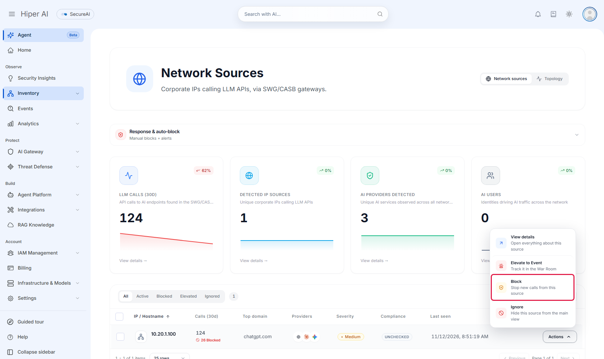

3. Marque los dominios (por ejemplo `chatgpt.com` y `api.openai.com`), elija la duración (de 30 minutos a **Hasta
   liberar**) y escriba el motivo. **Aplicado vía** tiene que decir **Feed de bloqueo para firewalls**.

   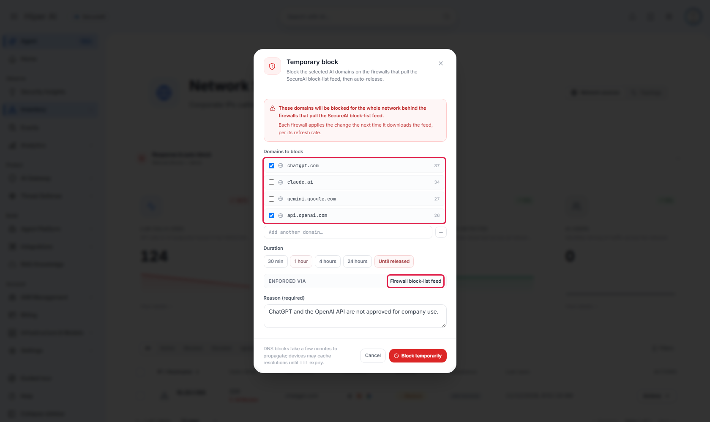

4. En el próximo refresco del connector, desde el equipo, `nslookup chatgpt.com` devuelve 208.91.112.55, la IP del
   portal de bloqueo de FortiGuard, y el navegador no llega. En **Log & Report → Security Events → DNS Query**, la
   respuesta de `chatgpt.com` tiene **Action** `redirect`.

   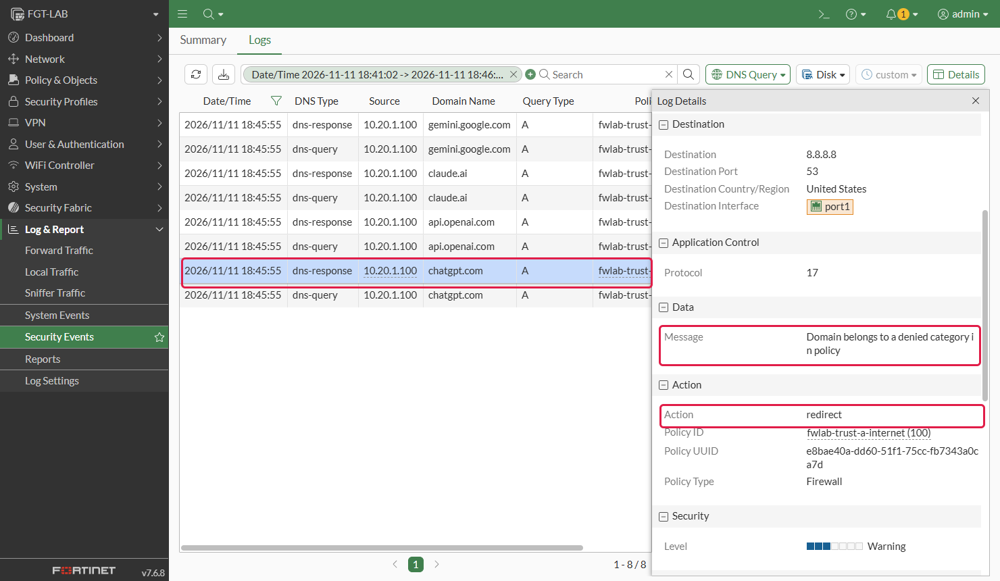

5. Ese log vuelve a SecureAI. En el detalle de la fuente, **Aplicación en el gateway** pasa a **Bloqueo confirmado**
   y cuenta las consultas que el FortiGate bloqueó desde que creó el bloqueo.

   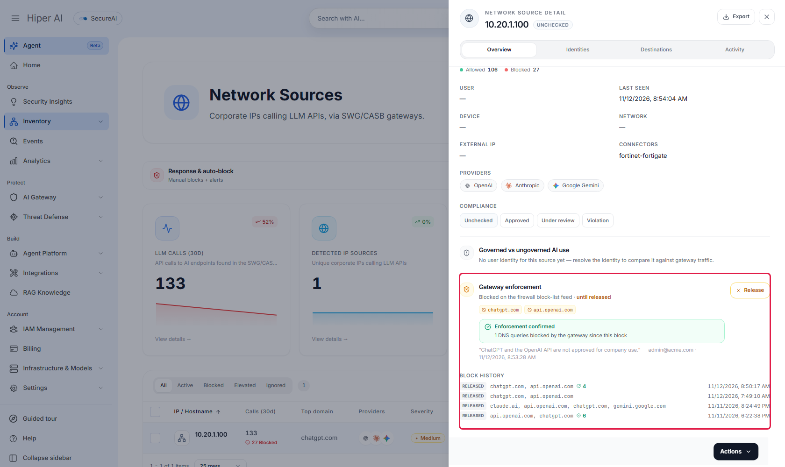

6. Para levantarlo, elija **Acciones → Liberar** en la fila. SecureAI saca los dominios del feed y el FortiGate los
   vuelve a resolver en su próximo refresco.

   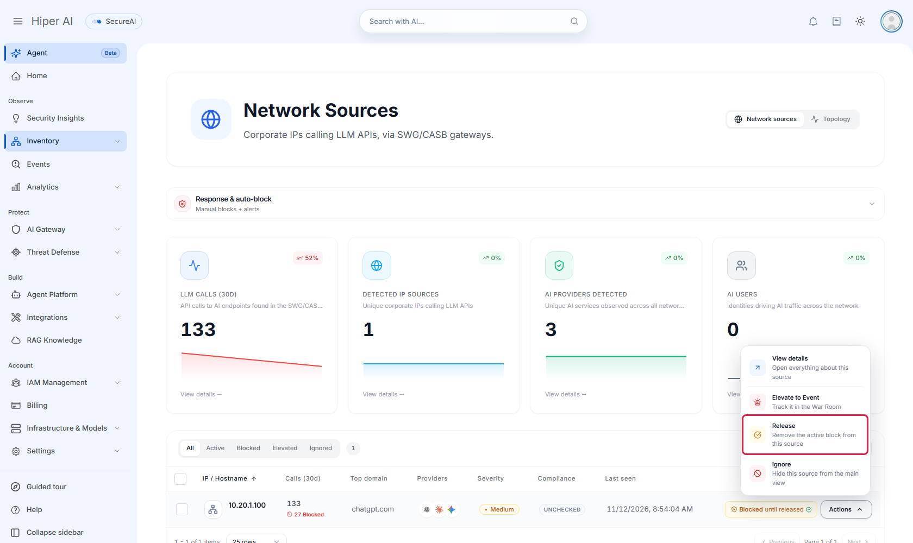

## Bloqueo automático

En **Respuesta y auto-bloqueo**, arriba de la lista de Fuentes de red, active **Auto-bloquear fuentes que superen
el umbral** y elija el umbral de llamadas (por día o por 7 días), cuánto dura el bloqueo y cuántos bloqueos
automáticos puede haber a la vez. Cuando una fuente pasa el umbral, SecureAI pone sus dominios de IA en el feed y
los saca al vencer. Guardar estos ajustes pide el segundo factor.

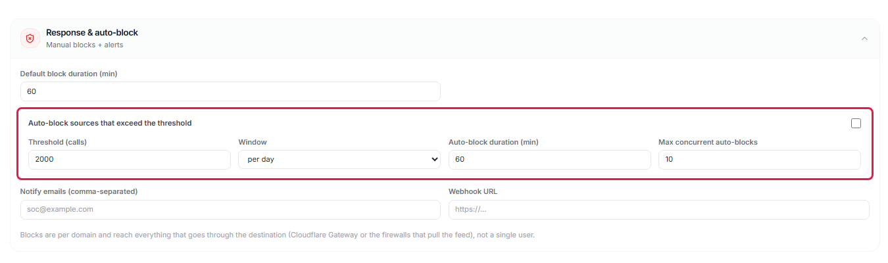

## Límites

- **Sin inspección TLS, el FortiGate ve el nombre del destino y no el contenido.** SecureAI sabe que alguien usó
  ChatGPT, desde qué equipo y cuántas veces; no qué escribió.
- **El connector usa `https://`.** Con `http://` el token del feed viaja en claro.
- **Deshabilitar o borrar el feed no desbloquea nada.** El FortiGate se queda con la última lista que descargó.
  Para desbloquear, use **Liberar** o saque la categoría del perfil de DNS Filter.
- **Un dominio que el FortiGate ya resolvió puede tardar en bloquearse o liberarse.** Además del refresco del
  connector (5 minutos), el FortiGate guarda las respuestas DNS un tiempo. En el laboratorio, entre el bloqueo y la
  respuesta del portal pasaron de 1 a 8 minutos.
- **El colector procesa unos 3.000 eventos por segundo por vCPU.** Por encima, el syslog por UDP se pierde sin
  aviso.
- **Cada connector necesita su propia categoría remota.** Con dos connectors en la misma categoría, el FortiGate
  descarga las dos listas pero bloquea con una sola, sin avisar.
- **El bloqueo alcanza a toda la red detrás del FortiGate**, no a un usuario ni a una IP: el feed es una lista de
  dominios.
- **Si su tenant tiene además Cisco Umbrella o el bloqueo de Cloudflare Gateway, los bloqueos van ahí y no al
  feed.** Para mandarlos al FortiGate, pida a soporte que fije el destino de bloqueo en el feed.
- **Los contadores son aproximados.** FortiOS registra una misma sesión en el log de seguridad y en el de tráfico.
  SecureAI la cuenta una vez, salvo que el servicio se reinicie en el medio.
- Si SecureAI no puede armar la lista, responde con un error y el FortiGate conserva la anterior. Nunca recibe una
  lista vacía por un error.

## Versiones probadas

| FortiOS | Equipo | Resultado |
|---|---|---|
| 7.6.8 | FortiGate-VM, en laboratorio | Alta desde la consola, colector instalado desde el `.zip` del panel en una máquina Linux con Docker, descubrimiento por DNS Filter y Application Control, bloqueo manual y automático por el feed, bloqueo confirmado y liberación |
| 7.6.8 | FortiGate-VM, en laboratorio | Usuario por RSSO: el FortiGate escribió el usuario en sus logs y SecureAI lo mostró en la observación |
| 7.6.8 | FortiGate-VM, en laboratorio | Bloqueo por Web Filter de un equipo que resolvía DNS sin pasar por el FortiGate, con el log de vuelta en SecureAI. Con SecureAI respondiendo error, el FortiGate conservó la lista y siguió bloqueando |

Todavía no la probamos en FortiOS 7.2 ni 7.4, ni en equipos físicos. Los pasos usan objetos que existen en las tres
versiones; los nombres de los menús de la GUI pueden cambiar.
