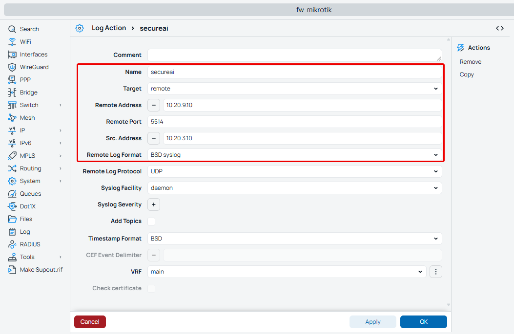
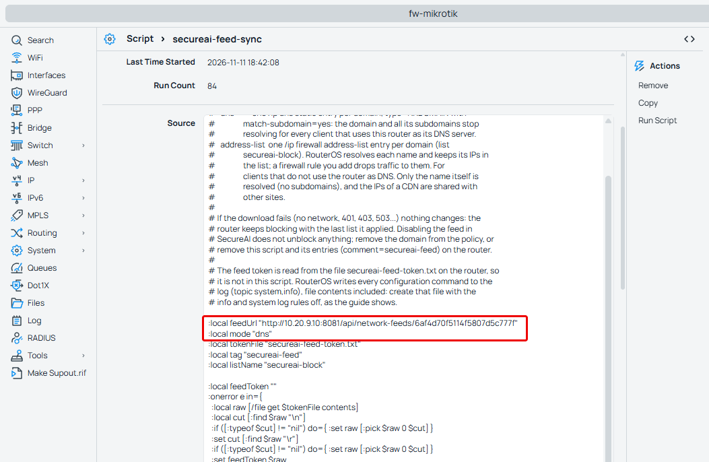
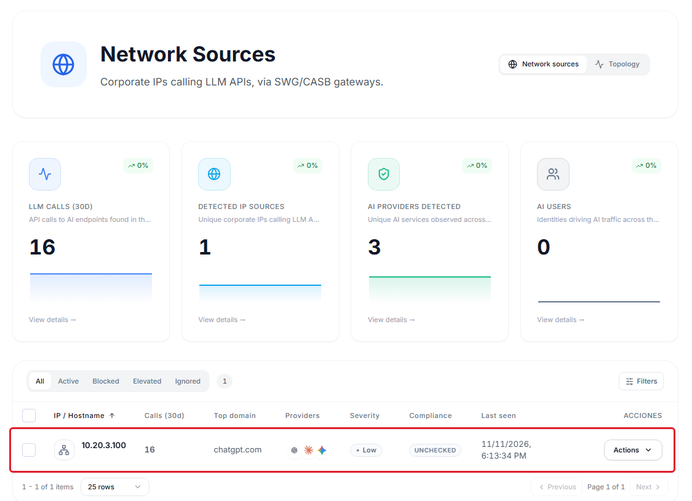
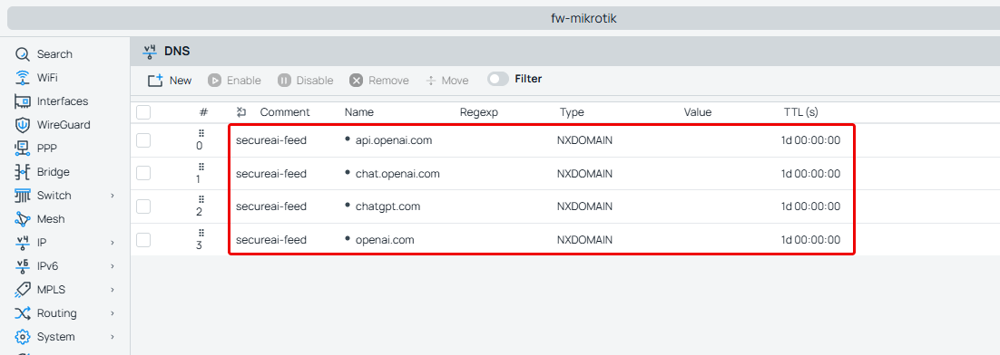

SecureAI lee el log de consultas DNS de su router MikroTik, le muestra qué equipos de su red usan servicios de IA y
hace que el router deje de resolver los proveedores que usted prohíbe en SecureAI. RouterOS no registra URLs: todo
sale de los nombres que los clientes le preguntan al DNS del router.

<Note>
El conector `mikrotik-routeros` está en **beta**. En beta, el equipo de SecureAI acompaña la configuración.
</Note>

## Cómo funciona

1. El router manda por syslog una línea por cada consulta DNS que recibe de un cliente, IPv4 o IPv6
   (`query from 10.20.3.100: #5 chatgpt.com. A`).
2. El colector de SecureAI, un contenedor que corre en su red, se queda con las consultas a servicios de IA y se
   las manda a SecureAI. El resto de la navegación no sale de su red.
3. En **Fuentes de red** ve la IP de cada equipo y los proveedores de IA que consultó.
4. Cuando usted prohíbe un proveedor, un script del router descarga cada 5 minutos la lista de bloqueo de SecureAI y
   crea una entrada DNS por dominio. El cliente que pregunta por `chatgpt.com` o `ab.chatgpt.com` recibe NXDOMAIN.

Las dos mitades dependen de que los clientes resuelvan por el router. Las secciones 4 y 5 cubren a los que no.

## Qué ve SecureAI y qué no

- El **dominio** consultado y la **IP del cliente**, IPv4 o IPv6. No hay URLs, rutas ni contenido.
- El **usuario** y el **equipo**, si el router tiene Hotspot o reparte IPs por DHCP: el colector le suma a cada consulta
  quién tenía esa IP en ese momento ([sección 7](#7-usuario-y-equipo)). Sin Hotspot ni DHCP, la consulta llega sin
  usuario.
- Una consulta no es una conexión. El navegador consulta nombres que después puede no usar, y la caché del equipo
  evita consultas que sí usa. El conteo es aproximado.

## Requisitos

- Un MikroTik con **RouterOS 7.15 o posterior** (ver [Versiones](#versiones)).
- Un usuario del router con las policies `read`, `write`, `test` y `ftp`.
- Que los clientes reciban el router como DNS (por DHCP, que es lo habitual) y que el router acepte consultas de la
  LAN: `/ip dns set allow-remote-requests=yes`. La configuración de fábrica descarta las consultas que llegan por la
  WAN; si la cambió, verifique que el puerto 53 no quede abierto hacia internet.
- Una máquina Linux con Docker en su red para el colector. El router tiene que llegarle por syslog, y ella tiene que
  salir por HTTPS a su tenant.
- Que el router salga por HTTPS a su tenant de SecureAI para leer la lista de bloqueo.

## 1. Conectar el router e instalar el colector

1. Abra **Administrador → Integraciones** y elija la categoría **Red / SWG**.
2. En la tarjeta **MikroTik RouterOS**, haga clic en **Conectar**.
3. Complete el nombre, la IP del colector (la máquina Linux) y, si quiere, la IP pública del router: SecureAI rechaza a
   cualquier otro que pida la lista de bloqueo, aunque tenga el token.
4. **Crear y mostrar la configuración** pide el segundo factor y crea la fuente de logs del conector
   `mikrotik-routeros` y el feed de bloqueo en formato `plain`.

Los tokens se ven una sola vez, en ese panel. Si los pierde, **Tokens nuevos** en la fila del equipo los rota.

### Instalar el colector

En el mismo panel, **Descargar el colector (.zip)**. El paquete trae la configuración del colector con los datos de
este equipo y, en `router/`, los dos scripts para el router. Corre con la imagen oficial de Vector. En la máquina
Linux, dentro de la carpeta del paquete:

```bash
docker compose -f docker-compose.yml -f docker-compose.mikrotik.yml up -d
```

El panel también muestra, en **Terminal de RouterOS**, las líneas para el router con la IP del colector y el token del
feed ya puestos. Suba a **Files** del router los dos archivos de `router/` y pegue esas líneas en la terminal. Los
pasos que siguen explican qué hace cada una.

Escucha syslog en el 514 (UDP y TCP) y, para MikroTik por TCP, en el 5517.

## 2. Mandar el log DNS del router al colector

En la terminal del router (WebFig o Winbox: **New Terminal**):

```text
/system logging action add name=secureai target=remote remote=<IP del colector> remote-port=5517 \
  remote-protocol=tcp remote-log-format=syslog src-address=<IP LAN del router>
/system logging add topics=dns,!packet action=secureai
/system logging add topics=dhcp action=secureai
/system logging add topics=hotspot action=secureai
/system logging add topics=script action=secureai
```

Por TCP, las líneas llegan en el orden en que el router las escribió y no se pierden en el camino. `dhcp`, `hotspot` y
`script` son para el usuario y el equipo ([sección 7](#7-usuario-y-equipo)). `!packet` deja afuera el volcado de cada
paquete DNS, que ocupa varias líneas por consulta.

Si su RouterOS no tiene `remote-log-format`, mande por UDP al 514 (`remote-port=514 remote-protocol=udp`). Cada
mensaje viaja en su propio paquete, pero un paquete perdido no se reenvía.



La captura es de nuestro laboratorio, con la acción por UDP hacia el 5514.

## 3. Bloquear con el script de SecureAI

El script `secureai-feed-sync` corre cada 5 minutos. En cada corrida:

1. lee el token del feed del archivo `secureai-feed-token.txt` del router;
2. descarga la lista con `Authorization: Bearer <token>` y valida la conexión TLS (vencimiento, nombre y emisor) contra
   las CAs que trae RouterOS;
3. crea una entrada `/ip dns static` por dominio, de tipo NXDOMAIN y con `match-subdomain=yes`, y borra las que ya no
   están en la lista. Todas llevan `comment=secureai-feed`.

Si la descarga falla (sin red, 401, 403, 503, TLS que no valida), el script no toca nada y el router sigue
bloqueando con la última lista. Lo deja en el log: `secureai: feed download failed (...)`.

### 3.1 Guardar el token sin que quede en el log

RouterOS escribe en su log cada comando de configuración con sus valores. Este comando apaga las reglas de log de
`info` y `system`, crea el archivo del token y las vuelve a prender, en una sola línea:

```text
:local off [/system logging find where topics~"info|system" disabled=no]; /system logging disable $off; /file add name=secureai-feed-token.txt contents="<token del feed>"; /system logging enable $off
```

Después borre el historial de la terminal, que también guarda el comando: `/console clear-history`. Para cambiar el
token, repita la línea con `/file remove secureai-feed-token.txt` antes del `/file add`.

### 3.2 Crear el script y el scheduler

En WebFig, **System > Scripts > Add New**:

| Campo | Valor |
|---|---|
| Name | `secureai-feed-sync` |
| Policy | `read`, `write`, `test`, `ftp` |
| Source | el script de abajo, con `FEED_URL` reemplazado por `https://<su-tenant>/api/network-feeds/<id del feed>` |

El script no tiene secretos: el token está en el archivo del paso anterior.

<Accordion title="Script secureai-feed-sync">

```text
# SecureAI block list for MikroTik RouterOS 7.15+ (docs/integrations/mikrotik.md).
#
# Downloads the SecureAI feed (format "plain") and applies it in one of two modes:
#
#   dns           one /ip dns static entry per domain, type=NXDOMAIN with
#                 match-subdomain=yes: the domain and all its subdomains stop
#                 resolving for every client that uses this router as its DNS server.
#   address-list  one /ip firewall address-list entry per domain (list
#                 secureai-block). RouterOS resolves each name and keeps its IPs in
#                 the list; a firewall rule you add drops traffic to them. For
#                 clients that do not use the router as DNS. Only the name itself is
#                 resolved (no subdomains), and the IPs of a CDN are shared with
#                 other sites.
#
# blockDoh "yes" also blocks the public DNS over HTTPS resolvers, which a
# browser or the OS can use to skip the router: their names go into the block
# list (with the Firefox and iCloud Private Relay canaries), and their IPs into
# the address lists secureai-doh (/ip and /ipv6 firewall) for the firewall rules
# of the guide. The list of resolvers is below, in dohNames / dohIps / dohIps6.
#
# If the download fails (no network, 401, 403, 503...) nothing changes: the
# router keeps blocking with the last list it applied. Disabling the feed in
# SecureAI does not unblock anything; remove the domain from the policy, or
# remove this script and its entries (comment=secureai-feed) on the router.
#
# The feed token is read from the file secureai-feed-token.txt on the router, so
# it is not in this script. RouterOS writes every configuration command to the
# log (topic system,info), file contents included: create that file with the
# info and system log rules off, as the guide shows.

:local feedUrl "FEED_URL"
:local mode "dns"
:local tokenFile "secureai-feed-token.txt"
:local tag "secureai-feed"
:local listName "secureai-block"
:local blockDoh "no"
:local dohList "secureai-doh"

# Public DoH resolvers (names of their DoH endpoints, match-subdomain covers the
# variants such as mozilla.cloudflare-dns.com), and two canaries: Firefox turns
# its default DoH off when use-application-dns.net does not resolve, and Apple
# devices turn iCloud Private Relay off when mask.icloud.com does not.
:local dohNames {"dns.google";"dns.google.com";"cloudflare-dns.com";"one.one.one.one";"quad9.net";"doh.opendns.com";"doh.familyshield.opendns.com";"dns.nextdns.io";"doh.cleanbrowsing.org";"dns.adguard-dns.com";"dns.adguard.com";"dns.mullvad.net";"doh.mullvad.net";"doh.dns.sb";"freedns.controld.com";"use-application-dns.net";"mask.icloud.com";"mask-h2.icloud.com"}
# Their addresses: Windows and Android reach a known resolver over DoH by IP, with no name to block.
:local dohIps {"8.8.8.8";"8.8.4.4";"1.1.1.1";"1.0.0.1";"9.9.9.9";"149.112.112.112";"208.67.222.222";"208.67.220.220";"94.140.14.14";"94.140.15.15";"185.228.168.9";"185.228.169.9";"45.90.28.0";"45.90.30.0";"194.242.2.2";"185.222.222.222";"76.76.2.0";"76.76.10.0"}
:local dohIps6 {"2001:4860:4860::8888";"2001:4860:4860::8844";"2606:4700:4700::1111";"2606:4700:4700::1001";"2620:fe::fe";"2620:fe::9";"2620:119:35::35";"2620:119:53::53";"2a10:50c0::ad1:ff";"2a10:50c0::ad2:ff";"2a07:e340::2"}

:local feedToken ""
:onerror e in={
  :local raw [/file get $tokenFile contents]
  :local cut [:find $raw "\n"]
  :if ([:typeof $cut] != "nil") do={ :set raw [:pick $raw 0 $cut] }
  :set cut [:find $raw "\r"]
  :if ([:typeof $cut] != "nil") do={ :set raw [:pick $raw 0 $cut] }
  :set feedToken $raw
} do={}
:if ([:len $feedToken] = 0) do={
  :log warning ("secureai: no token in " . $tokenFile . ", keeping the current block list")
  :error "secureai: no feed token"
}

:local res
:local why ""
# Over HTTPS the certificate is checked (expiry, name and a CA of RouterOS's built-in trust store);
# without that check fetch accepts any certificate.
:onerror e in={
  :if ([:pick $feedUrl 0 8] = "https://") do={
    :set res [/tool fetch url=$feedUrl check-certificate=yes-without-crl http-header-field=("Authorization: Bearer " . $feedToken) output=user as-value]
  } else={
    :set res [/tool fetch url=$feedUrl http-header-field=("Authorization: Bearer " . $feedToken) output=user as-value]
  }
} do={ :set why $e }
# fetch throws on anything but a 2xx, so reaching here without `why` is a good download.
:if ($why != "") do={
  :log warning ("secureai: feed download failed (" . $why . "), keeping the current block list")
  :error "secureai: feed download failed"
}

# One domain per line. A leading "*." is dropped (the dns mode covers subdomains);
# a pattern with any other "*" cannot be written as an entry and is skipped.
:local body ($res->"data")
:local want [:toarray ""]
:local pos 0
:local total [:len $body]
:while ($pos < $total) do={
  :local nl [:find $body "\n" $pos]
  :if ([:typeof $nl] = "nil") do={ :set nl $total }
  :local line [:pick $body $pos $nl]
  :set pos ($nl + 1)
  :if ([:pick $line 0 2] = "*.") do={ :set line [:pick $line 2 [:len $line]] }
  :if ([:len $line] > 0 && [:typeof [:find $line "*"]] = "nil") do={ :set ($want->$line) true }
}
:if ($blockDoh = "yes") do={ :foreach n in=$dohNames do={ :set ($want->$n) true } }

# The DoH addresses: kept in sync like the domains, removed when blockDoh goes back to "no".
:local wantIp [:toarray ""]
:local wantIp6 [:toarray ""]
:if ($blockDoh = "yes") do={
  :foreach a in=$dohIps do={ :set ($wantIp->$a) true }
  # /ipv6 firewall address-list stores a single address as <address>/128.
  :foreach a in=$dohIps6 do={ :set ($wantIp6->($a . "/128")) true }
}
:foreach id in=[/ip firewall address-list find list=$dohList comment=$tag dynamic=no] do={
  :local a [/ip firewall address-list get $id address]
  :if ([:typeof ($wantIp->$a)] = "nothing") do={ /ip firewall address-list remove $id } else={ :set ($wantIp->$a) false }
}
:foreach a,v in=$wantIp do={ :if ($v) do={ /ip firewall address-list add list=$dohList address=$a comment=$tag } }
:onerror e in={
  :foreach id in=[/ipv6 firewall address-list find list=$dohList comment=$tag dynamic=no] do={
    :local a [/ipv6 firewall address-list get $id address]
    :if ([:typeof ($wantIp6->$a)] = "nothing") do={ /ipv6 firewall address-list remove $id } else={ :set ($wantIp6->$a) false }
  }
  :foreach a,v in=$wantIp6 do={ :if ($v) do={ /ipv6 firewall address-list add list=$dohList address=$a comment=$tag } }
} do={ :log warning ("secureai: could not update the IPv6 DoH list (" . $e . ")") }
:if ($blockDoh = "yes") do={ :log info ("secureai: DoH resolvers blocked, " . [:len $dohNames] . " names, " . ([:len $dohIps] + [:len $dohIps6]) . " addresses") }

# Inside `find`, a variable named like a property ($name, $address) reads the
# property: the entries already applied are collected in `have` instead.
:local have [:toarray ""]
:if ($mode = "address-list") do={
  # Switching modes: the entries of the other mode go away.
  :foreach id in=[/ip dns static find comment=$tag] do={ /ip dns static remove $id }
  :foreach id in=[/ip firewall address-list find list=$listName comment=$tag dynamic=no] do={
    :local dom [/ip firewall address-list get $id address]
    :if ([:typeof ($want->$dom)] = "nothing") do={ /ip firewall address-list remove $id } else={ :set ($have->$dom) true }
  }
  :foreach dom,v in=$want do={
    :if ([:typeof ($have->$dom)] = "nothing") do={
      :onerror e in={
        /ip firewall address-list add list=$listName address=$dom comment=$tag
      } do={ :log warning ("secureai: could not add " . $dom . " (" . $e . ")") }
    }
  }
  :log info ("secureai: block list applied, " . [:len [/ip firewall address-list find list=$listName comment=$tag dynamic=no]] . " domains (address-list)")
} else={
  :foreach id in=[/ip firewall address-list find list=$listName comment=$tag dynamic=no] do={ /ip firewall address-list remove $id }
  :foreach id in=[/ip dns static find comment=$tag] do={
    :local dom [/ip dns static get $id name]
    :if ([:typeof ($want->$dom)] = "nothing") do={ /ip dns static remove $id } else={ :set ($have->$dom) true }
  }
  :foreach dom,v in=$want do={
    :if ([:typeof ($have->$dom)] = "nothing") do={
      :onerror e in={
        /ip dns static add name=$dom type=NXDOMAIN match-subdomain=yes comment=$tag
      } do={ :log warning ("secureai: could not add " . $dom . " (" . $e . ")") }
    }
  }
  /ip dns cache flush
  :log info ("secureai: block list applied, " . [:len [/ip dns static find comment=$tag]] . " domains")
}
```

</Accordion>



En la captura, el laboratorio baja el feed por HTTP dentro de su red. Con su tenant, la URL es HTTPS.

Después, en la terminal:

```text
/system scheduler add name=secureai-feed-sync interval=5m policy=read,write,test,ftp \
  on-event="/system script run secureai-feed-sync"
```

Un proveedor que usted prohíbe queda bloqueado en el router en 5 minutos como máximo, más el tiempo que el equipo
tenga guardada la respuesta anterior en su caché.

## 4. Clientes con otro DNS

Un equipo con otro DNS configurado a mano (`8.8.8.8`, por ejemplo) no le pregunta al router: no aparece en SecureAI
y no queda bloqueado. Estas reglas mandan al router toda consulta DNS que sale de la LAN, vaya al servidor que vaya:

```text
/ip firewall nat add chain=dstnat in-interface-list=LAN protocol=udp dst-port=53 action=redirect to-ports=53 \
  comment=secureai-dns
/ip firewall nat add chain=dstnat in-interface-list=LAN protocol=tcp dst-port=53 action=redirect to-ports=53 \
  comment=secureai-dns
```

`LAN` es la lista de interfaces de la configuración de fábrica. Si su router no la tiene, use `in-interface=` con la
interfaz o el bridge de la LAN. El equipo cree que le responde `8.8.8.8`, pero la respuesta es la del router.

Para IPv6, las mismas reglas en `/ipv6 firewall nat`. Esa variante no la probamos todavía.

## 5. DNS sobre HTTPS

Navegadores y sistemas pueden resolver por DNS sobre HTTPS (DoH): la consulta viaja cifrada a un resolver público y
el router no la ve. Con `:local blockDoh "yes"` en el script, en cada corrida:

- suma a la lista de bloqueo los resolvers DoH públicos conocidos (`dns.google`, `cloudflare-dns.com`, `quad9.net` y
  otros) y dos canarios: `use-application-dns.net`, que hace que Firefox apague su DoH por defecto, y
  `mask.icloud.com`, que hace que los equipos de Apple apaguen iCloud Private Relay;
- llena las listas `secureai-doh` (`/ip` y `/ipv6 firewall address-list`) con sus direcciones, porque algunos
  sistemas llegan a un resolver conocido por IP, sin nombre que bloquear.

Las direcciones cortan algo solo con estas reglas (853 es DNS sobre TLS):

```text
/ip firewall filter add chain=forward in-interface-list=LAN protocol=tcp dst-port=443,853 \
  dst-address-list=secureai-doh action=reject reject-with=tcp-reset comment=secureai-doh
/ip firewall filter add chain=forward in-interface-list=LAN protocol=udp dst-port=443,853 \
  dst-address-list=secureai-doh action=drop comment=secureai-doh
/ipv6 firewall filter add chain=forward in-interface-list=LAN protocol=tcp dst-port=443,853 \
  dst-address-list=secureai-doh action=reject reject-with=tcp-reset comment=secureai-doh
/ipv6 firewall filter add chain=forward in-interface-list=LAN protocol=udp dst-port=443,853 \
  dst-address-list=secureai-doh action=drop comment=secureai-doh
```

Cortar DoH corta también los usos legítimos de esos resolvers por HTTPS. Un resolver poco conocido o propio no está en
la lista: en los equipos administrados, apagar DoH por política del navegador (`DnsOverHttpsMode=off` en Chrome y
Edge) sigue siendo lo más firme. Si vuelve a poner `"no"`, la próxima corrida borra lo que había agregado.

## 6. Modo address-list

Para equipos que no pasan por el DNS del router ni con la redirección, el script puede bloquear por IP: con
`:local mode "address-list"` crea una entrada en la lista `secureai-block` por dominio, RouterOS resuelve cada nombre
y guarda sus IPs, y estas reglas cortan el tráfico:

```text
/ip firewall filter add chain=forward in-interface-list=LAN protocol=tcp dst-address-list=secureai-block \
  action=reject reject-with=tcp-reset comment=secureai-block
/ip firewall filter add chain=forward in-interface-list=LAN dst-address-list=secureai-block action=drop \
  comment=secureai-block
```

No lo recomendamos como modo principal. Los servicios de IA grandes están detrás de CDNs que comparten IPs con otros
sitios: en nuestro laboratorio, bloquear `chatgpt.com` y `openai.com` también cortó `platform.openai.com`. Además
resuelve solo el nombre exacto, sin subdominios. Al cambiar de modo, la próxima corrida borra las entradas del modo
anterior.

## 7. Usuario y equipo

Una consulta DNS trae la IP del equipo, no quién es. El colector la completa con lo que sabe el router:

- **Equipo**, del servidor DHCP: el nombre que mandó el equipo y su MAC, por ejemplo `laptop-ana (02:00:5A:00:00:0A)`.
- **Usuario**, del Hotspot: el usuario que inició sesión con esa IP.

La identidad sale solo del Hotspot y del DHCP del router. Un equipo con IP fija, o que no pasa por esos servicios,
aparece sin usuario y sin equipo. Lo mismo un equipo con IPv6.

Para eso, el router corre cada minuto el script `secureai-identity`, que escribe en el log una línea por lease vigente
y otra por sesión de Hotspot, con lo que le queda a cada una. Créelo como el de bloqueo (policies `read`, `write`,
`test`) y prográmelo:

```text
/system scheduler add name=secureai-identity interval=1m policy=read,write,test \
  on-event="/system script run secureai-identity"
```

<Accordion title="Script secureai-identity">

```text
# SecureAI identity snapshot for MikroTik RouterOS 7.15+ (docs/integrations/mikrotik.md).
#
# Logs one line per bound DHCP lease and per active Hotspot session, so the
# SecureAI collector can tell which device and which Hotspot user had each IP:
#
#   secureai-identity dhcp ip=10.0.0.10 mac=02:00:5A:00:00:0A name="laptop-ana" ttl=578
#   secureai-identity hotspot ip=10.0.0.10 mac=02:00:5A:00:00:0A user="ana" ttl=3540
#
# ttl is what is left of the lease or the session, in seconds (0 when it does
# not expire). The collector keeps each entry for that long at most, and never
# more than 3 minutes without seeing it again, so this runs every minute from
# the scheduler. The router's own log lines (dhcp: assigned / deassigned,
# hotspot: logged in / logged out) add and remove entries in between.
#
# A name or a user with a double quote or a backslash is skipped: the collector
# could not read it back without ambiguity. The collector also drops values with
# control characters.

:local ok do={
  :if ([:typeof $1] != "str") do={ :return false }
  :if ([:typeof [:find $1 "\""]] != "nil") do={ :return false }
  :if ([:typeof [:find $1 "\\"]] != "nil") do={ :return false }
  :return true
}
:local secs do={
  :if ([:typeof $1] != "time") do={ :return 0 }
  :return [:tonum $1]
}

# Over TCP the collector only cuts a message when the next one starts: this line, every run, pushes out the
# last query the router logged.
:log info "secureai-identity tick"

:foreach id in=[/ip dhcp-server lease find where status="bound"] do={
  :local l [/ip dhcp-server lease get $id]
  :local name ($l->"host-name")
  :if ([:typeof $name] != "str") do={ :set name "" }
  :if ([$ok $name]) do={
    :log info ("secureai-identity dhcp ip=" . ($l->"active-address") . " mac=" . ($l->"active-mac-address") . " name=\"" . $name . "\" ttl=" . [$secs ($l->"expires-after")])
  }
}

:foreach id in=[/ip hotspot active find] do={
  :local s [/ip hotspot active get $id]
  :local user ($s->"user")
  :if ([:len $user] > 0 && [$ok $user]) do={
    :log info ("secureai-identity hotspot ip=" . ($s->"address") . " mac=" . ($s->"mac-address") . " user=\"" . $user . "\" ttl=" . [$secs ($s->"session-time-left")])
  }
}
```

</Accordion>

Cómo decide el colector, porque atribuirle un acceso a la persona equivocada es peor que no atribuirlo:

- Una entrada dura lo que le queda al lease o a la sesión, y nunca más de 3 minutos sin que el script la confirme.
- Cuando el router libera un lease (`deassigned`) o se cierra una sesión (`logged out`), la entrada se borra en el
  momento.
- Un usuario del Hotspot cuya MAC no es la que tiene el lease de esa IP no se usa.
- Sin una entrada vigente, o si el colector se reinició y el script todavía no volvió a correr, la consulta llega igual,
  sin usuario ni equipo. Nunca se le pone una identidad vieja.

Si la misma IP pasó por dos personas en el día, en **Fuentes de red** ve una fila por cada una.

## Comprobar

Desde un equipo de la LAN que use el router como DNS, antes de prohibir nada, `dig chatgpt.com` devuelve una IP. En
SecureAI, **Fuentes de red** muestra la IP de ese equipo con OpenAI entre sus proveedores:



Prohíba OpenAI y espere hasta 5 minutos. En el router, **IP > DNS > Static** muestra las entradas `secureai-feed`, y
el log, `secureai: block list applied, N domains`:



```bash
dig chatgpt.com          # status: NXDOMAIN
dig ab.chatgpt.com       # status: NXDOMAIN (subdominio)
dig claude.ai            # una IP: lo que no está prohibido resuelve
```

## Deshabilitar el feed no desbloquea

Si deshabilita el feed, lo borra o rota su token, el router recibe 403 o 401 y sigue bloqueando con la última lista.
Para desbloquear, saque el dominio de la política en SecureAI: en la próxima corrida el script borra sus entradas. Para
sacar la integración del router, borre el scheduler y el script, y después
`/ip dns static remove [find comment=secureai-feed]` y `/ip firewall address-list remove [find comment=secureai-feed]`.

Un bloqueo por el feed alcanza a toda la red detrás del router, no a un equipo en particular.

## Por qué no `/ip dns adlist`

RouterOS 7.15 trae `/ip dns adlist`, que lee una lista de dominios de una URL. No la recomendamos: no manda
credenciales (con usuario y clave en la URL, RouterOS los descarta y SecureAI responde 401), no bloquea subdominios y
escribe la URL completa en el log DNS.

## Límites

- Solo ve y bloquea a los equipos cuyas consultas DNS pasan por el router.
- Un resolver DoH que no está en la lista del script saltea el router.
- Los patrones del catálogo con `*` en el medio (`bedrock.*.amazonaws.com`) no se pueden escribir como entrada DNS: el
  script los saltea.
- El usuario y el equipo salen solo del Hotspot y del DHCP del router: un equipo con IP fija, fuera de esos servicios o
  con IPv6 aparece sin usuario.

## Versiones

RouterOS 7.15 es la primera versión con todo lo que usa la integración, según los changelogs de MikroTik: `/file add`
con contenido (7.15), `:onerror` (7.13) y `match-subdomain` (7.5). La probamos de punta a punta en RouterOS 7.25.1
(CHR): descubrimiento por IPv4 e IPv6, usuario y equipo por Hotspot y DHCP con una IP que pasa de una persona a
otra, bloqueo con subdominios, redirección del 53, corte de DoH por nombre y por IP,
modo address-list, y el comportamiento ante 401 y 403. La validación TLS se probó aparte: el router acepta un
servidor válido y rechaza uno vencido, uno con otro nombre y uno autofirmado.

## Problemas comunes

| Síntoma | Causa probable |
|---|---|
| Nada en Fuentes de red | Los equipos no usan el router como DNS, o resuelven por DoH (secciones 4 y 5) |
| `secureai: no token in secureai-feed-token.txt` | Falta el archivo del token, o está vacío |
| `secureai: feed download failed (failure: Status 401, Unauthorized ...)` | El token del feed es otro o se rotó |
| `secureai: feed download failed (failure: Status 403, Forbidden ...)` | El feed está deshabilitado, o la IP del router no es la que tiene permitida |
| Error de TLS en la descarga | El router no valida la conexión TLS con el tenant, o su reloj está mal |
| El script no aplica dominios con `*` | Es esperado: no se pueden escribir como entrada DNS |
