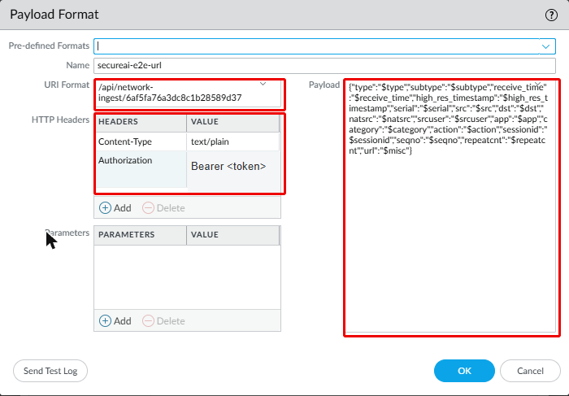
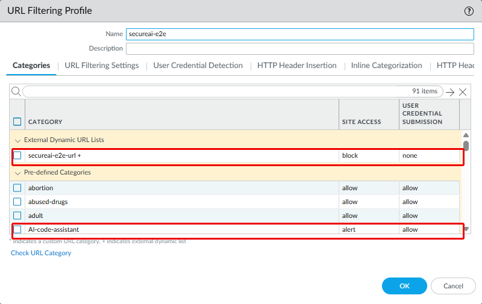
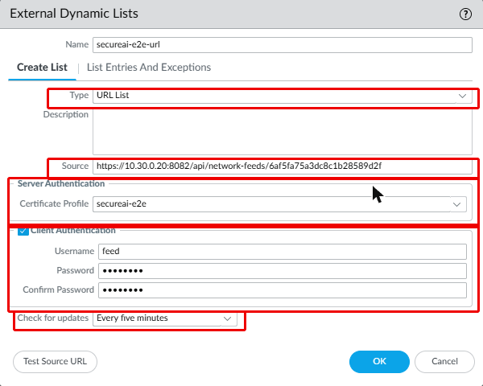
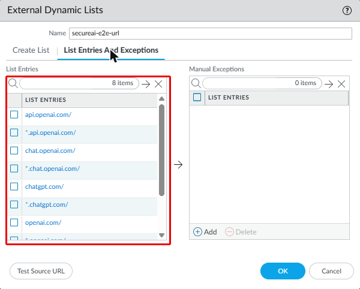
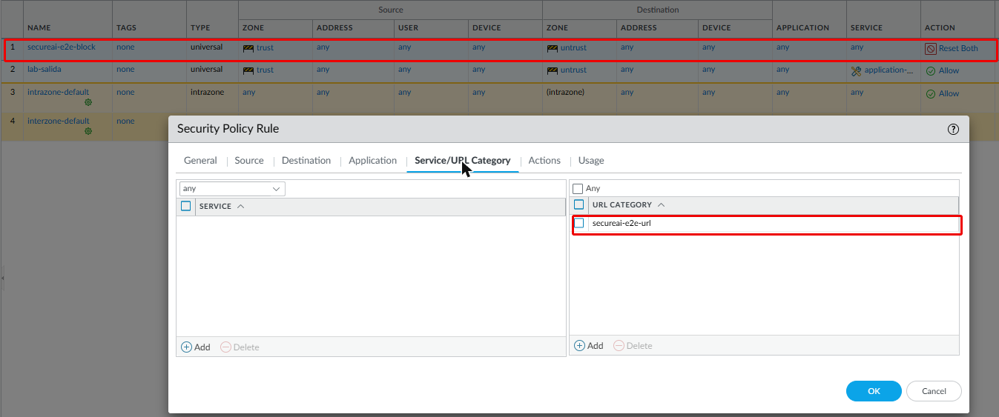
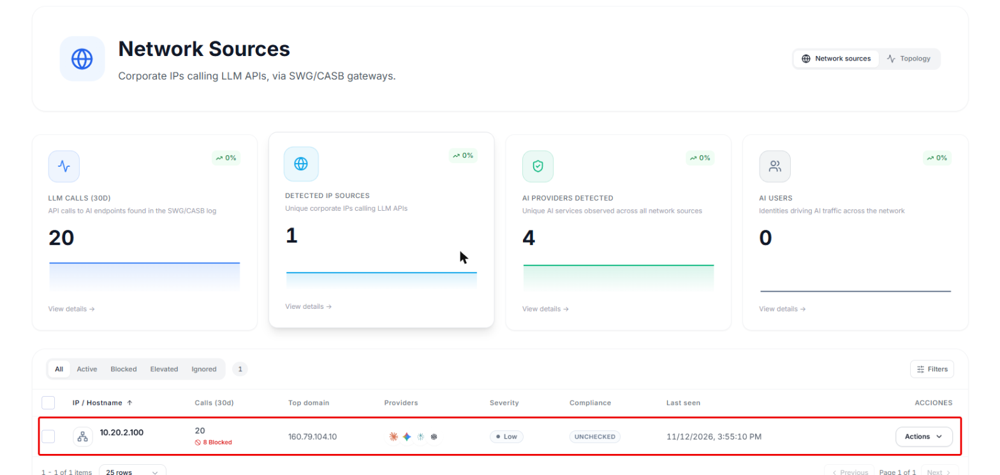
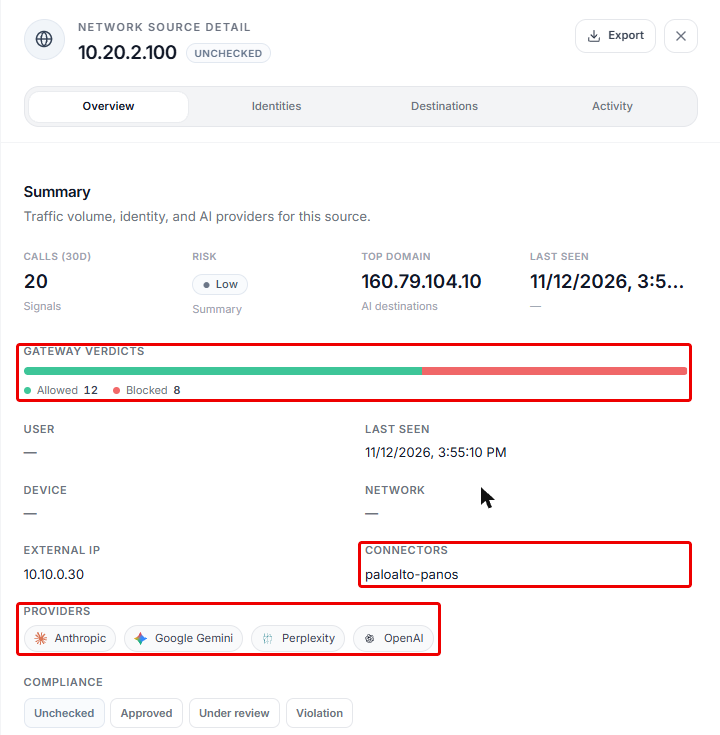
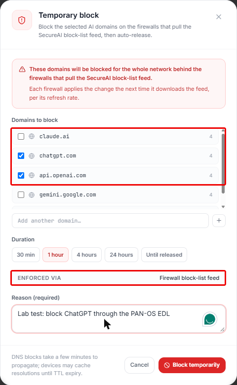
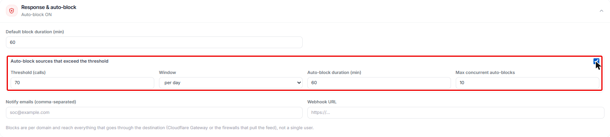

SecureAI lee los logs de URL Filtering y de Traffic de sus firewalls Palo Alto, le muestra qué servicios de IA usa
su gente y publica las External Dynamic Lists (EDL) con lo que usted prohíbe. El firewall las descarga y las aplica
con sus propios perfiles y reglas. No hace falta la suscripción de AI Access Security.

<Note>
La integración está en **beta**. La consola todavía no tiene una pantalla para crear las fuentes de logs y los
feeds: el equipo de SecureAI lo hace con usted y le entrega los identificadores y los tokens.
</Note>

## Cómo funciona

1. El firewall manda a SecureAI sus logs de URL Filtering y de Traffic, por syslog a través del colector de
   SecureAI o directo por HTTP log forwarding.
2. SecureAI lee de cada log el equipo de origen, el usuario (si el firewall lo conoce), el destino, la decisión y la
   clasificación de Palo Alto: el App-ID y la categoría de PAN-DB. Los App-IDs con la etiqueta *Generative AI*
   (`openai-chatgpt`, `claude-base`, `google-gemini`, `github-copilot` y unos 500 más) y las categorías
   `artificial-intelligence` y `AI-*` cuentan como IA.
3. Usted ve el resultado en **Inventario > Fuentes de red**.
4. Cuando usted prohíbe un proveedor o bloquea dominios, SecureAI los agrega a las EDL. El firewall las descarga
   cada cinco minutos y bloquea con un perfil de URL Filtering, una regla de seguridad y la política DNS de un perfil
   Anti-Spyware.

## Qué ve SecureAI y qué no

- **Sin descifrado TLS, el firewall ve el dominio y no el contenido.** Lee el SNI de la conexión HTTPS y la consulta
  DNS. SecureAI sabe que alguien usó ChatGPT, desde qué equipo y cuántas veces; no qué escribió.
- **El log de URL Filtering trae el dominio** (`chatgpt.com/`). El log de Traffic trae la IP de destino y el App-ID:
  cuando es lo único que llega, SecureAI muestra la IP y nombra el proveedor por el App-ID.
- **El usuario aparece si el firewall tiene User-ID.** Sin User-ID, SecureAI agrupa por la IP del equipo.

## Qué licencia pide cada pieza

Según la documentación de Palo Alto. En el laboratorio de SecureAI usamos VM-Series con la licencia Bundle2, que
incluye todas las suscripciones: no pudimos probar qué pasa sin cada una.

| Pieza | Licencia |
|---|---|
| App-ID y sus actualizaciones de contenido | Ninguna suscripción: alcanza el contrato de soporte ([Dynamic Content Updates](https://docs.paloaltonetworks.com/pan-os/11-1/pan-os-upgrade/software-and-content-updates/dynamic-content-updates)) |
| Perfil de URL Filtering, categorías de PAN-DB y log de URL Filtering | Advanced URL Filtering, o la licencia de URL Filtering anterior. Si vence, el firewall deja de hacer URL Filtering ([Configure URL Filtering](https://docs.paloaltonetworks.com/advanced-url-filtering/administration/configuring-url-filtering/configure-url-filtering), [Activate URL Filtering License](https://docs.paloaltonetworks.com/advanced-url-filtering/administration/configuring-url-filtering/activate-url-filtering-license)) |
| EDL de tipo URL en un perfil de URL Filtering | La del perfil: Advanced URL Filtering |
| EDL de tipo URL como categoría en una regla de seguridad | La documentación de Palo Alto no lo dice, y no lo probamos sin licencia |
| EDL de tipo dominio en la política DNS de un perfil Anti-Spyware | Threat Prevention o Advanced Threat Prevention. DNS Security no hace falta ([Configure DNS Sinkholing for a List of Custom Domains](https://docs.paloaltonetworks.com/advanced-threat-prevention/administration/configure-threat-prevention/use-dns-queries-to-identify-infected-hosts-on-the-network/configure-dns-sinkholing-for-a-list-of-custom-domains)) |
| EDL de tipo IP | La documentación no menciona una licencia para las EDL propias. Las EDL de IP predefinidas de Palo Alto piden Threat Prevention ([Built-in EDLs](https://docs.paloaltonetworks.com/pan-os/11-1/pan-os-admin/policy/use-an-external-dynamic-list-in-policy/built-in-edls)) |

Con solo el contrato de soporte, SecureAI ve la IA por el App-ID del log de Traffic. Para bloquear con las EDL de
SecureAI necesita Advanced URL Filtering o Threat Prevention.

## Lo que necesita

- PAN-OS 11.1 o posterior, y un administrador con permiso de escritura en Device, Objects y Policies.
- Que el firewall salga por HTTPS a su tenant (`https://<tenant>.hiperai.com`) desde su interfaz de administración,
  o desde la que fije en **Device > Setup > Services > Service Route Configuration**.
- Para syslog, una máquina Linux con Docker en la red del firewall, donde corre el colector de SecureAI. Con HTTP
  log forwarding no hace falta.
- Del equipo de SecureAI: el id y el token de la fuente de logs, y el id y el token de los dos feeds (`panos-url` y
  `panos-domain`). Guarde los tokens en su gestor de secretos.

## 1. Mandar los logs a SecureAI

Elija una de las dos vías.

### Opción A: HTTP log forwarding, sin colector

**Device > Server Profiles > HTTP > Add**. En **Servers**:

| Campo | Valor |
|---|---|
| Address | `<tenant>.hiperai.com` |
| Protocol | HTTPS |
| Port | 443 |
| TLS Version | 1.2 |
| HTTP Method | POST |

En **Payload Format**, configure un formato para **Traffic** y otro para **URL**, cada uno con:

| Campo | Valor |
|---|---|
| URI Format | `/api/network-ingest/<id de la fuente>` |
| Headers | `Content-Type: text/plain` y `Authorization: Bearer <token de la fuente>` |

Payload de **Traffic**:

```json
{"type":"$type","subtype":"$subtype","receive_time":"$receive_time","high_res_timestamp":"$high_res_timestamp","serial":"$serial","src":"$src","dst":"$dst","natsrc":"$natsrc","srcuser":"$srcuser","app":"$app","category":"$category","action":"$action","sessionid":"$sessionid","seqno":"$seqno","repeatcnt":"$repeatcnt"}
```

Payload de **URL**: el mismo, con `,"url":"$misc"` antes de la llave final.



El token viaja en un header, nunca en la URL. Use `text/plain` y no `application/json`: PAN-OS no escapa los valores
que reemplaza (un usuario `ACME\ana` llega con la barra sin escapar, y `$misc` llega con comillas propias), y
SecureAI corrige cada línea al leerla.

PAN-OS valida el certificado del servidor contra sus CA raíz de confianza (**Device > Certificate Management >
Certificates > Default Trusted Certificate Authorities**). El certificado de su tenant es de una CA pública.

### Opción B: syslog al colector

1. Instale el colector de SecureAI con el id y el token de la fuente de logs. El equipo de SecureAI le pasa el
   paquete y lo acompaña.
2. **Device > Server Profiles > Syslog > Add**: la IP del colector, UDP o TCP 514, formato **BSD**. Con el formato por
   defecto (CSV) no hay nada más que configurar. Si su SIEM ya espera CEF o LEEF, cargue en **Custom Log Format**,
   para **Traffic** y **URL**:

   CEF (Traffic; para URL, agregue ` request=$misc` al final):

   ```
   CEF:0|Palo Alto Networks|PAN-OS|$sender_sw_version|$subtype|$type|1|rt=$cef-formatted-receive_time deviceExternalId=$serial src=$src dst=$dst sourceTranslatedAddress=$natsrc cs1Label=Rule cs1=$rule suser=$srcuser app=$app cn1Label=SessionID cn1=$sessionid cnt=$repeatcnt act=$action cs2Label=URL Category cs2=$category externalId=$seqno
   ```

   LEEF (Traffic; para URL, agregue `|Miscellaneous=$misc` al final):

   ```
   LEEF:1.0|Palo Alto Networks|PAN-OS Syslog Integration|$sender_sw_version|$subtype|cat=$type|devTime=$cef-formatted-receive_time|SerialNumber=$serial|src=$src|dst=$dst|srcPostNAT=$natsrc|usrName=$srcuser|Application=$app|SessionID=$sessionid|RepeatCount=$repeatcnt|action=$action|URLCategory=$category|sequence=$seqno
   ```

El colector manda a SecureAI solo los logs de URL Filtering con destino de IA, y el resto de la navegación no sale
de su red. El log de Traffic no trae el dominio y el colector no lo deja pasar: por syslog, SecureAI ve la IA por el
log de URL Filtering.

### Log Forwarding

**Objects > Log Forwarding > Add**, con dos entradas: **Log Type** `traffic` y `url`, filtro **All Logs**, y el
server profile de la opción A o B. Con HTTP log forwarding puede filtrar en el firewall, por ejemplo
`(category eq artificial-intelligence)` en la entrada `url`.

En cada regla de seguridad que lleva tráfico a internet (**Policies > Security**), en **Actions**, elija el perfil en
**Log Forwarding** y marque **Log at Session End**.

## 2. Registrar la IA en el log de URL Filtering

**Objects > Security Profiles > URL Filtering**: en su perfil, ponga en **Alert** la categoría
`artificial-intelligence` y las `AI-*` (`AI-conversational-assistant`, `AI-code-assistant` y las demás). Las
categorías en **Allow** no generan log. Asigne el perfil a las reglas de salida a internet.



## 3. Bloquear con las EDL de SecureAI

### Las dos EDL

**Objects > External Dynamic Lists > Add**:

| Campo | EDL de URL | EDL de dominio |
|---|---|---|
| Type | URL List | Domain List |
| Source | `https://<tenant>.hiperai.com/api/network-feeds/<id del feed panos-url>` | `https://<tenant>.hiperai.com/api/network-feeds/<id del feed panos-domain>` |
| Server Authentication | Un certificate profile con la CA raíz del certificado de su tenant | El mismo |
| Client Authentication | Usuario: cualquiera, por ejemplo `feed`. Contraseña: el token del feed | Usuario `feed` y el token del otro feed |
| Automatically expand to include subdomains | | Activado |
| Check for updates | Five Minute | Five Minute |



PAN-OS acepta usuario y contraseña en una EDL solo con un certificate profile, o sea con una fuente HTTPS. El token
viaja como contraseña de HTTP Basic, nunca en la URL.

**List Entries And Exceptions** muestra lo que descargó el firewall. SecureAI escribe cada dominio dos veces en la
EDL de URL (`chatgpt.com/` y `*.chatgpt.com/`) y una vez en la de dominio (`chatgpt.com`; la opción de subdominios
cubre el resto). Mientras no haya nada prohibido, las listas están vacías.



Por CLI:

```
set profiles certificate-profile secureai CA <CA raíz importada>
set external-list secureai-ia-url type url url https://<tenant>.hiperai.com/api/network-feeds/<id>
set external-list secureai-ia-url type url certificate-profile secureai
set external-list secureai-ia-url type url auth username feed password <token del feed panos-url>
set external-list secureai-ia-url type url recurring five-minute
set external-list secureai-ia-dominios type domain url https://<tenant>.hiperai.com/api/network-feeds/<id>
set external-list secureai-ia-dominios type domain certificate-profile secureai
set external-list secureai-ia-dominios type domain auth username feed password <token del feed panos-domain>
set external-list secureai-ia-dominios type domain recurring five-minute
set external-list secureai-ia-dominios type domain expand-domain yes
```

### Dónde se usan

- **Perfil de URL Filtering**: en el perfil del paso 2, la EDL de URL aparece entre las categorías. Póngala en
  **Block**.
- **Regla de seguridad**: una regla arriba de las de salida a internet, con la EDL de URL en **Service/URL
  Category** y acción **Reset both** o **Deny**. Bloquea aunque la regla de abajo no tenga perfil de URL Filtering.

  

- **Anti-Spyware**: en **Objects > Security Profiles > Anti-Spyware > DNS Policies**, agregue la EDL de dominio con
  acción **Sinkhole**. Asigne el perfil a las reglas por las que pasa el DNS de los equipos.

## 4. Comprobar

1. Desde un equipo detrás del firewall, abra chatgpt.com. En uno o dos minutos el equipo aparece en **Inventario >
   Fuentes de red** de SecureAI.

   

   En el detalle (**Actions > Ver detalles**), **Conectores** dice `paloalto-panos`.

   

2. En la fila del equipo, **Actions > Bloquear**: marque los dominios, la duración y el motivo. **Aplicado vía** tiene
   que decir **Feed de bloqueo para firewalls**.

   

3. Para no esperar el refresco, en el firewall:

   ```
   request system external-list refresh type url name secureai-ia-url
   request system external-list show type url name secureai-ia-url
   ```

4. El equipo ya no abre chatgpt.com, y el bloqueo vuelve a SecureAI como una llamada bloqueada.
5. **Liberar** en la misma fila saca los dominios de la lista, y el firewall los deja pasar en su refresco siguiente.

Con la EDL en **Five Minute**, el firewall aplica un bloqueo o una liberación en hasta cinco minutos. En nuestras
pruebas, el bloqueo hecho desde la consola llegó al equipo en poco más de un minuto.

### Bloqueo automático

En **Respuesta y auto-bloqueo**, arriba de la lista de Fuentes de red, prenda **Auto-bloquear fuentes que superen
el umbral** y elija el umbral de llamadas (por día o por 7 días), cuánto dura el bloqueo y cuántos bloqueos
automáticos puede haber a la vez. Cuando un equipo pasa el umbral, SecureAI bloquea los dominios de IA que más usa
y los libera al vencer, sin que nadie toque la consola.



## Cuando el feed falla

En las pruebas de laboratorio, con el feed deshabilitado, con un error del servidor de SecureAI y con un token
equivocado, el firewall conservó la última lista que descargó y siguió bloqueando. SecureAI nunca responde una lista
vacía por un error.

Con el token equivocado, la documentación de Palo Alto dice que el firewall deja de aplicar la EDL; en nuestras
pruebas no pasó durante el minuto que lo medimos. Si rota el token de un feed, actualice la EDL en el mismo cambio.

Cuando no queda nada bloqueado, la EDL trae una sola entrada, `secureai-empty.invalid`. PAN-OS no acepta una EDL
vacía (se queda con la anterior y no desbloquearía), y `.invalid` es un dominio reservado que no coincide con ningún
sitio real.

Deshabilitar o borrar un feed no desbloquea nada: para desbloquear, libere el bloqueo en SecureAI o saque la EDL de
la política.

## Límites

- **El bloqueo alcanza a toda la red detrás del firewall**: las EDL son listas de dominios, no de usuarios.
- **Los contadores son aproximados.** SecureAI cuenta una vez cada sesión por firewall en cada tipo de log, con
  memoria de 10 minutos.
- **Las IP no se bloquean.** Las EDL de SecureAI son listas de dominios. Una IP que llegó por el log de Traffic
  aparece en la consola pero no entra a la lista.
- **Tope de entradas por modelo**: de 50.000 URLs en VM-50 y PA-220 a 250.000 en PA-5200 y PA-5400
  ([External Dynamic List](https://docs.paloaltonetworks.com/pan-os/11-1/pan-os-admin/policy/use-an-external-dynamic-list-in-policy/external-dynamic-list)).
  La lista de SecureAI tiene decenas o cientos de entradas.
- **Prisma Access**: SecureAI tiene además un conector para Prisma Access que lee Strata Logging. Todavía no se
  validó contra una cuenta real.

## Versiones probadas

| PAN-OS | Equipo | Resultado |
|---|---|---|
| 12.2.3 | VM-Series en Google Cloud, licencia Bundle2 | Descubrimiento por syslog y por HTTP log forwarding, bloqueo con las EDL de URL y de dominio (perfil de URL Filtering, regla de seguridad y sinkhole DNS), y la última lista conservada cuando el feed falla |
| 11.2.15 | VM-Series en Google Cloud, licencia Bundle2 | La misma prueba |
| 12.2.3 | El mismo, configurado como un cliente | Syslog al colector de SecureAI, EDL por HTTPS, y desde la consola: bloquear, liberar y bloqueo automático por umbral |

Los formatos CEF y LEEF se probaron con logs reales de PAN-OS 12.2.3. No probamos todavía PAN-OS 11.1, equipos
físicos ni Panorama; los menús de la GUI pueden cambiar de nombre entre versiones.
